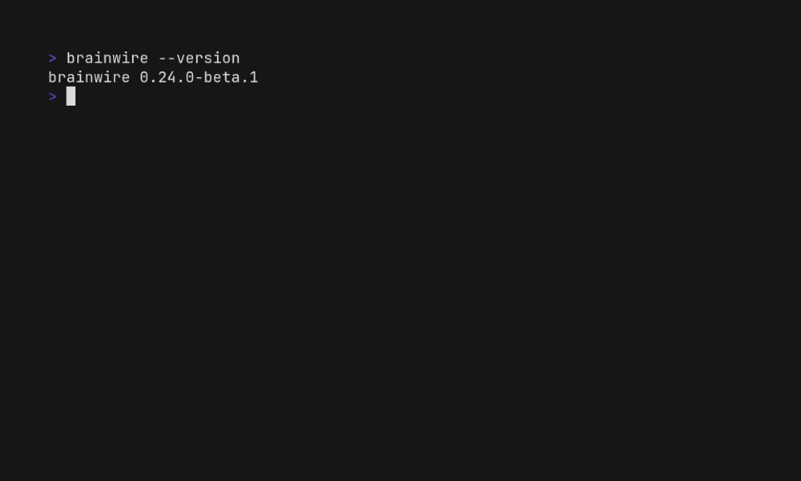
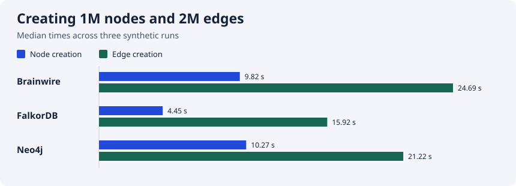

<p align="center"><picture><source media="(prefers-color-scheme: dark)" srcset="assets/brainwire-logo.svg"></picture></p>

<h1 align="center">A graph database for agent memory</h1>
<p align="center">Connect projects, decisions and their evidence. Query the graph with Cypher and give agents the relevant records.</p>
<p align="center">
  <a href="https://allandefraga.github.io/brainwire/">Documentation</a> ·
  <a href="https://github.com/allandefraga/homebrew-brainwire">Homebrew tap</a> ·
  <a href="docs/getting-started.pt-BR.md">Português</a> ·
  <a href="#quickstart">Quickstart</a> ·
  <a href="#try-agent-context">Agent memory</a> ·
  <a href="#bring-your-data">Ingestion</a> ·
  <a href="BENCHMARKS.md">Benchmarks</a>
</p>

<p align="center">
  <a href="https://github.com/allandefraga/brainwire/actions/workflows/ci.yml"></a>
  <a href="LICENSE"></a>
  
</p>

Brainwire is an open source graph database built in Rust on RocksDB. Define
your ontology, write over Bolt and inspect the live graph in your terminal.
In the company example, an agent can recall a decision and follow it to
the meeting that supports it. [Try the decision memory demo](docs/agent-context-quickstart.md)

> **v0.24.0-beta.4 · experimental beta.** <!-- brainwire-release-version --> Use rebuildable data and a tested backup. [Current limits](#current-limits)

The [backup guide](docs/checkpoints.md) covers checkpoint copies and restore
permissions. The [experimental object storage helper](docs/object-storage-backup.md)
can copy a verified checkpoint to MinIO; active data stays on local disk.

<p align="center"></p>

This [VHS recording](assets/launch/typed-vhs/demo.tape) uses the published
v0.24.0-beta.1 CLI and synthetic data. [Watch the video](assets/launch/typed-vhs/brainwire-demo.mp4)

## Quickstart

For a local CLI without Docker, install the experimental macOS source formula:

```sh
brew install allandefraga/brainwire/brainwire
```

The tap currently installs v0.24.0-beta.2 and compiles from source; there are
no prebuilt bottles yet. See [Brainwire on macOS](docs/homebrew.md).

Use Git and Docker with Compose. On macOS, Colima can run the Docker engine.
With Colima running, run `export DOCKER_CONTEXT=colima` first.

```sh
git clone --branch v0.24.0-beta.4 https://github.com/allandefraga/brainwire.git # brainwire-release-version
cd brainwire
export BRAINWIRE_IMAGE=ghcr.io/allandefraga/brainwire:v0.24.0-beta.4 # brainwire-release-version
docker compose -p brainwire-demo -f deploy/compose.demo.yaml up --no-build --pull always --wait --wait-timeout 900
```

Check readiness with the built-in probe.

```sh
docker compose -p brainwire-demo -f deploy/compose.demo.yaml exec -T brainwire brainwire probe --mode ready
```

The demo listens at `bolt://127.0.0.1:7687` and keeps data in a Docker volume.
Use synthetic data on a trusted host and container network. The demo disables
authentication, and other containers on the demo network can reach it. Use
Docker Engine 28 or newer because earlier versions can expose loopback ports
to the local network. [Docker port publishing](https://docs.docker.com/engine/network/port-publishing/)
· [Protected deployment](docs/protected-containers.md)

### Write and query from Python

```sh
python3 scripts/setup_python.py
```

Run this with `.venv-brainwire/bin/python`:

```python
from brainwire import connect

with connect("bolt://127.0.0.1:7687", "demo", auth=None) as graph:
    graph.upsert_node("Customer", "customer-1", {"name": "Ada"})
    graph.upsert_node("Segment", "segment-1", {"name": "beta"})
    graph.upsert_edge(
        ("Customer", "customer-1"), "IN_SEGMENT", ("Segment", "segment-1")
    )
    print(graph.run_cypher("""
        MATCH (c:Customer)-[:IN_SEGMENT]->(s:Segment)
        RETURN c.name AS customer, s.name AS segment
    """))
```

The demo includes these types. For your own graph, define an ontology first.
See [Python](docs/python-client.md) and [protected deployment](docs/protected-containers.md).

### Try agent context

The company demo saves a decision and its source in one transaction. In a
fresh process, recall the project decisions and supporting records the reader
can see. Repeating the same write returns the same IDs.
[Set up the company graph with Docker](docs/agent-context-quickstart.md)

After saving the example decision, run the read command in the same shell with
`BW_PORT` set.

```sh
.venv-brainwire/bin/python -m examples.python.agent_memory --uri "bolt://$BW_PORT" \
  recall --project project-release --limit 5
```

If you are using the Customer and Segment records from the quickstart above,
run `.venv-brainwire/bin/python -m examples.python.agent_context_demo` to read
those records and their connection. [Context API and provider configuration](docs/context-api.md)

### Explore in the terminal

```sh
docker compose -p brainwire-demo -f deploy/compose.demo.yaml exec brainwire \
  brainwire shell --connect 127.0.0.1:7687 --graph demo \
  --node-label Customer --entity-id customer-1 \
  --edge-type IN_SEGMENT --target-label Segment
```

Use **Tab** to change views, **r** to refresh, **?** for help and **q** to quit.
The connected TUI is read-only; it shows schema, indexes, memory diagnostics
and a bounded relationship sample. Add `--lang pt-BR` for Portuguese.
[Explore the TUI](docs/connected-status.md).

### Define a metric

Give an agent a named, read-only question such as “how many decisions can I
see?” The [semantic metrics example](docs/semantic-metrics.md) defines
`count`, `sum` and `avg` over one node type and can group by a declared field.
It uses the caller's graph permissions. This is a bounded Python example, not
a complete MetricFlow implementation.

To stop the demo while keeping its volume:

```sh
docker compose -p brainwire-demo -f deploy/compose.demo.yaml down
```

## Bring your data

| Source | Start here |
| --- | --- |
| Application writes | Upsert nodes and relationships in batches from [Python](docs/python-client.md). |
| DuckDB | Load a local table, then compare snapshots with a resumable journal. [DuckDB sync](docs/duckdb-sync.md) |
| DuckLake | Load a mapped table and apply changes between pinned versions. [DuckLake sync](docs/parallel-ingestion.md#ducklake-full-load-then-incremental) |
| Obsidian | Preview a small Markdown vault and import notes and wikilinks once into an empty graph. [Obsidian example](examples/obsidian/README.md) |
| Python code | Extract local Python structure and trace source links. [Code graph example](docs/code-graph.md) |
| Typed batches | Validate a small JSON batch before writing it. [Typed ingestion example](examples/typed_ingest/README.md) |

For a new standalone graph, the engine can also enforce optional scalar
property types declared in the ontology. [Typed properties](docs/typed-properties.md)

```json
{"label": "Project", "properties": ["priority"], "property_types": {"priority": "integer"}}
```

## How it works

Applications write and query over Bolt. The Rust engine checks access, executes
transactions and stores graph records in RocksDB. Keep its files on a persistent
volume so restarting the container reopens the same graph. A terminal workspace
provides read-only inspection.

The standard deployment runs one instance. The separate
[three-voter Raft setup](docs/quorum-replication.md) is experimental. Read the
[architecture guide](docs/architecture.md) for memory, storage and recovery.

### How RocksDB stores the graph

RocksDB stores Brainwire's records and indexes as key/value data. Writes first
enter a **write-ahead log (WAL)** on disk and a **memtable** in memory. A flush
writes the memtable into sorted, immutable **SST files**.

- **L0** receives new files; their key ranges can overlap.
- **L1 and deeper levels** organize files into non-overlapping key ranges within
  each level. Deeper levels normally hold more data.
- **Compaction** merges files, keeping the versions still needed by reads and
  eventually reclaiming obsolete values and deletion markers.

Reads combine memory and the relevant SST files. A shared block cache can
avoid disk reads. Compaction uses CPU, disk bandwidth and temporary disk
space, so keep the persistent volume and leave room for storage to grow.
[Storage details](docs/architecture.md#rocksdb-files-levels-and-compaction)

## A synthetic benchmark

Three local runs loaded **1 million nodes and 2 million relationships** into
each engine, checked indexed reads, then restarted after a process kill. The
engines ran sequentially, each with a 3 GiB container limit and two CPUs.
Brainwire used the published **v0.24.0-beta.2** image; the measurements are
from November 15, 2026.



| Metric | Brainwire | FalkorDB | Neo4j |
| --- | ---: | ---: | ---: |
| Create 1 million nodes | 9.823 s | 4.447 s | 10.267 s |
| Create 2 million relationships | 24.694 s | 15.920 s | 21.222 s |
| Update 10,000 rows | 0.114 s | 0.038 s | 0.150 s |
| Indexed point read, median p95 | 0.715 ms | 0.365 ms | 0.603 ms |
| One-hop read, median p95 | 0.726 ms | 0.372 ms | 0.636 ms |
| Ready after process kill, median | 0.808 s | 3.438 s | 8.388 s |

Each p95 summarizes 1,000 warm, serial queries per run; the table shows the
median of those three p95 values, not a pooled p95. Each sampled node had two
outgoing edges. These are diagnostic results, not production promises. Engines
used different protocols, internal memory settings,
authentication and durability settings; peak memory was not measured. Read the
[workload, exact versions, raw result and limitations](benchmarks/comparison/README.md)
before comparing or reproducing them.

[See the memory and recovery test results](BENCHMARKS.md).

## Current limits

Brainwire is an experimental beta. Plan a controlled trial:

- **Memory:** budgets and sampled RSS/cgroup admission can refuse growing queries under pressure. They are partial protection, not a guaranteed process-wide RSS ceiling. Sustained capacity testing is incomplete.
- **Search and Cypher:** [Cypher support](docs/local-cypher.md) is a subset; native ANN and BM25 indexes are not available.
- **Types and metrics:** native scalar property types require a new standalone graph; required fields, vector types and Raft are not supported. Typed batch validation is separate and client-side. Named metrics are a limited Python example, not full semantic-model compatibility.
- **History:** explicit events are supported; automatic revisions and `AS OF` reads are not.
- **Ingestion:** DuckDB snapshot sync needs a private persistent journal and exclusive ownership of mapped IDs. DuckLake fencing covers cooperating standalone writers; neither sync provides a graph-wide atomic cutover.
- **Security:** shared deployments need a service-token policy and verified encryption. Optional native Bolt TLS requires a server certificate, a matching private key and client trust configuration. Rotate the server certificate by restarting. [Protected transport](docs/protected-transport.md)
- **Distribution:** three-voter quorum is experimental. Standard Docker, Kubernetes and Swarm configurations run one instance; multi-machine failover is not qualified.

See [memory](docs/memory-defaults.md), [security](docs/protected-containers.md),
[recovery](docs/checkpoints.md), [replication](docs/quorum-replication.md) and
[benchmark conditions](BENCHMARKS.md). Synthetic tests are not production SLOs.

## Learn more

[Getting started](docs/getting-started.md) · [Architecture](docs/architecture.md) ·
[Python](docs/python-client.md) · [Cypher](docs/local-cypher.md) ·
[TUI](docs/connected-status.md) · [Operations](docs/README.md#operate-and-evaluate)

Brainwire is [Apache-2.0](LICENSE). Please report bugs with a small synthetic
reproduction via [GitHub Issues](https://github.com/allandefraga/brainwire/issues).
