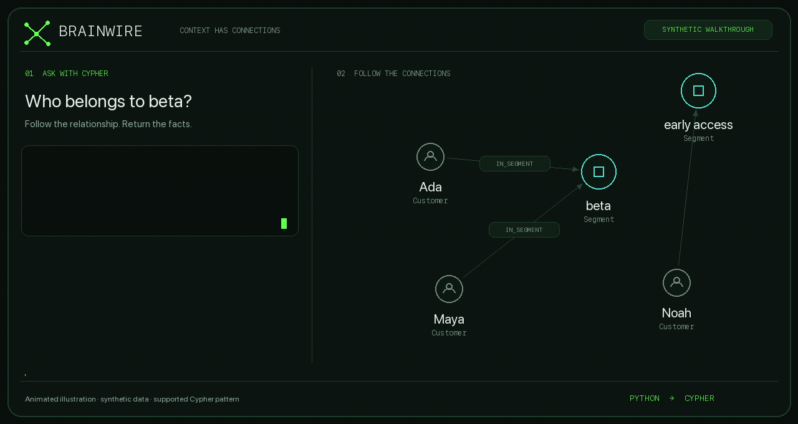

<p align="center">
  
</p>

<h1 align="center">Give your context connections.</h1>

<p align="center">
  <strong>A Rust graph database for the context behind your AI apps.</strong>
  <br>Python in. Cypher out. Relationships that stay on disk.
</p>

<p align="center">
  <a href="https://github.com/allandefraga/brainwire/actions/workflows/ci.yml"></a>
  <a href="LICENSE"></a>
  <a href="#current-limits"></a>
  
</p>

<p align="center">
  <a href="#quickstart">Run it</a> &nbsp; / &nbsp;
  <a href="#write-from-python">Python</a> &nbsp; / &nbsp;
  <a href="#see-what-the-tui-can-do">Terminal UI</a> &nbsp; / &nbsp;
  <a href="https://allandefraga.github.io/brainwire/">Docs</a> &nbsp; / &nbsp;
  <a href="BENCHMARKS.md">Benchmarks</a>
</p>

<p align="center">
  
  <br><sub>Animated illustration using synthetic data · the terminal UI is described below · <a href="assets/brainwire-social-preview-v1.jpg">Social card</a></sub>
</p>

People own projects. Documents explain decisions. Tickets depend on releases.
Brainwire stores those connections in named graphs. Write from Python, query
with Cypher over Bolt and inspect your data in the terminal. Rust runs the engine;
RocksDB stores the data.

> **v0.15.0-beta.4 · experimental beta.** <!-- brainwire-release-version --> For controlled trials with rebuildable data.
> Memory and distributed recovery qualification remain open. Read the
> [current limits](#current-limits) before choosing a deployment.

## What you can build

- **Knowledge graphs:** nodes, edges, properties, ontology descriptions and indexes. Inspect the catalog with `graph.schema()` in Python.
- **Explicit timelines:** record application-supplied milestones as separate
  event nodes using the [Python example](docs/temporal-data.md#record-explicit-milestones).
- **Agent context:** bounded Python reads, source references and experimental text/vector reranking of explicit candidates. Evidence reads stop when the response limit is exceeded.
- **Code maps:** local Python AST extraction, source references, inferred import/call candidates, paths and explanations.
- **Graph queries:** supported Cypher, sparse algorithms and explainable metadata ranking.
- **List conversions:** `toBooleanList`, `toIntegerList` and `toFloatList` help
  clean mixed values in supported Cypher queries.
- **Inspectable storage:** persistent files, checkpoints and a read-only terminal UI.
- **Memory-aware admission:** on Linux, reject new queries under visible cgroup
  pressure, including a configured `memory.high` threshold. See
  [how the check works](docs/memory-defaults.md#admission-under-linux-cgroup-pressure).
  New RUN admission also checks current process RSS where available.

Your application chooses the data, permissions and model. See the
[context API](docs/context-api.md) and [code graph guide](docs/code-graph.md).

## Quickstart

You need **Git** and **Docker with Compose**. Start a local demo:

```sh
git clone --branch v0.15.0-beta.4 https://github.com/allandefraga/brainwire.git # brainwire-release-version
cd brainwire
export BRAINWIRE_IMAGE=ghcr.io/allandefraga/brainwire:v0.15.0-beta.4 # brainwire-release-version
docker compose -p brainwire-demo -f deploy/compose.demo.yaml up --no-build --pull always --wait --wait-timeout 900
```

`docker pull` only downloads an image. The Compose command above initializes
and starts the database, then waits for it to accept queries. Check it with:

```sh
docker compose -p brainwire-demo -f deploy/compose.demo.yaml exec -T brainwire brainwire probe --mode ready
```

The **demo** graph is available at **bolt://127.0.0.1:7687**. Graph files stay in
a Docker volume across restarts. If the port is busy, set
`BRAINWIRE_BIND_PORT=17687` before starting and use that port in your client.

Choose a published image from the [release page](https://github.com/allandefraga/brainwire/releases).
Public images can be pulled without logging in. If GHCR returns `denied` or
`unauthorized`, see [image access and troubleshooting](docs/container.md#start-from-a-release-image).
For startup failures, collect recent logs and [report a reproducible bug](https://github.com/allandefraga/brainwire/issues/new?template=bug_report.yml):

```sh
docker compose -p brainwire-demo -f deploy/compose.demo.yaml logs --tail 100
```

Remove credentials and private data before sharing logs.

The demo disables authentication and binds to host loopback. For shared access,
use [protected containers](docs/protected-containers.md) and
[encrypted transport](docs/protected-transport.md).

### Write from Python

Install the helper with Python 3.9 or newer (with `venv` and `pip`):

```sh
python3 scripts/setup_python.py
```

This creates a new `.venv-brainwire` environment, installs this checkout's
client and downloads its dependencies. It leaves existing environments untouched; use `--venv` to
choose a different new path. Run this with `.venv-brainwire/bin/python`:

```python
from brainwire import connect

with connect("bolt://127.0.0.1:7687", "demo", auth=None) as graph:
    graph.upsert_node("Customer", "customer-1", {"name": "Ada"})
    graph.upsert_node("Segment", "segment-1", {"name": "beta"})
    graph.upsert_edge(
        ("Customer", "customer-1"), "IN_SEGMENT", ("Segment", "segment-1")
    )
    print(graph.run_cypher("""
        MATCH (c:Customer)-[:IN_SEGMENT]->(s:Segment)
        RETURN c.name AS customer, s.name AS segment
    """))
```

Result: `[{'customer': 'Ada', 'segment': 'beta'}]`.
The demo declares these types. Define an ontology for your own data.

See the [Python guide](docs/python-client.md) for batches, property updates and
streaming reads. Batches commit separately; after an unknown commit outcome,
reconcile before retrying. The helper uses the Neo4j Bolt driver. Install from
source; a public PyPI package is not available.

### See what the TUI can do

Open another terminal:

```sh
docker compose -p brainwire-demo -f deploy/compose.demo.yaml exec brainwire brainwire shell --connect 127.0.0.1:7687 --graph demo --node-label Customer --entity-id customer-1 --edge-type IN_SEGMENT --target-label Segment
```

**Tab** switches views, **r** refreshes, **?** explains and **q** exits.
Inspect ontology, query memory, indexes and up to 20 outgoing relationships for
the selected node and type. The connected TUI is read-only. Add `--lang pt-BR`
for Portuguese. [TUI guide](docs/connected-status.md).

Stop the demo and keep its data:

```sh
docker compose -p brainwire-demo -f deploy/compose.demo.yaml down
```

## Current limits

Start with a rebuildable graph and a tested backup while evaluating this beta.

- **Memory:** query budgets and pressure admission help reject work under load.
  A [512 MiB synthetic pressure smoke](docs/benchmarks/2026-11-03-cgroup-014b4.json)
  passed on the local candidate. A hard process-wide RSS ceiling is not guaranteed;
  sustained 2/4/8 GiB tests are incomplete and an older failure remains unexplained.
- **Queries and search:** Brainwire supports a [documented Cypher subset](docs/local-cypher.md)
  and reranks explicit candidates. Nodes have one fixed label; native ANN and
  BM25 indexes are not yet available.
- **History and ingestion:** DuckLake synchronization compares pinned snapshots.
  Full reconciliation applies missing-key deletions in bounded Python batches.
  Confirmed rolled-back transaction conflicts receive bounded retries.
  Native CDC, historical node/edge revisions and `AS OF` reads are not available.
  Relationship `MERGE` currently identifies an edge by its endpoints and type:
  different property maps on the same pair do not create independent events.
  Use explicit event nodes where multiple milestones must remain distinct.
- **Security:** authentication and grants are available. Shared deployments need
  a verified encrypted network boundary because native Bolt TLS is not implemented.
- **Distribution:** an experimental three-voter quorum is available for testing.
  Invalid log sequences and inconsistent commit markers are rejected before
  they are persisted.
  Standard Kubernetes/Swarm templates run one instance; sharding and failover
  across machines still need implementation or qualification.

Read [supported Cypher](docs/local-cypher.md), [memory limits](docs/memory-defaults.md),
[recovery](docs/checkpoints.md), [quorum operation](docs/quorum-replication.md) and
[benchmark conditions](BENCHMARKS.md). Measurements use synthetic workloads and
do not establish production SLOs or general superiority over other databases.

## Documentation

| I want to… | Start here |
|---|---|
| Install or deploy | [Docker](docs/container.md) · [Kubernetes / Swarm](docs/orchestrators.md) |
| Create a graph and types | [CLI](docs/mvp-quickstart.md) · [ontology](docs/connected-ontology.md) |
| Write and query | [Python](docs/python-client.md) · [Cypher](docs/local-cypher.md) · [ingestion](docs/source-ingestion.md) |
| Build agent context | [Context and reranking](docs/context-api.md) · [code graphs](docs/code-graph.md) |
| Inspect and operate | [TUI](docs/connected-status.md) · [security](docs/bolt-auth.md) · [checkpoints](docs/checkpoints.md) |
| Evaluate or contribute | [Benchmarks](BENCHMARKS.md) · [releasing](docs/releasing.md) · [changelog](CHANGELOG.md) |

[All documentation](docs/README.md). To build the Rust server, CLI and TUI, follow
the [local setup](docs/mvp-quickstart.md). Homebrew and Electron installers are
not available.

## Release status and license

**v0.15.0-beta.4 · experimental beta · production qualification open.** <!-- brainwire-release-version -->

[Apache-2.0](LICENSE). Use, modify and redistribute the current source under its
terms. Repository and image visibility control access separately.
Tags run CI and image checks; a container is available after the release
workflow publishes it. That workflow does not publish packages to crates.io or PyPI.

## Feedback and contributions

Trying Brainwire? Report a [bug](https://github.com/allandefraga/brainwire/issues/new?template=bug_report.yml)
with the release tag, platform and a small synthetic reproduction, or propose a
[feature](https://github.com/allandefraga/brainwire/issues/new?template=feature_request.yml).
See [contributing](CONTRIBUTING.md) for local checks and [security reporting](SECURITY.md)
for suspected vulnerabilities. Community support is best effort; this beta has
no production support SLA.
