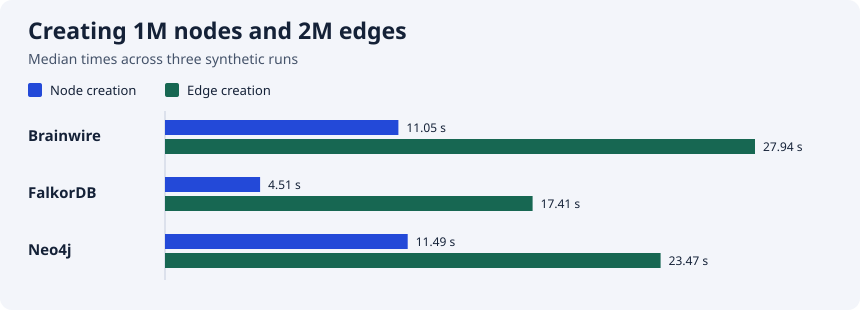

<p align="center"><picture><source media="(prefers-color-scheme: dark)" srcset="assets/brainwire-logo.svg"></picture></p>

<h1 align="center">Your data has connections.</h1>
<p align="center">A graph database for connected application and agent context.</p>
<p align="center">
  <a href="https://allandefraga.github.io/brainwire/">Documentation</a> ·
  <a href="#quickstart">Quickstart</a> ·
  <a href="docs/local-cypher.md">Cypher</a> ·
  <a href="BENCHMARKS.md">Benchmarks</a>
</p>

<p align="center">
  <a href="https://github.com/allandefraga/brainwire/actions/workflows/ci.yml"></a>
  <a href="LICENSE"></a>
  
</p>

Brainwire connects people, projects, documents and events in named graphs.
Write from Python, query with Cypher and inspect the database in your terminal.

> **v0.20.0-beta.2 · experimental beta.** <!-- brainwire-release-version --> Start with rebuildable data and a tested backup. Read the [current limits](#current-limits) before a shared deployment.

## How it works

Applications write and query over Bolt. The Rust engine checks access, executes
transactions and stores graph records in RocksDB. Keep its files on a persistent
volume so restarting the container reopens the same graph. A terminal workspace
provides read-only inspection.

The standard deployment runs one instance. The separate
[three-voter Raft setup](docs/quorum-replication.md) is experimental. Read the
[architecture guide](docs/architecture.md) for memory, storage and recovery.

### How RocksDB stores the graph

RocksDB stores Brainwire's records and indexes as key/value data. Writes first
enter a **write-ahead log (WAL)** on disk and a **memtable** in memory. A flush
writes the memtable into sorted, immutable **SST files**.

- **L0** receives new files; their key ranges can overlap.
- **L1 and deeper levels** organize files into non-overlapping key ranges within
  each level. Deeper levels normally hold more data.
- **Compaction** merges files, keeping the versions still needed by reads and
  eventually reclaiming obsolete values and deletion markers.

These are storage levels, not node types, graph hops or history versions. Reads
combine memory and the relevant SST files; a shared block cache can avoid disk
reads. Compaction uses CPU, disk bandwidth and temporary disk space, so heavy
ingestion can slow down when storage cannot keep up. Keep the persistent volume
and leave disk headroom. See [storage details](docs/architecture.md#rocksdb-files-levels-and-compaction)
for local durability, memory budgets and the current settings.

## What you can build

- **Agent context:** explore ontology and visible record paths, combine ranked IDs from configured providers, then return authorized records and sources.
- **Connected operations:** link customers, projects, documents and tickets and query relationships with Cypher.
- **Timelines:** model explicit events with stable keys and page through them in the Python example.
- **Code graphs:** extract local Python structure and explore paths and source links.

Try the [synthetic company context example](examples/company_brain/README.md) to connect a project, decision and source. See the [agent context roadmap](docs/agent-context-roadmap.md) for what exists and what is next.

See the [architecture](docs/architecture.md), [agent context](docs/context-api.md),
[Cypher guide](docs/local-cypher.md) and [all documentation](docs/README.md).

Context and batch APIs have size checks; these are not a process-wide memory
limit. See [memory settings](docs/memory-defaults.md) and
[encrypted connections](docs/protected-transport.md) for their boundaries.

## Quickstart

Install Git and Docker with Compose, then start a local demo:

On macOS, Colima can provide the Docker engine; with Colima running, run
`export DOCKER_CONTEXT=colima` in your shell first. Docker's CLI and
Compose plugin are still required.

```sh
git clone --branch v0.20.0-beta.2 https://github.com/allandefraga/brainwire.git # brainwire-release-version
cd brainwire
export BRAINWIRE_IMAGE=ghcr.io/allandefraga/brainwire:v0.20.0-beta.2 # brainwire-release-version
docker compose -p brainwire-demo -f deploy/compose.demo.yaml up --no-build --pull always --wait --wait-timeout 900
```

Check that it is ready:

```sh
docker compose -p brainwire-demo -f deploy/compose.demo.yaml exec -T brainwire brainwire probe --mode ready
```

The demo listens at `bolt://127.0.0.1:7687` and keeps data in a Docker volume.
It disables authentication: use it only on a trusted host and container network.
Other containers on the same network can reach the service. Use Docker Engine
28 or newer; [older engines can expose localhost ports to the local network](https://docs.docker.com/engine/network/port-publishing/).
For shared environments, use
[authentication and encrypted transport](docs/protected-containers.md).

### Write and query from Python

```sh
python3 scripts/setup_python.py
```

Run this with `.venv-brainwire/bin/python`:

```python
from brainwire import connect

with connect("bolt://127.0.0.1:7687", "demo", auth=None) as graph:
    graph.upsert_node("Customer", "customer-1", {"name": "Ada"})
    graph.upsert_node("Segment", "segment-1", {"name": "beta"})
    graph.upsert_edge(
        ("Customer", "customer-1"), "IN_SEGMENT", ("Segment", "segment-1")
    )
    print(graph.run_cypher("""
        MATCH (c:Customer)-[:IN_SEGMENT]->(s:Segment)
        RETURN c.name AS customer, s.name AS segment
    """))
```

The demo includes these types. For your own graph, define an ontology first.
See [Python](docs/python-client.md) and [protected deployment](docs/protected-containers.md).

### Try agent context

After creating the demo records, run the read-only context example:

```sh
.venv-brainwire/bin/python -m examples.python.agent_context_demo
```

The example's provider returns a fixed demo ID; bring your own provider for
text or vector search. Follow the [agent quickstart](docs/agent-quickstart.md)
for a reusable prompt, or read the [context API guide](docs/context-api.md) for
access checks and snapshot limits.

### Explore in the terminal

```sh
docker compose -p brainwire-demo -f deploy/compose.demo.yaml exec brainwire \
  brainwire shell --connect 127.0.0.1:7687 --graph demo \
  --node-label Customer --entity-id customer-1 \
  --edge-type IN_SEGMENT --target-label Segment
```

Use **Tab** to change views, **r** to refresh, **?** for help and **q** to quit.
The connected TUI is read-only; it shows schema, indexes, memory diagnostics
and a bounded relationship sample. Add `--lang pt-BR` for Portuguese.
[Explore the TUI](docs/connected-status.md).

To stop the demo while keeping its volume:

```sh
docker compose -p brainwire-demo -f deploy/compose.demo.yaml down
```

## A synthetic benchmark

Three local runs loaded **1 million nodes and 2 million relationships** into
each engine, checked indexed reads, then restarted after a process kill. The
engines ran sequentially, each with a 3 GiB container limit and two CPUs.
Brainwire was a locally built **v0.20.0-beta.2 candidate**, not the published image.



| Metric | Brainwire | FalkorDB | Neo4j |
| --- | ---: | ---: | ---: |
| Indexed point read, median p95 | 0.898 ms | 0.361 ms | 0.724 ms |
| One-hop read, median p95 | 0.905 ms | 0.367 ms | 0.702 ms |
| Ready after process kill, median | 0.862 s | 3.175 s | 9.286 s |

Each p95 summarizes 1,000 warm, serial queries per run; the table shows the
median of those three p95 values, not a pooled p95. Each sampled node had two
outgoing edges. These are diagnostic results, not production promises. Engines
used different protocols, internal memory settings,
authentication and durability settings; peak memory was not measured. Read the
[workload, exact versions, raw result and limitations](benchmarks/comparison/README.md)
before comparing or reproducing them.

[See the memory and recovery test results](BENCHMARKS.md).

## Current limits

Brainwire is an experimental beta. Plan a controlled trial:

- **Memory:** budgets and sampled RSS/cgroup admission can refuse growing queries under pressure. They are partial protection, not a guaranteed process-wide RSS ceiling. Sustained capacity testing is incomplete.
- **Search and Cypher:** [Cypher support](docs/local-cypher.md) is a subset; native ANN and BM25 indexes are not available.
- **History:** explicit events are supported; automatic revisions and `AS OF` reads are not.
- **Security:** shared deployments need authentication and a verified encrypted boundary; native Bolt TLS is not implemented.
- **Distribution:** three-voter quorum is experimental. Standard Docker, Kubernetes and Swarm configurations run one instance; multi-machine failover is not qualified.

See [memory](docs/memory-defaults.md), [security](docs/protected-containers.md),
[recovery](docs/checkpoints.md), [replication](docs/quorum-replication.md) and
[benchmark conditions](BENCHMARKS.md). Synthetic tests are not production SLOs.

## Learn more

[Getting started](docs/getting-started.md) · [Architecture](docs/architecture.md) ·
[Python](docs/python-client.md) · [Cypher](docs/local-cypher.md) ·
[TUI](docs/connected-status.md) · [Operations](docs/README.md#operate-and-evaluate)

Brainwire is [Apache-2.0](LICENSE). Please report bugs with a small synthetic
reproduction via [GitHub Issues](https://github.com/allandefraga/brainwire/issues).
