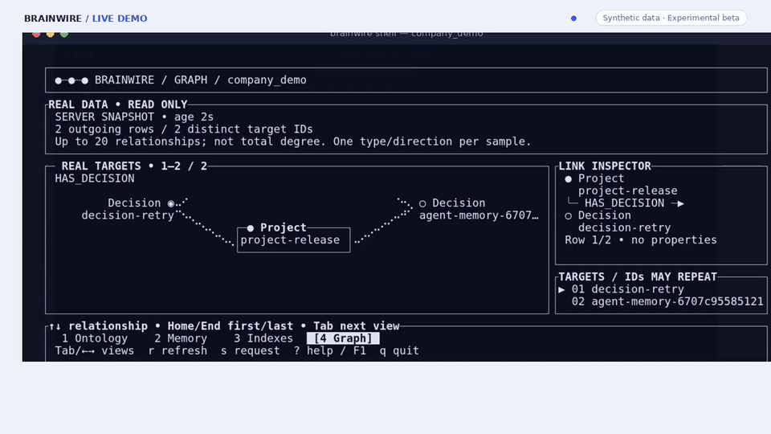

<p align="center"><picture><source media="(prefers-color-scheme: dark)" srcset="assets/brainwire-logo.svg"></picture></p>

<h1 align="center">An open-source graph database for connected data</h1>
<p align="center">Build knowledge graphs, connect company data, and give AI agents context.</p>
<p align="center">
  <a href="https://allandefraga.github.io/brainwire/">Documentation</a> ·
  <a href="https://github.com/allandefraga/homebrew-brainwire">Homebrew tap</a> ·
  <a href="https://allandefraga.github.io/brainwire/guides/getting-started.pt-BR.html">Português</a> ·
  <a href="#quickstart">Quickstart</a> ·
  <a href="#use-cases">Use cases</a> ·
  <a href="#bring-your-data">Ingestion</a> ·
  <a href="BENCHMARKS.md">Benchmarks</a>
</p>

<p align="center">
  <a href="https://github.com/allandefraga/brainwire/actions/workflows/ci.yml"></a>
  <a href="LICENSE"></a>
  
</p>

Brainwire is an open source graph database built in Rust on RocksDB. Model
relationships between records, such as a project and the decisions behind it.
Run Cypher against a local graph or connect an application over Bolt. Inspect
index metadata with `SHOW INDEXES`; see the [Cypher guide](https://allandefraga.github.io/brainwire/guides/local-cypher.html) for supported filters.

> **v0.25.0-beta.2 · experimental beta.** <!-- brainwire-release-version --> Use rebuildable data and a tested backup. [Current limits](#current-limits)

<p align="center"></p>

The agent-memory example saves a decision with its source and recalls both
from a disposable graph with synthetic data. The terminal workspace then
shows the server's query memory reservations and the project's real
`HAS_DECISION` relationships.
[See the typed graph demo](assets/launch/typed-vhs/brainwire-demo.gif).

## Quickstart

Try a query with [Docker](#try-a-connection-with-docker) or use the
[native CLI on macOS](#open-a-local-graph-with-homebrew). To connect a client or
keep your graph across restarts, [start the Docker server](#start-the-docker-server).

### Try a connection with Docker

The public image includes a small example schema. Run a Cypher query that
creates two nodes and returns the relationship it created between them.

```sh
BRAINWIRE_IMAGE=ghcr.io/allandefraga/brainwire:v0.25.0-beta.2 # brainwire-release-version
docker run --rm --network none "$BRAINWIRE_IMAGE" cypher \
  --database /data/demo --ontology /opt/brainwire/example-schema.json \
  --query "CREATE (c:Customer {entity_id:'customer-1', name:'Ada'})-[r:IN_SEGMENT]->(s:Segment {entity_id:'segment-1', name:'beta'}) RETURN c.name AS customer, type(r) AS relationship, s.name AS segment"
```

The container prints JSON and Docker removes the disposable graph when the
command exits. The `rows` array shows `[["Ada", "IN_SEGMENT", "beta"]]`.

### Open a local graph with Homebrew

Use the native CLI to create a project, link a decision to it, and read back
that connection from a disposable graph.

```sh
brew install allandefraga/brainwire/brainwire
brainwire_prefix="$(brew --prefix allandefraga/brainwire/brainwire)"
export PATH="$brainwire_prefix/bin:$PATH"
graph_dir="$(mktemp -d)"
brainwire cypher --database "$graph_dir/graph" \
  --ontology "$brainwire_prefix/share/brainwire/company-ontology.json" \
  --query "CREATE (:Project {entity_id:'release', name:'Release'})-[:HAS_DECISION]->(:Decision {entity_id:'retry', title:'Retry failed requests'})"
brainwire cypher --database "$graph_dir/graph" \
  --query "MATCH (p:Project)-[:HAS_DECISION]->(d:Decision) RETURN p.name AS project, d.title AS decision"
```

The query follows `HAS_DECISION` and returns `[["Release", "Retry failed requests"]]`
in the `rows` array. The tap currently builds v0.24.0-beta.2 from source.
[Use Brainwire on macOS](https://allandefraga.github.io/brainwire/guides/homebrew.html)

### Start the Docker server

Use Git and Docker with Compose. On macOS, Colima can run the Docker engine.
With Colima running, run `export DOCKER_CONTEXT=colima` first.

```sh
git clone --branch v0.25.0-beta.2 https://github.com/allandefraga/brainwire.git # brainwire-release-version
cd brainwire
export BRAINWIRE_IMAGE=ghcr.io/allandefraga/brainwire:v0.25.0-beta.2 # brainwire-release-version
docker compose -p brainwire-demo -f deploy/compose.demo.yaml up --no-build --pull always --wait --wait-timeout 900
```

Check readiness with the built-in probe.

```sh
docker compose -p brainwire-demo -f deploy/compose.demo.yaml exec -T brainwire brainwire probe --mode ready
```

The demo listens at `bolt://127.0.0.1:7687` and keeps data in a Docker volume.
Use synthetic data on a trusted host and container network. The demo disables
authentication, and other containers on the demo network can reach it. Use
Docker Engine 28 or newer because earlier versions can expose loopback ports
to the local network. [Docker port publishing](https://docs.docker.com/engine/network/port-publishing/)
· [Protected deployment](https://allandefraga.github.io/brainwire/guides/protected-containers.html)

### Connect a Python application (optional)

Use the Python helper when writing a Python app or running the Python examples.
It connects to a running Bolt server, such as the Docker demo above.

```sh
python3 scripts/setup_python.py
```

Run this with `.venv-brainwire/bin/python`:

```python
from brainwire import connect

with connect("bolt://127.0.0.1:7687", "demo", auth=None) as graph:
    graph.upsert_node("Customer", "customer-1", {"name": "Ada"})
    graph.upsert_node("Segment", "segment-1", {"name": "beta"})
    graph.upsert_edge(
        ("Customer", "customer-1"), "IN_SEGMENT", ("Segment", "segment-1")
    )
    print(graph.run_cypher("""
        MATCH (c:Customer)-[:IN_SEGMENT]->(s:Segment)
        RETURN c.name AS customer, s.name AS segment
    """))
```

The demo includes these types. For your own graph, define an ontology first.
See [Python](https://allandefraga.github.io/brainwire/guides/python-client.html) and [protected deployment](https://allandefraga.github.io/brainwire/guides/protected-containers.html).

### Explore in the terminal

After writing the Customer and Segment records above, open the connected TUI.

```sh
docker compose -p brainwire-demo -f deploy/compose.demo.yaml exec brainwire \
  brainwire shell --connect 127.0.0.1:7687 --graph demo \
  --node-label Customer --entity-id customer-1 \
  --edge-type IN_SEGMENT --target-label Segment
```

Use **Tab** to change views, **r** to refresh, **?** for help and **q** to quit.
The connected TUI is read-only; it shows schema, indexes, memory diagnostics
and a bounded relationship sample. Add `--lang pt-BR` for Portuguese.
[Explore the TUI](https://allandefraga.github.io/brainwire/guides/connected-status.html).

To stop the demo while keeping its volume:

```sh
docker compose -p brainwire-demo -f deploy/compose.demo.yaml down
```

## Use cases

| Use case | What to build |
| --- | --- |
| Knowledge graph | Connect notes and their references, then follow the links between them. [Obsidian example](examples/obsidian/README.md) |
| Company brain | Link teams, projects, decisions and sources so readers can trace where a decision came from. [Company graph](examples/company_brain/README.md) |
| Semantic layer | Reuse named counts, sums and averages over a declared node type with the reader's graph permissions. [Python metrics example](https://allandefraga.github.io/brainwire/guides/semantic-metrics.html) |
| Agent context | Save a decision with its source, then retrieve the connected records the reader can see. [Agent memory demo](https://allandefraga.github.io/brainwire/guides/agent-context-quickstart.html) |

### Try agent context

The company graph is also available to agents through the Python examples.
An application can retrieve a project's decisions alongside their sources,
or request a bounded view of connected records. A trusted writer can also save
the example's decision, source and node permissions together in one transaction.
[Agent context guide](https://allandefraga.github.io/brainwire/guides/agent-context-quickstart.html) · [Context API](https://allandefraga.github.io/brainwire/guides/context-api.html)

For MCP clients, the optional Python adapter exposes bounded, read-only node,
neighbor, evidence and text-filter tools for one operator-configured graph.
Text filtering returns matches only from explicit candidate IDs. The adapter uses a reader's
existing permissions. [Connect an agent with MCP](https://allandefraga.github.io/brainwire/guides/agent-mcp.html).
The decision example also supports cursor-based recall when a project has more
memories than fit in one response.

## Bring your data

| Source | Start here |
| --- | --- |
| Application writes | Upsert nodes and relationships in batches from [Python](https://allandefraga.github.io/brainwire/guides/python-client.html). |
| DuckDB | Load a local table, then compare snapshots with a resumable journal. [DuckDB sync](https://allandefraga.github.io/brainwire/guides/duckdb-sync.html) |
| DuckLake | Load a mapped table and apply changes between pinned versions. [DuckLake sync](https://allandefraga.github.io/brainwire/guides/parallel-ingestion.html#ducklake-full-load-then-incremental) |
| Obsidian | Preview a small Markdown vault and import notes and wikilinks once into an empty graph. [Obsidian example](examples/obsidian/README.md) |
| Python code | Extract local Python structure and trace source links. [Code graph example](https://allandefraga.github.io/brainwire/guides/code-graph.html) |
| Typed batches | Validate a small JSON batch before writing it. [Typed ingestion example](examples/typed_ingest/README.md) |

For a new standalone graph, the engine can also enforce optional scalar
property types declared in the ontology. [Typed properties](https://allandefraga.github.io/brainwire/guides/typed-properties.html)

```json
{"label": "Project", "properties": ["priority"], "property_types": {"priority": "integer"}}
```

## How it works

The CLI can open a local graph directly. Applications connect to a running server
over Bolt. The Rust engine executes transactions and stores graph records in
RocksDB. Keep the files on a persistent volume so restarting the container reopens
the same graph. The terminal workspace provides read-only inspection.

The standard deployment runs one instance. The separate
[three-voter Raft setup](https://allandefraga.github.io/brainwire/guides/quorum-replication.html) is experimental. Read the
[architecture guide](https://allandefraga.github.io/brainwire/guides/architecture.html) for memory, storage and recovery.

The [backup guide](https://allandefraga.github.io/brainwire/guides/checkpoints.html) covers checkpoint copies and restore
permissions. The [experimental object storage helper](https://allandefraga.github.io/brainwire/guides/object-storage-backup.html)
can copy a verified checkpoint to MinIO; active data stays on local disk.

To check one stopped graph, run `brainwire db check GRAPH --json`. The check
opens that graph exclusively and can replay its write-ahead log during recovery.
For controlled trials, the [experimental request-outcome mode](https://allandefraga.github.io/brainwire/guides/standalone-requests.html)
initializes ledger storage before publishing a new graph path and helps reconcile identified writes.

### How RocksDB stores the graph

RocksDB stores Brainwire's records and indexes as key/value data. Writes first
enter a **write-ahead log (WAL)** on disk and a **memtable** in memory. A flush
writes the memtable into sorted, immutable **SST files**.

- **L0** receives new files; their key ranges can overlap.
- **L1 and deeper levels** organize files into non-overlapping key ranges within
  each level. Deeper levels normally hold more data.
- **Compaction** merges files, keeping the versions still needed by reads and
  eventually reclaiming obsolete values and deletion markers.

Reads combine memory and the relevant SST files. A shared block cache can
avoid disk reads. Compaction uses CPU, disk bandwidth and temporary disk
space, so keep the persistent volume and leave room for storage to grow.
[Storage details](https://allandefraga.github.io/brainwire/guides/architecture.html#rocksdb-files-levels-and-compaction)

## A synthetic benchmark

Three local runs loaded **1 million nodes and 2 million relationships** into
each engine, checked indexed reads, then restarted after a process kill. The
engines ran sequentially, each with a 3 GiB container limit and two CPUs.
Brainwire used the published **v0.24.0-beta.2** image; the measurements are
from November 15, 2026.


| Metric | Brainwire | FalkorDB | Neo4j |
| --- | ---: | ---: | ---: |
| Create 1 million nodes | 9.823 s | 4.447 s | 10.267 s |
| Create 2 million relationships | 24.694 s | 15.920 s | 21.222 s |
| Update 10,000 rows | 0.114 s | 0.038 s | 0.150 s |
| Indexed point read, median p95 | 0.715 ms | 0.365 ms | 0.603 ms |
| One-hop read, median p95 | 0.726 ms | 0.372 ms | 0.636 ms |
| Ready after process kill, median | 0.808 s | 3.438 s | 8.388 s |

Each p95 summarizes 1,000 warm, serial queries per run; the table shows the
median of those three p95 values, not a pooled p95. Each sampled node had two
outgoing edges. These are diagnostic results, not production promises. Engines
used different protocols, internal memory settings,
authentication and durability settings; peak memory was not measured. Read the
[workload, exact versions, raw result and limitations](benchmarks/comparison/README.md)
before comparing or reproducing them.

[See the memory and recovery test results](BENCHMARKS.md).

## Current limits

Brainwire is an experimental beta. Plan a controlled trial:

- **Memory:** budgets and sampled RSS/cgroup admission can refuse growing queries under pressure. They are partial protection, not a guaranteed process-wide RSS ceiling. Sustained capacity testing is incomplete.
- **Search and Cypher:** [Cypher support](https://allandefraga.github.io/brainwire/guides/local-cypher.html) is a subset; native ANN and BM25 indexes are not available.
- **Types and metrics:** native scalar property types require a new standalone graph; required fields, vector types and Raft are not supported. Typed batch validation is separate and client-side. Named metrics are a limited Python example, not full semantic-model compatibility.
- **History:** explicit events are supported; automatic revisions and `AS OF` reads are not.
- **Ingestion:** DuckDB snapshot sync needs a private persistent journal and exclusive ownership of mapped IDs. DuckLake fencing covers cooperating standalone writers; neither sync provides a graph-wide atomic cutover.
- **Security:** shared deployments need a service-token policy and verified encryption. Optional native Bolt TLS requires a server certificate, a matching private key and client trust configuration. Rotate the server certificate by restarting. [Protected transport](https://allandefraga.github.io/brainwire/guides/protected-transport.html)
- **Distribution:** three-voter quorum is experimental. Standard Docker, Kubernetes and Swarm configurations run one instance; multi-machine failover is not qualified.

See [memory](https://allandefraga.github.io/brainwire/guides/memory-defaults.html), [security](https://allandefraga.github.io/brainwire/guides/protected-containers.html),
[recovery](https://allandefraga.github.io/brainwire/guides/checkpoints.html), [replication](https://allandefraga.github.io/brainwire/guides/quorum-replication.html) and
[benchmark conditions](BENCHMARKS.md). Synthetic tests are not production SLOs.

## Learn more

[Getting started](https://allandefraga.github.io/brainwire/guides/getting-started.html) · [Architecture](https://allandefraga.github.io/brainwire/guides/architecture.html) ·
[Python](https://allandefraga.github.io/brainwire/guides/python-client.html) · [Cypher](https://allandefraga.github.io/brainwire/guides/local-cypher.html) ·
[TUI](https://allandefraga.github.io/brainwire/guides/connected-status.html) · [Operations](https://allandefraga.github.io/brainwire/guides/README.html#operate-and-evaluate)

See the [managed pilot plan](https://allandefraga.github.io/brainwire/guides/managed-pilot.html) for the proposed hosted
pilot and its readiness checks.

Brainwire is licensed under [Apache 2.0](LICENSE). Report bugs with a small
synthetic reproduction in [GitHub Issues](https://github.com/allandefraga/brainwire/issues).
