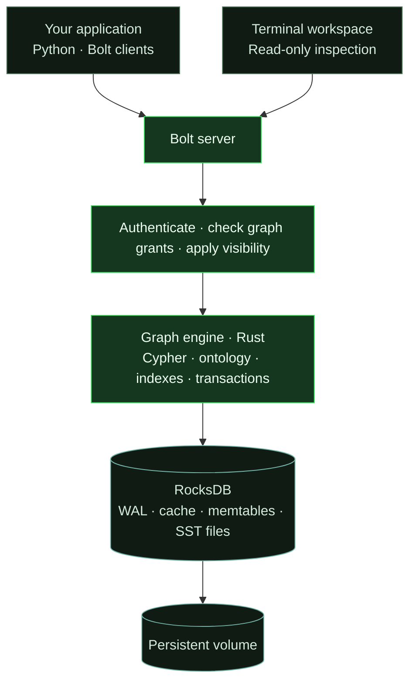
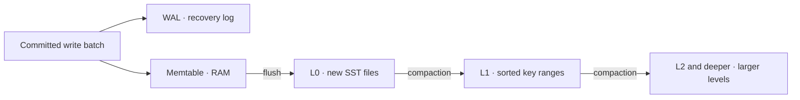

<p align="center"><picture><source media="(prefers-color-scheme: dark)" srcset="assets/brainwire-logo.svg"></picture></p>

<h1 align="center">Your data has connections.</h1>
<p align="center">A graph database for connected application and agent context.</p>
<p align="center">
  <a href="https://allandefraga.github.io/brainwire/">Documentation</a> ·
  <a href="#quickstart">Quickstart</a> ·
  <a href="docs/local-cypher.md">Cypher</a> ·
  <a href="BENCHMARKS.md">Benchmarks</a>
</p>

<p align="center">
  <a href="https://github.com/allandefraga/brainwire/actions/workflows/ci.yml"></a>
  <a href="LICENSE"></a>
  
</p>

Brainwire connects people, projects, documents and events in named graphs.
Write from Python, query with Cypher and inspect the database in your terminal.

> **v0.18.0-beta.6 · experimental beta.** <!-- brainwire-release-version --> Start with rebuildable data and a tested backup. Read the [current limits](#current-limits) before a shared deployment.

## How it works



Applications write and query over Bolt. The Rust engine checks access, executes
transactions and stores graph records in RocksDB. Keep its files on a persistent
volume so restarting the container reopens the same graph.

This diagram shows the standard single-instance deployment. The separate
[three-voter Raft setup](docs/quorum-replication.md) is experimental. Read the
[architecture guide](docs/architecture.md) for memory, storage and recovery.

### How RocksDB stores the graph

RocksDB stores Brainwire's records and indexes as key/value data. Writes first
enter a **write-ahead log (WAL)** on disk and a **memtable** in memory. A flush
writes the memtable into sorted, immutable **SST files**:



- **L0** receives new files; their key ranges can overlap.
- **L1 and deeper levels** organize files into non-overlapping key ranges within
  each level. Deeper levels normally hold more data.
- **Compaction** merges files, keeping the versions still needed by reads and
  eventually reclaiming obsolete values and deletion markers.

These are storage levels, not node types, graph hops or history versions. Reads
combine memory and the relevant SST files; a shared block cache can avoid disk
reads. Compaction uses CPU, disk bandwidth and temporary disk space, so heavy
ingestion can slow down when storage cannot keep up. Keep the persistent volume
and leave disk headroom. See [storage details](docs/architecture.md#rocksdb-files-levels-and-compaction)
for local durability, memory budgets and the current settings.

## What you can build

- **Agent context:** explore ontology and visible record paths, combine ranked IDs from configured providers, then return authorized records and sources.
- **Connected operations:** link customers, projects, documents and tickets and query relationships with Cypher.
- **Timelines:** model explicit events with stable keys and page through them in the Python example.
- **Code graphs:** extract local Python structure and explore paths and source links.

See the [architecture](docs/architecture.md), [agent context](docs/context-api.md),
[Cypher guide](docs/local-cypher.md) and [all documentation](docs/README.md).

Context reads check nested response values before encoding them; search and
reranking use the same bounded checks. These output limits do not bound memory
used by the driver or database process. Nesting is limited to 256 levels.
Context IDs and search text longer than 4,096 characters are rejected before
UTF-8 encoding; their existing 4,096-byte limit still applies.
Batch writes also reject some clearly oversized strings and collections before
serialization, with `BatchTooLargeError` available to Python callers. Their
byte limit is not a process-wide memory limit.

## Quickstart

Install Git and Docker with Compose, then start a local demo:

```sh
git clone --branch v0.18.0-beta.6 https://github.com/allandefraga/brainwire.git # brainwire-release-version
cd brainwire
export BRAINWIRE_IMAGE=ghcr.io/allandefraga/brainwire:v0.18.0-beta.6 # brainwire-release-version
docker compose -p brainwire-demo -f deploy/compose.demo.yaml up --no-build --pull always --wait --wait-timeout 900
```

Check that it is ready:

```sh
docker compose -p brainwire-demo -f deploy/compose.demo.yaml exec -T brainwire brainwire probe --mode ready
```

The demo listens at `bolt://127.0.0.1:7687` and keeps data in a Docker volume.
It disables authentication for local use. For shared environments, use
[authentication and encrypted transport](docs/protected-containers.md).

### Write and query from Python

```sh
python3 scripts/setup_python.py
```

Run this with `.venv-brainwire/bin/python`:

```python
from brainwire import connect

with connect("bolt://127.0.0.1:7687", "demo", auth=None) as graph:
    graph.upsert_node("Customer", "customer-1", {"name": "Ada"})
    graph.upsert_node("Segment", "segment-1", {"name": "beta"})
    graph.upsert_edge(
        ("Customer", "customer-1"), "IN_SEGMENT", ("Segment", "segment-1")
    )
    print(graph.run_cypher("""
        MATCH (c:Customer)-[:IN_SEGMENT]->(s:Segment)
        RETURN c.name AS customer, s.name AS segment
    """))
```

The demo includes these types. For your own graph, define an ontology first.
See [Python](docs/python-client.md) and [protected deployment](docs/protected-containers.md).

### Help an agent understand the schema

Use the same connection to discover declared routes between types:

```python
from brainwire import schema_paths, trace_paths

paths = schema_paths(graph, "Customer", "Segment", max_hops=2)
for path in paths["paths"]:
    print([edge["name"] for edge in path["relationships"]])

connections = trace_paths(
    graph, ("Customer", "customer-1"), ("Segment", "segment-1"),
    relationship="IN_SEGMENT", max_hops=1,
)
print(connections["paths"])
```

Run this inside the connection block above. Schema routes are allowed shapes;
connection paths are a bounded, unordered sample of records visible to the
caller. Use `direction="incoming"` or `direction="both"` to follow paths in
other directions. See [context for agents](docs/context-api.md) for source citations and
search with configured providers.

After creating the demo records, run the complete read-only context example:

```sh
.venv-brainwire/bin/python -m examples.python.agent_context_demo
```

Its provider returns a fixed demo ID; replace it with your own search provider.

### Explore in the terminal

```sh
docker compose -p brainwire-demo -f deploy/compose.demo.yaml exec brainwire \
  brainwire shell --connect 127.0.0.1:7687 --graph demo \
  --node-label Customer --entity-id customer-1 \
  --edge-type IN_SEGMENT --target-label Segment
```

Use **Tab** to change views, **r** to refresh, **?** for help and **q** to quit.
The connected TUI is read-only; it shows schema, indexes, memory diagnostics
and a bounded relationship sample. Add `--lang pt-BR` for Portuguese.
[Explore the TUI](docs/connected-status.md).

To stop the demo while keeping its volume:

```sh
docker compose -p brainwire-demo -f deploy/compose.demo.yaml down
```

## Current limits

Brainwire is an experimental beta. Plan a controlled trial:

- **Memory:** budgets and admission provide partial protection, not a guaranteed process-wide RSS ceiling. Sustained capacity testing is incomplete.
- **Search and Cypher:** [Cypher support](docs/local-cypher.md) is a subset; native ANN and BM25 indexes are not available.
- **History:** explicit events are supported; automatic revisions and `AS OF` reads are not.
- **Security:** shared deployments need authentication and a verified encrypted boundary; native Bolt TLS is not implemented.
- **Distribution:** three-voter quorum is experimental. Standard Docker, Kubernetes and Swarm configurations run one instance; multi-machine failover is not qualified.

See [memory](docs/memory-defaults.md), [security](docs/protected-containers.md),
[recovery](docs/checkpoints.md), [replication](docs/quorum-replication.md) and
[benchmark conditions](BENCHMARKS.md). Synthetic tests are not production SLOs.

## Learn more

[Getting started](docs/getting-started.md) · [Architecture](docs/architecture.md) ·
[Python](docs/python-client.md) · [Cypher](docs/local-cypher.md) ·
[TUI](docs/connected-status.md) · [Operations](docs/README.md#operate-and-evaluate)

Brainwire is [Apache-2.0](LICENSE). Please report bugs with a small synthetic
reproduction via [GitHub Issues](https://github.com/allandefraga/brainwire/issues).
