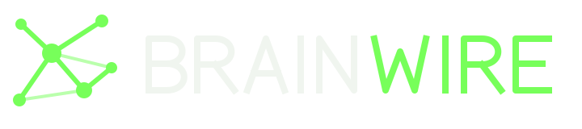
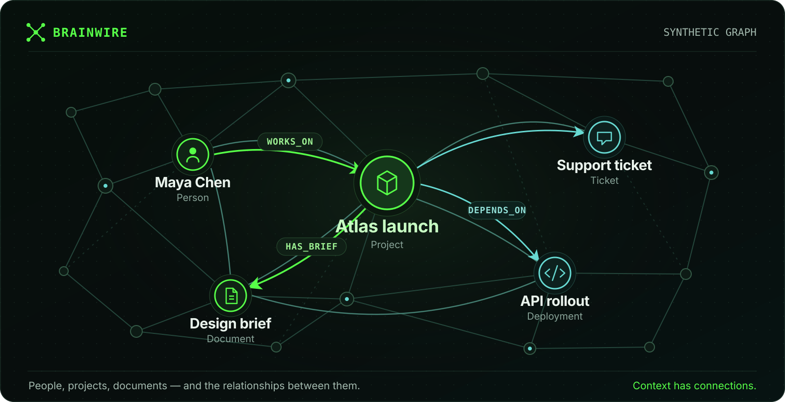
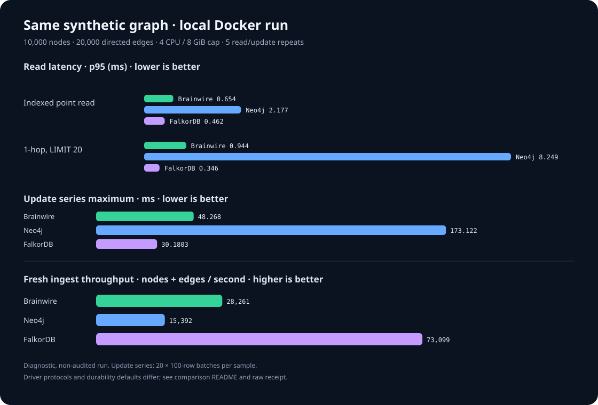

<p align="center">
  
</p>

<h1 align="center">Context has connections.</h1>

<p align="center"><strong>A graph database for the context your AI apps need to remember.</strong><br>
Connect people, projects, events and documents. Keep those relationships durable. Query the graph with Cypher.</p>

<p align="center"><code>RUST</code> &nbsp; <code>ROCKSDB</code> &nbsp; <code>BOLT</code> &nbsp; <code>CYPHER</code> &nbsp; <code>PYTHON</code></p>

<p align="center">
  <a href="#quickstart">Get started ↓</a> &nbsp;·&nbsp;
  <a href="docs/local-cypher.md">Cypher guide</a> &nbsp;·&nbsp;
  <a href="docs/beta-operator-checklist.md">Beta readiness</a>
</p>

<p align="center">
  
</p>
<p align="center"><sub>Illustrative graph with synthetic entities and relationships.</sub></p>

Brainwire is an independent graph database for builders who need structured
relationships and durable state behind their applications. It is written in
Rust, stores data in RocksDB, speaks Bolt, and accepts bounded Python batches.
Run it locally or in Docker with a persistent volume.

**Brainwire is the graph database layer for your application.** Your code owns
ingestion, identity mapping and agent orchestration. Brainwire stores the graph,
executes supported Cypher and exposes it through Bolt and a local CLI.

> **v0.9.0-beta.1 · source beta.** <!-- brainwire-release-version --> This beta is intended for controlled trials.
> Production qualification is open. A container image is published only after
> the matching release workflow passes its source and recovery checks.

## ⚡ Quickstart

You need Docker Engine and Docker Compose. From the repository root, this builds
the image, creates a persistent demo graph with a bundled synthetic ontology,
and waits for the server to become ready:

```sh
docker compose -p brainwire-demo -f deploy/compose.demo.yaml \
  up --build --wait --wait-timeout 900
```

The server listens on `bolt://127.0.0.1:7687`; the graph is named `demo`. The
first build compiles RocksDB and can take several minutes. If that port is in
use, set `BRAINWIRE_BIND_PORT=17687` before the command and connect to port
17687.

### 🐍 Feed it from Python

This example uses the standard Neo4j Bolt driver. It inserts nodes and edges
with parameterized Cypher, then reads the relationship back. The bundled demo
server has authentication disabled and binds the published port to localhost;
use synthetic data only with this quickstart.

```sh
python3 -m venv .venv
.venv/bin/python -m pip install neo4j==6.3.0
.venv/bin/python - <<'PYTHON'
from neo4j import GraphDatabase

customers = [
    {"id": "customer-1", "name": "Ada", "email": "ada@example.test"},
    {"id": "customer-2", "name": "Grace", "email": "grace@example.test"},
]
segments = [{"id": "segment-1", "name": "beta"}]
links = [
    {"customer_id": "customer-1", "segment_id": "segment-1"},
    {"customer_id": "customer-2", "segment_id": "segment-1"},
]

with GraphDatabase.driver("bolt://127.0.0.1:7687", auth=None) as driver:
    with driver.session(database="demo") as session:
        session.run("""
            UNWIND $rows AS row
            MERGE (c:Customer {entity_id: row.id})
            SET c.name = row.name, c.email = row.email
        """, rows=customers).consume()
        session.run("""
            UNWIND $rows AS row
            MERGE (s:Segment {entity_id: row.id})
            SET s.name = row.name
        """, rows=segments).consume()
        session.run("""
            UNWIND $rows AS row
            MATCH (c:Customer {entity_id: row.customer_id})
            MATCH (s:Segment {entity_id: row.segment_id})
            MERGE (c)-[:IN_SEGMENT]->(s)
        """, rows=links).consume()
        result = sorted(session.run("""
            MATCH (c:Customer)-[:IN_SEGMENT]->(s:Segment)
            RETURN c.name AS customer, s.name AS segment
        """).data(), key=lambda row: row["customer"])
        print(result)
PYTHON
```

Expected result:

```text
[{'customer': 'Ada', 'segment': 'beta'}, {'customer': 'Grace', 'segment': 'beta'}]
```

The demo schema includes these node labels and the `IN_SEGMENT` relationship.
For your own graph, create it with your ontology before starting the server.
See the [container guide](docs/container.md) for persistent volumes, custom
schemas, restart checks and running Python from another container.

Stop the demo and keep its data:

```sh
docker compose -p brainwire-demo -f deploy/compose.demo.yaml down
```

Do not add `--volumes` unless you intend to delete the demo database.

## What works today

| Area | Implemented now |
|---|---|
| Graph model | Independent named graphs, versioned ontology catalogs, one label per node, typed directed relationships, stable `entity_id` identities and declared properties |
| Read and write | Bolt and local Cypher with atomic local transactions; create and delete nodes and edges; bounded Python upserts and property patches |
| Cypher | Multi-hop and bounded variable-length patterns, `WITH`, `OPTIONAL MATCH`, `UNION`, expressions, aggregates, and returned node/relationship/path values |
| Indexes | Primary identity lookup; scalar equality, `IN`, range and prefix access for supported predicates; online `CREATE INDEX` / `DROP INDEX` with resumable backfill |
| Storage | Local RocksDB, synchronized WAL commits, retained-volume restarts, consistency checks and checkpoints |
| Graph analytics | Sparse CSR projection, degree, weighted PageRank, shortest path, reachability, WCC and SCC; explainable `knowledge.rank` |
| Ingestion | Python lists/generators and Arrow objects, JSONL import with replay support, and pinned DuckLake snapshot comparison |
| Terminal UI | Synthetic visual demo; offline local inspector; connected read-only ontology, query-memory counters, index status and a bounded outgoing node neighborhood |
| Deployment | Docker/Compose, single-instance Kubernetes and Swarm manifests, protected auth overlays, health probes and explicit persistent volumes |

Python writes commit each bounded batch separately: completed batches remain
committed if a later batch fails. See the [mutation semantics](docs/python-client.md)
and [supported Cypher](docs/local-cypher.md) for node and edge operations.

The opt-in three-voter quorum path is **experimental** and has a separate
[operations guide](docs/quorum-replication.md). The standard container manifests
run one instance; adding replicas does not create a replicated graph.

For the Python helper's batch API, property semantics, and supported inputs, see
[Python client and ingestion](docs/python-client.md). The helper currently lives
in this repository; it is **not** a separately published Python package.

## Releases and container images

Every push to `main` runs formatting, workspace tests, Clippy, Python helper
tests, release-version checks and a Bolt/Python ingestion and restart check.
The `v*` tag workflow repeats source checks, builds a versioned Docker image,
tests Python/Bolt writes and retained-volume restart recovery, then publishes
the tested image and attaches its digest to the GitHub release. A `-beta.N` or
`-rc.N` tag creates a prerelease; a plain SemVer tag creates a stable release.
It does not create a floating `latest` tag. Check the latest workflow status
before relying on an image: a local tag alone does not mean it was published.

A source tag can exist before its release or image. Use the source-build
quickstart above until the matching GitHub release includes
`release-metadata.txt` with the tested image digest. After successful publication,
the versioned image reference is:

```sh
docker pull ghcr.io/allandefraga/brainwire:v0.9.0-beta.1 # brainwire-release-version
```

If the image is private, run `docker login ghcr.io` and enter a GitHub token
with `read:packages` access when prompted. Public images do not require login.
Repository visibility and package visibility are separate; check both before
announcing a public image. See GitHub's
[GHCR authentication guide](https://docs.github.com/en/packages/working-with-a-github-packages-registry/working-with-the-container-registry#authenticating-with-a-personal-access-token-classic).

The [local release workflow](docs/releasing.md) previews a SemVer version,
updates marked Docker/Kubernetes references, runs checks and creates a local
commit and tag. It never pushes or publishes. The Compose quickstart builds
from source; see the [container guide](docs/container.md) for persistent
volumes and running the versioned image.

## See what the TUI can do

After building the binary locally, inspect the running demo server:

```sh
./target/release/brainwire shell --connect 127.0.0.1:7687 --graph demo \
  --node-label Customer --entity-id customer-1 \
  --edge-type IN_SEGMENT --target-label Segment
```

Run the Python quickstart first to populate that neighborhood. Use `Tab` or
`1–4` for Ontology, Memory, Indexes and Graph; `r` refreshes, `?` explains the
current view and `q` exits. Add `--lang pt-BR` for Portuguese interface text.

The connected Graph pane draws actual sampled source/target IDs and directed
links. It reads at most 20 outgoing relationship rows for the configured node,
edge type and target label. It does not expand selected nodes or show arbitrary
properties. Memory displays the server's shared **query reservation pool**,
not process RSS or total RocksDB memory. The connected workspace is read-only;
run queries and mutations through Python or the CLI. See the
[connected workspace guide](docs/connected-status.md) for authentication,
permissions, stale samples and the exact limits.

For the visual demo, run `./target/release/brainwire shell --demo`. Its queries,
files and memory values are synthetic. For real local files and named graphs,
use the [offline backoffice](docs/multi-graph-backoffice.md) with the server
stopped so the shell can acquire the RocksDB lock.

## Performance snapshot

The [v0.7 qualification report](PERF-v0.7.md),
[engine performance notes](PERF.md), [benchmark receipts](docs/benchmarks/README.md) and
[Neo4j/FalkorDB diagnostic](docs/benchmarks/comparison/README.md) identify their
own dataset, configuration and measurement conditions. Each result applies to
that run; it is not a production SLO or a general database ranking. Performance
changes need fresh measurements on the application workload before deployment.




## Current limits

- Cypher compatibility is bounded: a node has one fixed label and an immutable
  `entity_id`. `CALL {}` subqueries, `EXISTS {}` subqueries, regex `=~`, pattern
  comprehensions, and temporal/spatial types are not implemented. Supported
  pattern predicates and functions have their own constraints; check the
  [Cypher guide](docs/local-cypher.md) before porting a query.
- `memory.query` provides conservative allocation accounting and a shared query
  reservation pool. It is not a global process RSS ceiling. Cache, memtables,
  result materialization and other allocations still need workload sizing;
  a 4 GiB production memory cap is not qualified.
- The demo Compose profile explicitly enables unauthenticated development
  access. Without an auth policy, the server accepts loopback listeners and
  rejects non-loopback listeners unless the development override is supplied.
  Shared environments need an auth policy and an encrypted network boundary;
  native Bolt TLS is not implemented. Read [server security](docs/serve.md),
  [protected containers](docs/protected-containers.md) and
  [transport guidance](docs/protected-transport.md) before connecting other
  services.
- Ontology/catalog versions and transaction snapshots are not historical graph
  data. Nodes and edges do not keep durable revisions; `AS OF` reads and automatic
  retention are not implemented. See the [temporal data guide](docs/temporal-data.md).
- DuckLake ingestion is version-pinned snapshot comparison, not native CDC. A
  production source mapping, authoritative ACL integration and representative
  application workload still need validation.
- Three-voter quorum replication is experimental. Current local fault tests do
  not qualify multi-machine Kubernetes/Swarm failover or production recovery.
- Text/vector indexes, arbitrary object serialization and sharding are not
  included. The Python helper uses the Neo4j Bolt driver; a separately published
  Brainwire Python package with its own sync/async driver is not implemented.
- Large ACL-filtered scans and paginated cursors need workload-specific
  qualification. The benchmark targets for the next read-performance release
  are engineering goals, not measured guarantees.
- Performance receipts use synthetic local workloads. They are not production
  SLOs. The separate Neo4j/FalkorDB diagnostic uses its own fixture and
  conditions; read its limitations before comparing numbers. See the
  [benchmark results and comparison status](docs/benchmarks/README.md).

The current release boundary and acceptance evidence are tracked in the
[beta operator checklist](docs/beta-operator-checklist.md). For an application trial,
start in **shadow mode** with a rebuildable graph and keep the existing source as
the authority until integration, security, recovery and workload gates pass.

## Pick your next move

| Goal | Guide |
|---|---|
| Install, run, restart, and connect Docker services | [Docker](docs/container.md) · [orchestrators](docs/orchestrators.md) |
| Write nodes and edges from Python | [Python client](docs/python-client.md) · [Python ingestion](docs/python-ingestion.md) |
| Understand supported Cypher and functions | [Cypher](docs/local-cypher.md) |
| Inspect equality indexes and query lookup behavior | [Indexes](docs/indexes.md) |
| Create graphs and apply an ontology | [Quickstart](docs/mvp-quickstart.md) · [ontology](docs/connected-ontology.md) |
| Inspect a running graph through the terminal | [Connected workspace](docs/connected-status.md) |
| Explore the visual demo or inspect local files | [TUI demo and controls](docs/tui-demo.md) · [offline backoffice](docs/multi-graph-backoffice.md) |
| Resume version-pinned source snapshot differences | [DuckLake incremental ingestion](docs/ducklake-incremental.md) |
| Load and keep a DuckLake table current with parallel writers | [Parallel writes and DuckLake sync](docs/parallel-ingestion.md) |
| Configure authentication and network protection | [Auth](docs/bolt-auth.md) · [container auth](docs/protected-containers.md) · [TLS boundary](docs/protected-transport.md) |
| Evaluate experimental quorum replication | [Quorum operations and limitations](docs/quorum-replication.md) |
| Review measured performance and comparison status | [Benchmarks](docs/benchmarks/README.md) |
| Understand data history and temporal limits | [Temporal data](docs/temporal-data.md) |
| Review deployment readiness and recovery limits | [Operator checklist](docs/beta-operator-checklist.md) · [Docker, Swarm and Kubernetes](docs/orchestrators.md) · [Quorum operations](docs/quorum-replication.md) |
| Explore system design | [Design documents](docs/design/) · [Temporal data model](docs/temporal-data.md) |

## Build it locally

Install Rust 1.98.1 as selected by `rust-toolchain.toml`; CI and the Docker
builder use the same version. The commands below use `--offline`, so dependencies
must already be cached. On the first connected build, run `cargo fetch --locked` first.
Then run:

```sh
cargo test --workspace --locked --offline
cargo clippy --workspace --all-targets --locked --offline -- -D warnings
cargo fmt --all -- --check
```

Build the server binary with `cargo build --release --locked --offline -p brainwire-server`.
The [local demo](examples/python/local_demo.py) exercises Python batches,
Cypher, indexes, restart and the connected TUI with synthetic data.

## Release status and license

**Version:** `v0.9.0-beta.1` · source beta · production qualification open. <!-- brainwire-release-version -->
A tag identifies source; a published release and image require the workflow to
finish successfully. The release workflow marks `-beta.N` and `-rc.N` tags as
prereleases and plain SemVer tags as stable releases. It publishes a versioned
Docker image to GHCR only after source and container recovery checks pass. Follow the
[release workflow](https://github.com/allandefraga/brainwire/actions/workflows/release.yml)
for its current status. It does not publish a Rust crate or Python package. The
image is a delivery artifact, not a production-readiness claim; see the
[current limits](#current-limits).

**License:** Current Brainwire source uses [Apache-2.0](LICENSE), a permissive
open-source license. Some [older releases](https://github.com/allandefraga/brainwire/tree/v0.1.1)
predate that license and carry no open-source license grant; check the license
in the tag you distribute. People may use, modify, redistribute, and sell the software, including
for commercial and BYOC deployments, while following its notice and license
terms. Others may sell their own versions too; this license does not reserve
exclusive commercial rights. The Docker image includes the license at
`/usr/share/licenses/brainwire/` and carries the `Apache-2.0` license label.
`publish = false` is separate: it keeps these Rust crates from being uploaded to
package registries such as crates.io. It does not prevent use of the source or
Docker image and does not control GitHub releases.

Repository and GHCR package visibility are separate access settings. The
license does not make a private repository or private image publicly accessible.
