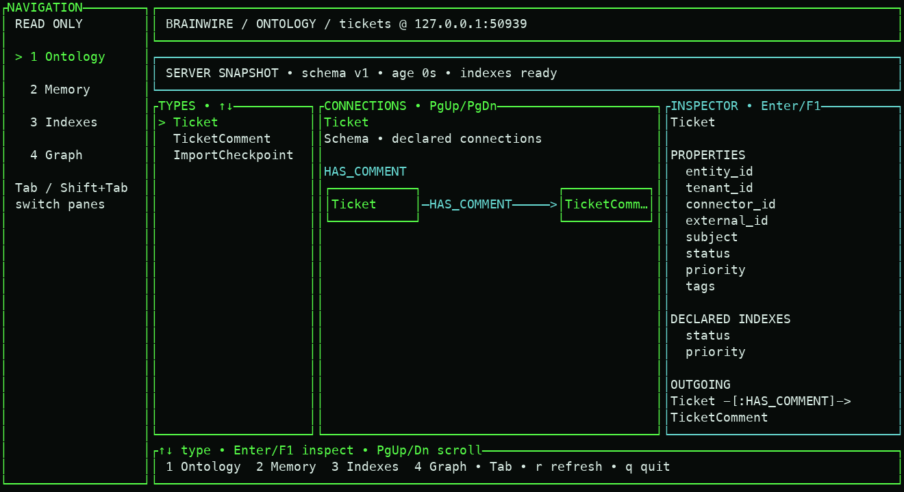
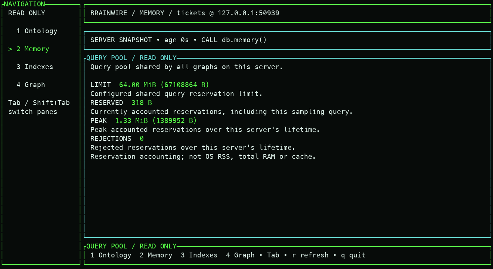
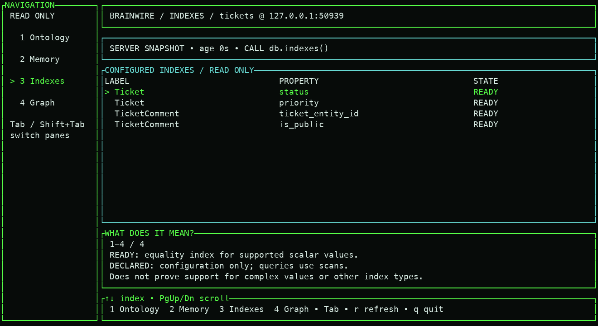
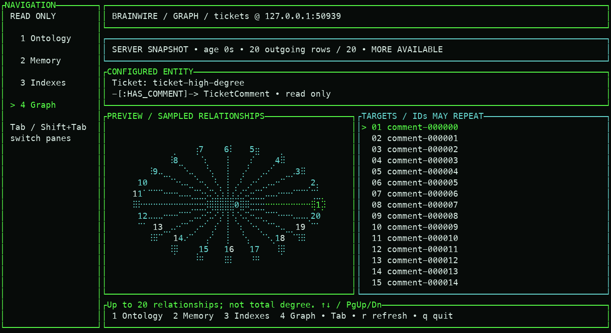

# Connected TUI capture — October 15

These are real terminal-cell captures from the connected read-only workspace,
populated by a temporary synthetic graph with 1,000 nodes and 999 edges. The
graph pane displays a bounded 20-row sample. Captures include English and
Portuguese, index readiness, shared query-memory counters and recovery from a
stale sample. The short import timing in `receipt.json` is a fixture setup
measurement, not a performance claim.

To exercise a larger end-to-end database demo, including Python batches and
real `run_cypher` calls, run `examples/python/local_demo.py` as documented in
the [README](../../../../README.md). Its generated receipt can record a
100,000-node rehearsal separately from these screenshots.

