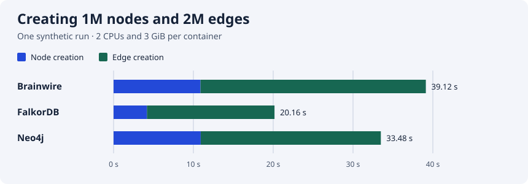
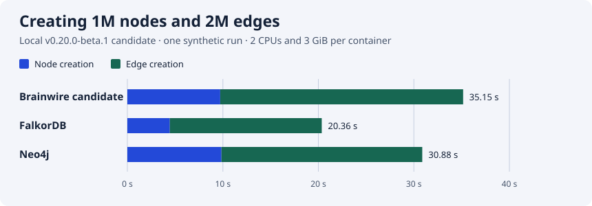

# Compare indexed graph operations

This runner compares the same synthetic Cypher workload on Brainwire, FalkorDB
and Neo4j, one server at a time. It creates a deterministic graph of `N` nodes
and `2N` directed edges and keeps only one batch of fixture rows in the client.
It checks the number accepted per batch, graph counts, every measured read,
and a sample of graph records and committed updates after a process `SIGKILL`.

## Measured baseline

The November 14, 2026 run used Brainwire v0.19.0-beta.1, FalkorDB 6.0.0 and Neo4j
2026.09.0 in Colima on Apple silicon, with 2 CPUs and a 3 GiB memory limit per
container. Each engine created 1,000,000 nodes and 2,000,000 directed edges in
batches of 500. Reads are p95 over 1,000 requests per query.



| Engine | Create nodes | Create edges | Update 10k rows | Point p95 | One hop p95 | Ready after SIGKILL |
| --- | ---: | ---: | ---: | ---: | ---: | ---: |
| Brainwire | 10.88 s | 28.24 s | 0.111 s | 1.139 ms | 1.221 ms | 0.83 s |
| FalkorDB | 4.18 s | 15.99 s | 0.037 s | 0.371 ms | 0.377 ms | 2.85 s |
| Neo4j | 10.91 s | 22.57 s | 0.149 s | 0.863 ms | 0.898 ms | 8.56 s |

All three matched the full node and edge counts and verified sample reads and
updates after the kill. The [run receipt](results/2026-11-14-1m.json) records the
image IDs, settings and measurements. This was one complete run with different
engine durability settings and client protocols. The [first attempt](results/2026-11-14-1m-harness-failure.json)
stopped when the harness compared Redis module order. The runner now compares
modules in a stable order, and the table uses only the complete rerun. The
[100-node smoke receipt](results/2026-11-14-smoke.json) covers initial validation.
The [archived runner source](results/2026-11-14-run.py.txt) matches the large-run
receipt's SHA-256. Its [imported helpers](results/2026-11-14-helpers.py.txt)
match `benchmarks/archive/comparison/run.py` at commit `074867d`, with SHA-256
`6e0b9dd59d947f8a76bdd2057048775dcac1dc87ee5f4b4d2acef4802e95305d`. The current runner adds the local Unix socket check below.

## Local v0.20.0-beta.1 candidate

A separate run used the same 1M-node, 2M-edge fixture, 500-row batches, 1,000
requests per read query, 2 CPUs and 3 GiB per container. Brainwire was built
locally as `brainwire-local-candidate:0.20.0-beta.1`. Its local image ID is in
the receipt. The image has no source revision label or verified release
registry digest. FalkorDB 6.0.0 and Neo4j 2026.09.0 used the same image IDs as the
baseline.



| Engine | Create nodes | Create edges | Update 10k rows | Point p95 | One hop p95 | Ready after SIGKILL |
| --- | ---: | ---: | ---: | ---: | ---: | ---: |
| Brainwire candidate | 9.72 s | 25.43 s | 0.117 s | 1.006 ms | 1.061 ms | 0.80 s |
| FalkorDB | 4.45 s | 15.91 s | 0.042 s | 0.362 ms | 0.365 ms | 2.79 s |
| Neo4j | 9.86 s | 21.02 s | 0.135 s | 0.626 ms | 0.648 ms | 8.19 s |

All three passed the post-kill counts and sample checks. The
[raw receipt](results/2026-11-14-1m-local-020b1.json) records images, parameters
and timings for this single run. Engine durability settings and client
protocols differ. The [exact runner](results/2026-11-14-local-020b1-run.py.txt)
has SHA-256 `f9c02a8d6e5758c347b8a1a92bf9fa5f40fca6879ff9d1863df9938c7213c9ea`
and uses the same [archived helpers](results/2026-11-14-helpers.py.txt) with
SHA-256 `6e0b9dd59d947f8a76bdd2057048775dcac1dc87ee5f4b4d2acef4802e95305d`.

## Run it

Use a Docker context with a local Unix socket, such as `colima`. The runner
rejects SSH and TCP contexts because it connects to published ports on the
same host. It creates temporary
labelled containers and volumes, binds client ports to loopback and removes
only resources carrying its unique run label. Containers on the default Docker
bridge can reach each other. Use synthetic data and a dedicated test engine
when other containers on the host are untrusted.

```sh
python3 -m venv /tmp/brainwire-comparison-venv
/tmp/brainwire-comparison-venv/bin/pip install -r benchmarks/comparison/requirements.txt

docker --context colima pull ghcr.io/allandefraga/brainwire:v0.19.0-beta.1
docker --context colima pull falkordb/falkordb-server:6.0.0
docker --context colima pull neo4j:2026.09.0

/tmp/brainwire-comparison-venv/bin/python benchmarks/comparison/run.py \
  --context colima --brainwire-image ghcr.io/allandefraga/brainwire:v0.19.0-beta.1 \
  --nodes 100 --batch 40 --reads 30 --update-batches 2 \
  --out /tmp/brainwire-comparison-smoke.json
```

For a 1M-node, 2M-edge workload, rerun with `--nodes 1000000 --batch 500
--reads 1000 --update-batches 20` and a new `--out` path. Set `--memory-mib`
and `--cpus` for your test machine so the same limits apply to all three
engines. Leave RAM and disk space for the Docker host. The smoke checks the
harness only. Run the full fixture in isolation and repeat before using its
numbers. The receipt records immutable image IDs and available repository
digests, client versions, Docker host resources, limits and parameters.

## Interpret a receipt

- Compare node creation, relationship creation and property updates separately.
  Each rate includes batch construction, parameter encoding, the client/server
  round trip and acknowledgement. Index setup is outside the timed intervals.
- The p50/p95/p99 values cover warm indexed point reads and indexed one-hop reads
  with exactly two results. This is a serial, low-degree workload with one label
  and one relationship type. It exercises neither ACL filtering nor search.
- All engines reuse a persistent volume after a process `SIGKILL`. Readiness
  time includes starting the container and reattaching the client. This checks a
  process failure and does not model host power loss, storage loss or failover.
- Brainwire uses its default RocksDB commit WAL sync, FalkorDB uses verified
  Redis AOF with `appendfsync always`, and Neo4j uses its default transaction
  log settings. Internal memory allocations, durability settings and client
  protocols differ. Report the settings alongside measurements and avoid a
  general speed or durability ranking. Memory usage and peak RSS are outside
  this run's measurements. The receipt records container limits and settings.
- Brainwire uses its development access mode and FalkorDB uses its unauthenticated
  test configuration. Neo4j uses a synthetic password. Keep the test isolated.
