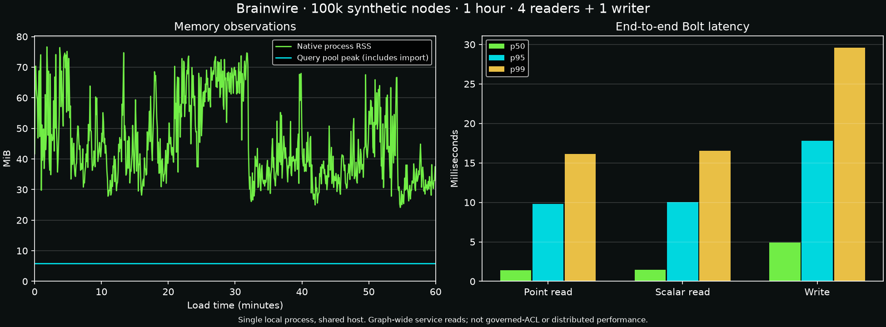

# October 13 ACL / incremental / deployment candidate

This is local synthetic single-owner qualification. It is not evidence of a live
external application integration, a distributed database, production readiness or superiority
against other databases. Source, binary, image and deployment manifest hashes are in
[the candidate receipt](../../benchmarks/archive/2026-10-13-beta-acl/candidate.json).

## Delivered and exercised

- Private, bounded node ACL in RocksDB; trusted static protected identities;
  MATCH, PK/index scans, traversal, ranking, WCC/SCC and TUI graph samples filter
  nodes and both relationship endpoints. Hidden physical scan counts are denied.
  Metadata stamping requires unrestricted write plus administration. Bolt READ
  transactions refuse mutation even for admin credentials.
- Predecode allocation estimates reject NULL-heavy/nested row amplification before
  allocating full values. ACL stamping validates existing encoded node bytes by
  borrowing them rather than decoding properties. These are accounting estimates,
  not hard RSS caps or allocator instrumentation.
- Python single/batch upserts and partial node/edge additions, replacements and
  removals. Actual server tests include index maintenance and filtered TUI reads.
- Version-pinned DuckLake full-snapshot differences, deterministic immutable input,
  bounded preparation, update/delete propagation and durable batch/source progress.
  Lost acknowledgements, interrupted deletes and subsequent snapshots are tested
  against actual DuckDB/DuckLake managed Parquet with synthetic source records.
- Compose, retained-PVC Kubernetes and isolated Swarm recovery harnesses use the
  candidate image. Each runs one database owner. Pending transaction rollback,
  committed indexed data, offline audit and checkpoint restoration are checked.
- Experimental concrete-mutation apply ledger has deterministic encoding/SHA-256,
  contiguous per-store sequence, atomic state+ledger commit and idempotent latest
  replay across independent stores. It is not connected to consensus or serving.

## Candidate checks

590 Rust workspace tests passed, none ignored. Clippy with warnings denied and
formatting passed. 21 Python helper tests and 11 incremental DuckLake tests passed.
The protected native API fixture validates 1,000 small synthetic nodes before and
after process restart and private-ACL checkpoint restore. Its rows/s is a fixture
observation, not an external application ingestion throughput claim.

An earlier simultaneous build/test run failed an existing 250 ms authentication
write-deadline test with EOF. The isolated test and complete final workspace run
passed without changing that test or widening its deadline. Preserve timing risk
when running the suite under heavy host contention.

## Endurance and recovery results

**PASS:** full 3,600.010-second load, zero observed cumulative query-pool
rejections, successful SIGKILL/reopen readback and offline graph/index audit.
All 100,000 rows survived; the latest 200 acknowledged updates and their indexes
matched. Docker Compose, isolated one-engine Swarm and one-node kind Kubernetes
also passed their retained-storage restart/audit rehearsals; Swarm and Kubernetes
checkpoint restoration passed. All task-owned runtime resources were removed.

| Operation | Requests | Requests/s | p50 ms | p95 ms | p99 ms |
| --- | ---: | ---: | ---: | ---: | ---: |
| Point read | 2,495,632 | 693.2 | 1.421 | 9.783 | 16.160 |
| Indexed scalar read | 2,495,629 | 693.2 | 1.485 | 10.061 | 16.546 |
| Write (throttled) | 59,427 | 16.5 | 4.911 | 17.790 | 29.583 |

Combined read rate was 1,386.5/s.
Sampled native RSS peak: **76.62 MiB**.
Shared query reservation peak (includes ingestion):
**5.80 MiB**.
The 115,277,780-byte input imported in 7.278 seconds
(13,739 input records/s). This synthetic Customer
fixture is not the ticket ingestion rate or a universal performance guarantee.

Workload: 100,000 Customer nodes, roughly 1 KiB ASCII entropy payload per node;
release native binary on this macOS host; four Bolt readers and one writer
throttled by 50 ms pauses. Point reads overlap the 200 updated identities; scalar
reads use disjoint unchanged identities. All serving queries are graph-wide
service reads, so this is **not** a 100k-node governed-ACL performance result.
Each latency measures materialized end-to-end Bolt requests, bucketed to 1 µs.

The engine pool uses cache 64 MiB, memtable 16 MiB and query 64 MiB configuration;
encoded/decoded limits are 8/16 MiB. RSS samples include the native process, not
Docker VM, client or source-preparation memory. Initial deployment qualification
ran concurrently on this host and can affect timing; other shared external application/CI
containers were active too. This was not an otherwise idle dedicated benchmark
host. Ingestion precedes the
one-hour load timer. At completion SIGKILL/reopen verifies all 100k nodes and
200 latest acknowledged updates, old/new scalar index behavior, then offline audit.

## Evidence and reproduction

Receipts and logs reside in [the evidence directory](../../benchmarks/archive/2026-10-13-beta-acl).
Run `python3 benchmarks/archive/2026-10-13-beta-acl/verify.py --self-check`, then the
same script without arguments to verify final source hashes, candidate IDs,
full-duration load, deployment cleanup and recovery receipts. Missing receipts,
shortened runs and mismatched hashes are rejected. PASS covers only the declared
synthetic single-owner scope.

The earlier candidate's receipts remain under `pre-stamp-fix/`, explicitly marked
SUPERSEDED. Its hour was intentionally interrupted after final review found an
unaccounted property decode in ACL stamping. Those results are not credited to the
corrected candidate; the corrected binary/image was rebuilt and tests repeated.

## Remaining gates

- Real external application DuckLake catalog and mapping, representative ACL/payload/degree
  corpus; dynamic GraphRepository binding and atomic authoritative ACL ingestion.
- ACL bounds currently 256 strings/list, below the larger external application knowledge-grant
  profile. Fail closed rather than claiming adapter parity.
- Pinned snapshot differences still scan full snapshots; native CDC/Arrow transport,
  temporal history, object-storage operation, vector/text indexes and maintenance
  policies require their own implementation and evidence.
- No real Raft, quorum writes, election, partition recovery or machine-loss failover.
  [Next replication gates](../design/replication-next-gates.md) make those explicit.
- Kubernetes is one private kind node; Swarm is one privileged DinD engine with no
  host socket. Neither proves distributed failure tolerance. All task-owned
  runtime resources must be removed; shared external application resources remain intact.
