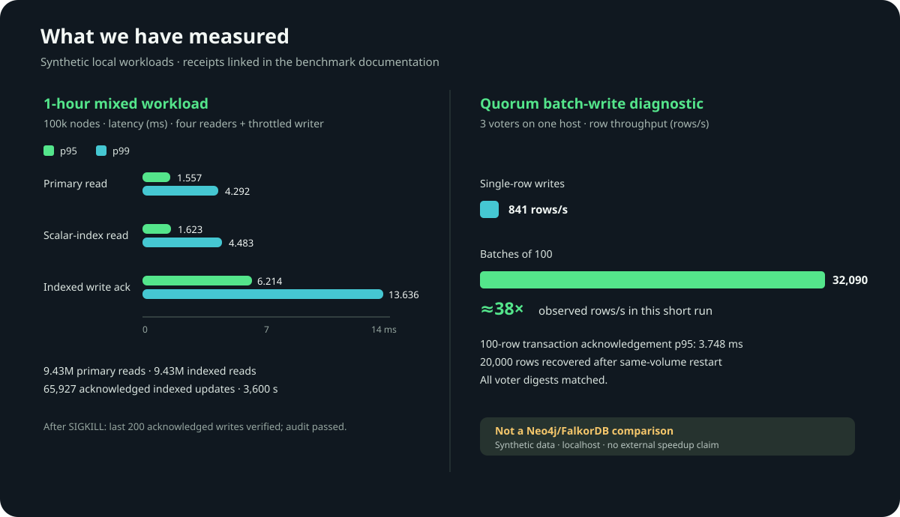

# Benchmark results and test runners

Start with [how to run benchmarks](../../BENCHMARKS.md). This directory keeps
raw receipts and reports so a result can be traced to its workload and binary.
The dates matter: historical results describe those candidates, not the current
working tree or latest release.

**Memory stability remains unqualified.** The 2, 4 and 8 GiB attempts in the
[v0.9 report](../../PRODUCTION-v0.9.md) stopped early. The later
[four-label diagnostic](2026-10-28-production-session.md) also stopped under
query-pool pressure. Neither completed the required sustained workload or
established a process RSS ceiling. Those results must not be presented as a
successful capacity benchmark.

## Recent pressure-admission smoke

The [beta.11 candidate pressure summary](2026-11-04-cgroup-015b11.json)
records synthetic rejection, rollback and recovery in a 512 MiB container.
It does not establish a process-wide limit or production capacity.

The [beta.10 candidate pressure receipt](2026-11-04-cgroup-015b10.json) records
a synthetic 512 MiB refusal and recovery on a local image. It is not a
sustained-load or global RSS qualification.

The [beta.9 candidate receipt](2026-11-04-cgroup-015b9.json) records a
512 MiB single-container pressure injection, rejection and recovery. It is a
short synthetic diagnostic, not a sustained capacity or failover test.
An independent [repeat summary](2026-11-04-cgroup-repeat-015b9.json) also
passed on the same candidate; its complete event log remains local.

The [beta.9 small read soak](2026-11-04-soak-015b9.json) loaded 1,000 rows per
label in a 2 GiB container, then ran four readers for 30 minutes with delegated
ACL visibility. Exact counts and the offline integrity check passed. Median
sampled process RSS increased from about 238 MiB in the first five-minute
window to 291 MiB in the last. That change needs investigation; it does not
by itself identify a leak: intermediate windows were lower and the increase
was not steady. Writes stopped before the soak, the data was small,
and host kernel logs were unavailable. This does not qualify the full 2 GiB
workload or the separate 4/8 GiB targets.
Reviewing that run's raw samples showed median anonymous process RSS rising
from about 222 MiB to 275 MiB over the same windows; file-backed RSS was nearly
unchanged. This narrows the observation but does not distinguish live data,
allocator retention or other anonymous allocations.

A [beta.10 repeat](2026-11-04-soak-015b10.json) with the same intended small
fixture and 30-minute read soak passed counts and offline integrity. Median RSS
fell from about 227 MiB to 208 MiB between the first and last windows. The
[descriptive comparison](2026-11-04-soak-comparison-015b10.json) shows both
runs, but their older receipts omit some settings and the host was shared. The
different outcome neither explains the earlier increase nor establishes that a
leak was fixed. Neither run qualifies production capacity.

The [beta.11 candidate repeat](2026-11-04-soak-015b11.json) passed the same
small 30-minute read diagnostic: median process RSS was about 227.5 MiB in the
first window and 215.9 MiB in the last. The [comparison](2026-11-04-soak-comparison-015b11.json)
is descriptive: the host was shared, the older receipt omitted some settings,
and neither run establishes a hard ceiling or explains the earlier increase.

A separate [100,000-node load and restart](2026-11-04-load100k-015b9.json)
passed against the same local candidate. It is a brief single-container test
without edges, ACL or representative source payloads.

The [beta.11 repeat](2026-11-04-load100k-015b11.json) loaded 100,000 synthetic
rows in a 1 GiB container and checked indexed overwrites after forced restarts.
It is a brief recovery check, not a sustained workload or throughput benchmark.

A [v0.13 local diagnostic](2026-10-30-v013-memory.md) repeats the pressure
smoke and records a small idle-RSS experiment. Its limits are explicit.

A [512 MiB Linux cgroup test](2026-10-29-cgroup-pressure/README.md) observed
query rejection, rollback and recovery after synthetic pressure. It is not an
RSS ceiling or sustained 2/4/8 GiB qualification. The first inconclusive
attempt and the repeated run are both recorded.

## Recent work

The [beta.11 quorum acceptance summary](2026-11-04-quorum-015b11.json) records
21 passing local-process fault and recovery checks on the candidate. It does
not qualify independent machines, snapshots or production throughput.
The [beta.11 quorum write summary](2026-11-04-quorum-write-015b11.json) records
300,000 synthetic rows verified after three local voters restarted. It used one
client on a shared host and does not establish multi-machine performance.

The [beta.10 quorum acceptance summary](2026-11-04-quorum-015b10.json) records
21 passing local-process fault and recovery checks on the candidate. It does
not qualify independent machines, snapshots or production throughput.
The [beta.10 quorum write summary](2026-11-04-quorum-write-015b10.json) records
300,000 verified rows after restarting three local voters. It used one client
and a debug binary on a shared host; it does not resolve the previous election
failure or establish multi-machine performance.

The [beta.9 quorum acceptance summary](2026-11-04-quorum-015b9.json) records
21 passing scenarios using three local processes. It covers partitions,
retained-state recovery and unknown-commit reconciliation; it does not qualify
TLS, snapshots or machine loss.

The [beta.9 quorum write summary](2026-11-04-quorum-write-015b9.json) records
300,000 verified rows after restarting three local voters. This one-client
diagnostic used a debug binary on a shared host; its throughput does not
represent a production deployment, and the previous leader-election failure
remains unexplained. Per-transaction samples were omitted from this summary.

| Report | What was measured | What remains open |
| --- | --- | --- |
| [2026-10-29 Bolt responses](2026-10-29-bolt-response/README.md) | Two native binaries returned the same eight 512 KiB strings; every ID and payload hash was checked. Raw samples, binary hashes and sampled RSS are included. | Timing varied between rounds. The results do not establish a 5% regression bound or an RSS improvement. |
| [2026-10-29 conflict history](2026-10-29-history-growth.md) | A focused test compared deque growth strategies while retaining conflict keys. | It excludes the database write path, fsync, Bolt and clients. Fewer capacity changes are not proof of better database throughput. |
| [2026-10-29 regex](../cypher-regex.md) | A small repeated-pattern query measured the cost of recompilation and a per-RUN cache; [uncached](2026-10-29-regex/uncached.log) and [cached](2026-10-29-regex/cached.log) logs are retained. | Three developer-build samples do not establish p99, general regex performance or Java-regex compatibility. |
| [2026-10-28 mixed load](2026-10-28-production-session.md) | Four labels, concurrent writers/readers and delegated visibility in a 4 GiB container. | Both loads aborted; exact final counts and `db check` were not reached. Different durations and host loads prevent a valid before/after comparison. |

A new change needs a new receipt. Preserve failed attempts rather than replacing
them with the fastest successful sample.

## Compare Brainwire, Neo4j and FalkorDB

The [three-database diagnostic](comparison/README.md) includes a new October 29
run as well as an October 19 historical baseline. It contains a checked-in runner,
raw JSON, pinned image identities and a chart for a 10,000-node, 20,000-edge
synthetic workload recorded on October 19. The recorded Brainwire source tree
was dirty, so its base commit alone cannot reproduce that exact image.

That run uses different client protocols and durability configurations across
products. It is useful as a historical engineering baseline, but it does not
support a general product ranking or an equivalent production comparison.
Refresh the workload, source identities and results for a new release before
using the chart to describe its performance.

To run a new diagnostic, install Docker and `uv`, then from the repository root:

```sh
docker pull neo4j:2026.09.0
docker pull falkordb/falkordb-server:6.0.0
docker build --build-arg CARGO_BUILD_JOBS=1 --tag brainwire-benchmark:local .
BRAINWIRE_IMAGE=brainwire-benchmark:local uv run --python 3.12 \
  --with-requirements docs/benchmarks/comparison/requirements.txt \
  docs/benchmarks/comparison/run.py \
  --nodes 10000 --batch 100 --repeats 5 --reads 200 \
  --neighborhoods 100 --update-batches 20
```

Finish the image build before timing and ensure the host has enough memory and
disk for all three databases. The runner creates uniquely named containers and
volumes, removes its own resources at exit and writes a new JSON receipt under
`comparison/results/`. Read the [full methodology](comparison/README.md) before
running it. Render that receipt's chart with:

```sh
python3 docs/benchmarks/comparison/plot.py \
  docs/benchmarks/comparison/results/<run-id>.json
```

Do not describe these results as LDBC results. A standardized LDBC result needs
its specified workload, execution rules and applicable audit process; the
current runner is a smaller custom diagnostic.

## Test memory under a container limit

To compare two complete raw four-label read-soak receipts, run:

```sh
python3 scripts/compare_read_soaks.py /path/to/first/report.json /path/to/second/report.json
```

The output compares sampled five-minute RSS and cgroup windows and checks the
workload fields present in both receipts. A raw receipt can contain host
telemetry; review it before sharing. A change in memory is not, by itself,
proof of a leak or its cause, and matching recorded fields does not make the
host or the complete workloads identical.

Use the [four-label container guide](../../scripts/bench_v09_container.md).
Start with its small smoke test, then run 2, 4 and 8 GiB separately using the
same frozen image and configuration policy. The full defaults load four million
nodes and four million edges, then run a 30-minute read soak. Loading has a
separate deadline; the smoke test does not qualify the full workload.

Keep the complete receipt, exact counts and ACL checks, Docker/cgroup events,
restart state, kernel evidence where available, and offline `db check` results.
No observed Docker OOM event is narrower evidence than proof of no kernel OOM.
The [production roadmap](../production-readiness-roadmap.md) lists the remaining
gates.

## Historical results

These reports and charts remain available for their original candidates. Do not
combine their numbers with current diagnostics or use them to certify a new
binary.

| Report | Recorded scope |
| --- | --- |
| [October 13 beta qualification](2026-10-13-beta.md) | A frozen local candidate ran for one hour on 100,000 synthetic nodes with four readers and a throttled writer. The report binds its binary/image identities, checks and limits. It does not qualify current memory settings or multi-machine deployment. |
| [October 15 quorum writes](2026-10-15-quorum-write/README.md) | Short three-voter tests on one host compared single-row writes with batches and checked retained-volume restart. The report also preserves a larger failed attempt with an unknown commit outcome. It does not establish multi-machine or sustained capacity. |
| [October 19 product comparison](comparison/README.md) | A small one-host comparison with unequal protocol/durability settings and one fixed system order. |

<details>
<summary>Historical charts</summary>

The Brainwire-only chart below summarizes the older local measurements described
above. The [separate comparison chart](assets/comparison-20261019.svg) uses its
own fixture and methodology.



</details>

Other dated reports in this directory cover ACLs, Cypher, ingestion, indexes,
recovery and replication. Read each report's source identity, test boundary and
failure evidence before reusing its numbers.
