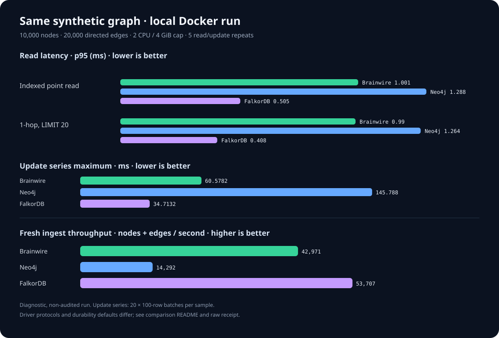
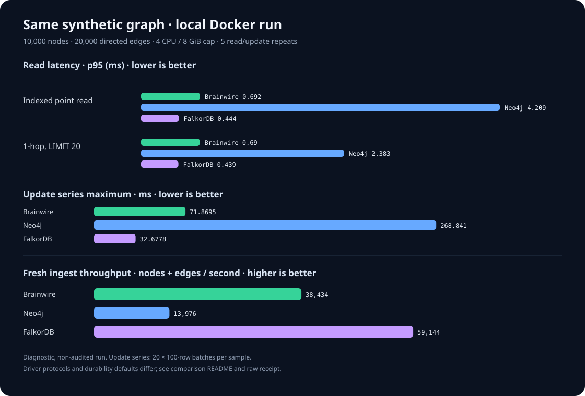
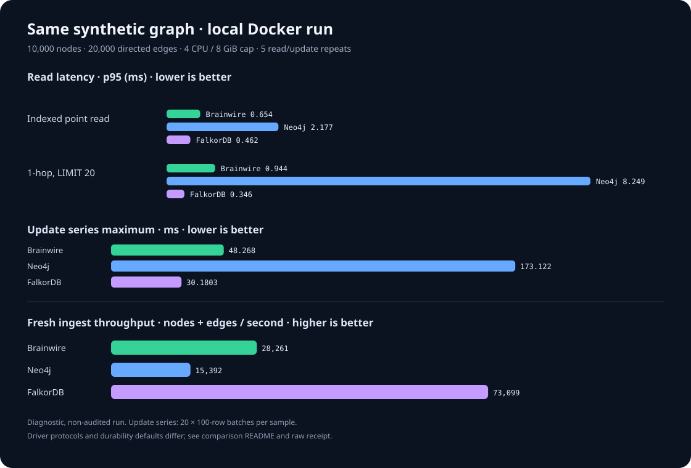

# Local comparison: Brainwire, Neo4j and FalkorDB

These are reproducible synthetic diagnostics on one developer machine. They
are not audited benchmarks, production guarantees or general product rankings.
Each receipt identifies its own data, images, settings and timing samples.

## 2026-11-02 diagnostic

[Raw JSON receipt](results/20261102T133046Z-fb12c1.json) · [Chart](comparison.svg)



| System | Point p50 | Point p95 | One-hop p50 | One-hop p95 | Fresh ingest records/s |
|---|---:|---:|---:|---:|---:|
| Brainwire | 0.634 ms | 1.001 ms | 0.667 ms | 0.990 ms | 42,971 |
| Neo4j Community | 0.828 ms | 1.288 ms | 0.854 ms | 1.264 ms | 14,292 |
| FalkorDB | 0.279 ms | 0.505 ms | 0.298 ms | 0.408 ms | 53,707 |

One run loaded 10,000 nodes and 20,000 directed edges, with batch size 100.
There were 1,000 point reads and 500 one-hop reads per system across five
repeats. Containers ran sequentially in fixed order (Brainwire, Neo4j,
FalkorDB), each capped at **2 CPU / 4 GiB**, with swap disabled. The host was
shared with other running services; those services were not stopped. These
conditions differ from the historical 4 CPU / 8 GiB runs below.

The pins were Neo4j Community `2026.09.0`, FalkorDB server `6.0.0`, Neo4j Python
`5.28.8` and FalkorDB Python `1.2.2`, using Python `3.14.7` on macOS arm64
with Docker. The reproduction example below selects Python `3.12`; matching
this measurement requires Python `3.14.7`. FalkorDB reported Redis `8.10.2`, graph module `60000`, AOF enabled and `appendfsync
always`; its configured maxmemory was 3 GiB. Brainwire and Neo4j used Bolt;
FalkorDB used its Redis-compatible protocol. Durability defaults and client
stacks differ, so this does not establish equivalent durability/performance.

The receipt's Git HEAD is `9952b2b` and the worktree was dirty. It is **not** a
measurement of that release alone: the Brainwire image records the candidate's
source-snapshot label `org.brainwire.benchmark-source-sha256` as
`1dee3ea53144dd8bfea314ad32fce430f97e8008c664d8c0cab551189ad38bb3`.
The receipt contains the immutable local image IDs. This label is declared build
metadata, not an independent source audit or qualification of later edits.

All systems passed the fixture's counts, selected-property checks and graceful
restart check. Memory/CPU values are single post-workload samples, not peak RSS
or comparable memory-efficiency scores. This small, warm, single-client graph
excludes concurrent load, ACL overhead, abrupt failures and distributed operation.
Read the methodology and interpretation limits below before drawing conclusions.

## New local run: October 29

[Raw receipt](results/20261029T113746Z-3ad8ce.json) ·
[Chart](../assets/comparison-20261029.svg)



| System | Point read p95 | One-hop p95 | Update series median / maximum | Fresh ingest records/s |
|---|---:|---:|---:|---:|
| Brainwire | 0.692 ms | 0.690 ms | 44.966 / 71.870 ms | 38,434 |
| Neo4j Community | 4.209 ms | 2.383 ms | 82.719 / 268.842 ms | 13,976 |
| FalkorDB | 0.444 ms | 0.439 ms | 27.457 / 32.678 ms | 59,144 |

This is one synthetic run with 10,000 nodes, 20,000 edges, a single client and
4 CPU / 8 GiB per container. All three recovered the expected counts after a
graceful restart. Brainwire was built from a **dirty worktree** based on
`db56230`; its local image ID and all samples are in the receipt. Different
protocols and durability settings make this a diagnostic, not a general
ranking or a production guarantee. The measurements do not isolate the cost
of memory-pressure admission. See the methodology and limits below.

## Historical results: October 19

[Raw JSON receipt](results/20261019T115937Z-c6b05d.json) ·
[Chart](../assets/comparison-20261019.svg)



All three systems loaded the same 10,000-node, 20,000-edge graph and recovered
those counts after a graceful restart of the same container with its persistent
volume attached. This is a restart check, not a power-loss, machine-loss or
container-recreation test. Each container had a 4 CPU / 8 GiB limit and ran
alone on the host.

| System | Indexed point read p95 | 1-hop `LIMIT 20` p95 | 20 × 100-row update series median / max | Fresh ingest records/s |
|---|---:|---:|---:|---:|
| Brainwire | 0.654 ms | 0.944 ms | 42.149 / 48.268 ms | 28,261 |
| Neo4j Community | 2.177 ms | 8.249 ms | 77.763 / 173.122 ms | 15,392 |
| FalkorDB | 0.462 ms | 0.346 ms | 21.175 / 30.180 ms | 73,099 |

Point-read p95 uses 1,000 measured requests per system; one-hop p95 uses 500.
Each update sample executes twenty parameterized 100-row property-update
statements. We report the median and maximum of five update-series samples
rather than treating five observations as a meaningful p95. Fresh ingest is
one measurement per system and is indicative only. Raw JSON contains every
read and update timing sample, p50/p95/p99 and mean latencies, sampled
container memory/CPU, image IDs/digests, client versions, persistent paths,
and data-directory byte counts. Memory is one post-workload snapshot, not peak
RSS; on-disk byte counts are not normalized across database formats.

For this particular local run, FalkorDB was fastest on the listed query,
update and ingest measurements; Brainwire was between FalkorDB and Neo4j on
those metrics. This is not a general ranking or proof of superiority. The
graph is small and synthetic, each product has a different client/protocol and
durability setup, and only one run was made in a fixed system order.
These results are not production capacity or service-level guarantees.

## What was measured

- Deterministic graph: 10,000 `Item` nodes with unique, indexed `entity_id`
  and a small `value` property; 20,000 directed `LINK` edges (a ring plus an
  offset-17 edge from every node).
- Batch size: 100. The graph starts empty. Ingestion uses parameterized
  `CREATE` statements; it does not measure `MERGE` or repeated upserts.
- Indexed point read: `MATCH (n:Item {entity_id: $key}) RETURN n.value AS value`.
- One-hop read: `MATCH (n:Item {entity_id: $key})-[:LINK]->(m:Item)
  RETURN m.entity_id AS key LIMIT 20`.
- Property update: twenty 100-row batches per measured series. Each batch
  matches by `entity_id` and sets `score`.
- One persistent driver session per service, one warm-up before timing, five
  repetitions for reads and update series. Databases ran sequentially, each in
  a fresh container and fresh named volume.
- After timings, each container was gracefully restarted on the same volume. The
  harness checked exact node and edge counts, selected property values and the
  last update score. This does not simulate abrupt process death, container
  recreation, host failure or a machine/network partition.

The Neo4j and Brainwire runs use the same Python Neo4j Bolt driver. FalkorDB
uses its official Python client over its native Redis-compatible protocol, so
latency includes different client and wire-protocol stacks. Durability is also
not identical: Brainwire uses its default WAL settings, Neo4j uses its image's
default transaction-log configuration, and FalkorDB used AOF with
`appendfsync always`. Brainwire explicitly enables synchronous WAL writes for
this benchmark candidate. The settings are not equivalent, so the measured
latency comparison must not be read as equivalent durability/performance tradeoffs.

## Historical environment: October 19

This table describes the October 19 run only. For later runs, use their own
receipts and report sections above.

| Component | Pin |
|---|---|
| Brainwire | local image ID in the raw receipt, built from dirty worktree based on commit `b6a3eb4`; includes the Bolt `TCP_NODELAY` change |
| Neo4j | Community `neo4j:2026.09.0`, image digest in receipt |
| FalkorDB | `falkordb/falkordb-server:6.0.0`, image digest in receipt; volume mounted at `/var/lib/falkordb/data` |
| Neo4j Python driver | `neo4j==5.28.8` |
| FalkorDB Python client | `falkordb==1.2.2` |
| Host | macOS 26.6.2, arm64; Docker Engine 29.7.2 |

The image digests are captured in the JSON receipt so a later run can identify
the exact container images, even if tags move. The Brainwire image is local;
the receipt records its immutable image ID. The source worktree was dirty, so
the commit alone does not reproduce that exact candidate.

## Resource and safety controls for new runs

The runner defaults to **2 CPU / 4 GiB per database**, with swap disabled.
Historical results above used 4 CPU / 8 GiB; new runs with different limits
must not be presented as identical conditions. `--cpus` accepts 1–4 and
`--memory-gib` accepts 4 or 8. Heap/cache limits scale with this choice and are
recorded in the receipt. Database limits do not reserve host memory: inspect
available capacity first, run one database at a time, and avoid concurrent
builds. Existing workloads remain running and can affect timings; disclose them.

All selected images must be local. Before creating any resources, the runner
resolves them to immutable local image IDs. Init and server containers use those
IDs and the runner checks the server's actual image before connecting. Containers
and volumes receive a unique run label; cleanup requires the matching label and
uses verified container IDs. Docker commands have timeouts, Redis socket operations use 60 seconds, and
Bolt queries carry a cooperative 60-second server deadline. A hung server that
ignores that deadline is not bounded by this client-side control. Failed runs
retain receipts, and cleanup errors are failures. Only resources created for that run are removed; images are retained.

The FalkorDB fixture reads `CONFIG GET appendonly`, `appendfsync` and
`maxmemory` after readiness and after restart. It refuses to time a run unless
AOF is enabled, fsync is `always` and the memory value matches the requested
fixture. The receipt records the Redis runtime version and graph-module version,
plus whitelisted source/revision labels from each resolved image, including
`org.brainwire.benchmark-source-sha256` when present. Source labels are declared
build metadata, not an independent proof of reproducibility.

These controls do not make protocols or durability equivalent. The workload is
still a synthetic diagnostic, not a general performance ranking or an isolated
host qualification.

## Reproduce

Install Docker and `uv`, then from the repository root. The runner uses only
local images (`--pull=never`), so pull the pinned images first. It enables
unauthenticated access for synthetic data: ports are bound to host loopback,
but other Docker containers on the same bridge may still reach the service.
Do not use sensitive data or run this on an untrusted Docker host:

```sh
docker pull neo4j:2026.09.0
docker pull falkordb/falkordb-server:6.0.0
docker build --build-arg CARGO_BUILD_JOBS=1 --tag brainwire-benchmark:local .
BRAINWIRE_IMAGE=brainwire-benchmark:local uv run --python 3.12 --with-requirements docs/benchmarks/comparison/requirements.txt \
  docs/benchmarks/comparison/run.py \
  --cpus 2 --memory-gib 4 --nodes 10000 --batch 100 --repeats 5 --reads 200 \
  --neighborhoods 100 --update-batches 20
```

Set `BRAINWIRE_IMAGE` to a local Brainwire image tag or ID to benchmark another
build. The runner creates only uniquely named `brainwire-comparison-*`
containers and `bw-compare-*` volumes, removes those exact resources at exit,
and leaves all images in place. It does not prune or inspect other workloads.
Each execution writes a new raw JSON receipt. Render its graph using:

```sh
python3 docs/benchmarks/comparison/plot.py \
  docs/benchmarks/comparison/results/<run-id>.json
```

## Interpretation limits

This does not follow the LDBC SNB specification and is not an audited result.
It excludes concurrency, large working sets, cold-storage random reads,
complex multi-hop traversals, ACL overhead, delete/merge workloads, sustained
ingestion, replication, and machine-failure testing. It also does not compare
memory use as a normalized database metric; container memory is only one
post-run sample and storage files are laid out differently by each product.
Use the LDBC SNB Interactive workload and its required execution/audit process
before making standardized claims.
