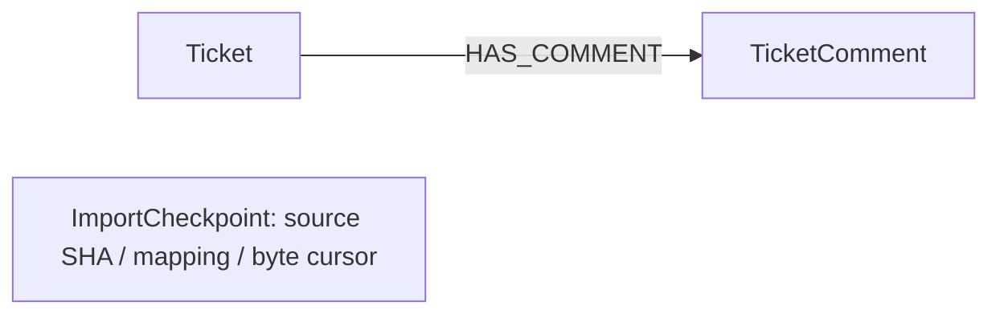

# client ticket/comment shadow integration

This is an executable **synthetic integration contract**, not an approved live
client schema or a production deployment. It implements the October 9–10
workload/fixture slice. The local client starter graph mapping is empty; the
Zendesk connector fragment documents Ticket, TicketComment and HAS_COMMENT.
This example selects those documented concepts and supplies explicit scope and
mapping rules rather than claiming the starter already has a working graph.

Source reference: sibling client repository,
`client-data/services/pipelines/src/connectors/zendesk/ontology_fragment.yaml`.
No production records, credentials or connector endpoints are read by the fixture.

## Supported contract

| Record | Required fields, all explicitly present | Meaning |
| --- | --- | --- |
| Both | record_type, tenant_id, connector_id, external_id | type is ticket/comment; identity components are nonempty strings |
| Ticket | subject, status, priority, tags | Strings/null; tags is a list of strings/null |
| TicketComment | ticket_id, body, is_public | Parent provider ID is a nonempty string; body string/null, visibility Boolean/null |

All internal labels/properties are English. The adapter enumerates authoritative
SET fields: null removes that field and its old scalar index entry; an omitted
required field is rejected, rather than implicitly clearing data. Extra fields
are ignored. IDs are compact JSON tuples `[tenant,connector,kind,external_id]`,
so a provider ID reused in another tenant/connector does not merge its records.
Convert provider numeric identifiers to strings in the source export deliberately.
Tenant-qualified identities are **not authorization**.

The ontology has Ticket equality indexes on status/priority, TicketComment indexes
on ticket_entity_id/is_public, and ImportCheckpoint progress metadata. Each comment
has one immutable parent and a merged `Ticket-[:HAS_COMMENT]->TicketComment` edge.
Ticket parents must already exist, or be in the same batch; tickets are upserted
before comments. Missing parents, reparenting and conflicting duplicate parents
fail the entire current batch. Replayed duplicate comments do not duplicate edges.
These checks assume adapter-managed records and do not repair externally changed
or corrupted edges. Requester/assignee/company relationships are not implemented.



`ImportCheckpoint` stores import progress; it is not a ticket relation or ticket
history. Duplicate input IDs within a batch use the last explicit property values;
conflicting comment parents are rejected even when both tickets exist.

## Resume and source ordering

The adapter reuses the existing bounded immutable-JSONL importer. SHA256,
`next_offset` and `contract_id=client-zendesk-snapshot-v1` bind the logical source
ID to both content and mapping. Data, comment links and progress share a transaction.
Completed replay performs no writes. Mapping/digest mismatch fails even at EOF.
Older customer checkpoints without contract_id remain valid only for the unchanged
default Customer example. Changing a mapping requires a new versioned contract;
changing its name is not a schema migration.

Use a **new source ID for each new immutable snapshot revision**. A new snapshot
can update existing source-qualified nodes, but absent records are not deleted.
Apply overlapping snapshots **chronologically and serially per tenant/connector**:
finish or deliberately abandon an older partial run before applying the next.
There is no lease, source-version arbitration or protection against resuming an
older snapshot after newer data. Run one importer per source ID.

Default input bounds: 250 rows, 1 MiB batch bytes, 64 KiB per line. These are input
limits, not RSS limits: JSON decoding, normalization and query buffers also use
memory. Earlier successful batches survive later malformed/oversized rows; a
failed batch does not advance its cursor. Allocator reservations can still advance
the durable store counter on rollback, so that counter is not the source cursor.
Input must remain immutable; stat checks catch ordinary edits, not adversarial
replacement. Source hashing reads the complete file on every resumed invocation.

## Run a local synthetic graph

From the Brainwire repository root, choose an unused loopback port and fresh
storage/file paths. For this unprotected example use an isolated local test. The server now also
supports [protected service-token connections](bolt-auth.md); shared deployment
still requires the transport and operational gates.
The [protected Bolt checklist](beta-auth-checklist.md) records the next dependency.

```sh
cargo build --release --locked --offline -p brainwire-server --bin brainwire
export BRAINWIRE_SERVER_DATA_DIR=/tmp/brainwire-client-shadow
export BRAINWIRE_SERVER_DEFAULT_DATABASE=client-shadow
export BRAINWIRE_SERVER_LISTEN=127.0.0.1:17687
export BRAINWIRE_MEMORY_CACHE=64MiB
export BRAINWIRE_MEMORY_MEMTABLES=16MiB
export BRAINWIRE_MEMORY_QUERY=64MiB
./target/release/brainwire db create client-shadow --ontology examples/client/ontology.json
./target/release/brainwire serve
```

In another terminal, still from the repository root:

```sh
python3 -m examples.client.generate_fixture /tmp/brainwire-client-tickets.jsonl --tickets 10000
uv run --no-project --with neo4j==5.28.6 python -m examples.client.ingest_snapshot \
  /tmp/brainwire-client-tickets.jsonl --database client-shadow \
  --uri bolt://127.0.0.1:17687 --source-id zendesk-synthetic-snapshot-001 \
  --batch-size 250 --batch-bytes 1048576 --line-bytes 65536
```

The generator refuses to overwrite an existing file. The module invocation is
required because the adapter imports the shared example from the repository root.
The 10K generator emits 10K tickets, 20K comments and repeated provider IDs in two
synthetic tenants, with 1KiB comment text. It prints expected counts as a manifest.

Queries through Python/Bolt (the CLI must not open the running server's directory):

```cypher
MATCH (t:Ticket {status:'open'}) RETURN count(*) AS openTickets
MATCH (t:Ticket {priority:'high'}) RETURN t.entity_id, t.subject LIMIT 20
MATCH (t:Ticket {entity_id:$ticket_id})-[:HAS_COMMENT]->(c:TicketComment)
RETURN c.external_id, c.body, c.is_public LIMIT 20
MATCH (s:ImportCheckpoint {entity_id:$source_id})
RETURN s.sha256, s.next_offset, s.contract_id
```

Stop the server, then in its original terminal/environment inspect real data:

```sh
./target/release/brainwire db check client-shadow --json
./target/release/brainwire shell --overview --graph client-shadow --view ontology
./target/release/brainwire shell --overview --graph client-shadow --view query
```

Ontology and pipeline show real schema/index state; this task does not add a live
TUI import-job editor or connected query UI. Existing EN/PT-BR display and selected
Observatory identity are unchanged.

## Automated local acceptance

```sh
python3 -m unittest discover -s examples/python -p test_resumable_customers.py
python3 -m unittest discover -s examples/client -p 'test_*.py'
uv run --no-project --with neo4j==5.28.6 python \
  docs/benchmarks/2026-10-10-client/acceptance.py --tickets 10000
```

The harness creates disposable graphs, verifies exact nodes/links/index answers,
replay, contract mismatch, update/null behavior, parent failures, batch rollback,
SIGKILL with pending data/cursor, reopen and fresh checkpoint restore/resume. It
always stops its server and removes temporary storage. See the
[acceptance evidence](benchmarks/2026-10-10-client.md) for actual run sizes and limits.

This is snapshot input preparation for a future DuckLake bridge. It does not read
DuckLake/DuckDB/Parquet/Delta directly, resolve cross-source customers, propagate
source deletes, store ticket history or provide ANN, Raft or shared-environment
security. The next planned slice is authentication and graph-scoped authorization.
