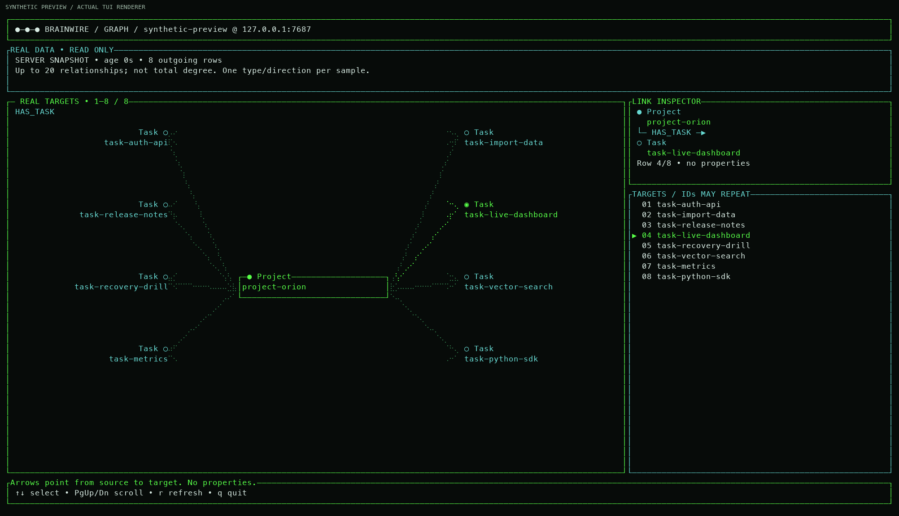

# Inspect a running graph in the connected workspace

The connected TUI reads a running Brainwire server over Bolt. It has four panes:
**Ontology, Memory, Indexes and Graph**. It never opens the server's RocksDB files.
The workspace is read-only; use Python or the CLI to write data.

## Open the workspace

After starting the [Docker demo](container.md#start-a-local-demo-with-one-command), use either a
locally built binary:

```sh
./target/release/brainwire shell --connect 127.0.0.1:7687 --graph demo
```

or the binary inside its running container:

```sh
docker compose -p brainwire-demo -f deploy/compose.demo.yaml \
  exec brainwire brainwire shell --connect 127.0.0.1:7687 --graph demo
```

| Key | Action |
| --- | --- |
| `Tab` / `Shift+Tab`, `←` / `→`, or `1`–`4` | Switch panes |
| Up/Down, `PgUp` / `PgDn` | Move/scroll the current selection |
| `Home` / `End` | Select the first/last relationship in Graph |
| `r` | Refresh the active pane |
| `?` or `F1` | Open help (`F1` opens the selected type details in Ontology) |
| `s` | Inspect one standalone identified request |
| `q` | Exit |

The view bar names all four panes and marks the current one, including on
compact terminals. Add `--lang pt-BR` for Portuguese. Each pane loads on its
first visit and shows its sample age. There is no automatic polling. A denied
Memory view does not prevent you from using authorized Ontology, Indexes or
Graph views.

## Inspect one request outcome

In the connected workspace, press `s`, enter the request ID and press Enter.
Esc closes the inspector. This is a single read, not a list of jobs or a
live ingestion monitor. It uses the configured Bolt identity and selected graph.

The inspector is for the authenticated, experimental standalone request ledger.
`committed` refers to the current store history; `not_recorded` is inconclusive
and does not authorize replay. On a quorum deployment, use the separate
`brainwire cluster request --id <effective-key>` contract instead. Status
lookups can be denied by server permissions or configuration. See
[standalone request outcomes](standalone-requests.md).

## Select a graph neighborhood

Populate the demo using the [README Python example](../README.md#write-from-python),
then select one source and one outgoing relationship signature:

```sh
./target/release/brainwire shell --connect 127.0.0.1:7687 --graph demo \
  --node-label Customer --entity-id customer-1 \
  --edge-type IN_SEGMENT --target-label Segment
```

The Graph pane uses those four flags for the whole terminal session. Omitting
them leaves the other panes usable; Graph shows an explanation of the missing
selection. Selecting a row does not expand it or change the source.



This preview uses synthetic data rendered by the real TUI widgets. It is not a
capture from a live database. In a connected session, every displayed link comes
from the completed server sample.

The server ontology is checked first. The source existence and outgoing targets
are then read in one transaction. At most **20 relationship rows** are kept; a
21st row is used only to decide whether to show MORE AVAILABLE. This is not full
graph degree, arbitrary graph exploration or a count of distinct neighbors.
Parallel relationships may repeat a target. The drawing groups duplicates and
preserves self-links; the list retains each sampled relationship row. The
relationship count and distinct target IDs refer to the sample, not global
graph degree. The selected position is shown within that sample.

A missing source is displayed as missing. A source with no rows for the selected
signature may still have other links. The view reads identity strings, not
arbitrary node/edge properties. Type names must be 1–128-byte ASCII identifiers;
entity IDs are nonempty strings up to 1,024 bytes and are passed as parameters.

## Connect to a protected server

The address is numeric `IP:PORT`, such as `127.0.0.1:7687` or `[::1]:7687`.
It is not a Bolt URL or DNS name. Select a private credential file:

```sh
export BRAINWIRE_BOLT_AUTH_FILE=/private/path/observer.json
./target/release/brainwire shell --connect 127.0.0.1:7687 --graph demo
```

See [protected Bolt connections](bolt-auth.md) for the file format. To create a
new synthetic policy with a telemetry observer:

```sh
python3 -m examples.python.create_service_tokens /private/path/auth \
  --graph demo --include-observer
```

The generator does not print tokens or overwrite an existing directory. The
server must use the matching generated policy. Ordinary graph readers/writers
do not gain telemetry access from possessing a graph grant.

Native TUI traffic is plaintext Bolt. Keep it on trusted loopback or the trusted
side of an encrypted tunnel. The [optional TLS proxy](protected-transport.md)
is qualified for Python clients, not native TUI TLS. The connected workspace has
no query editor, graph selector, property editor or import controller.

## Memory values and permissions

Memory fetches `CALL db.memory()` and shows four query-pool counters:

| Counter | Meaning |
| --- | --- |
| LIMIT | `memory.query` budget shared across this server's graphs |
| RESERVED | Accounted reservations now, including the sampling query |
| PEAK | Highest accounted reservation since server startup |
| REJECTIONS | Rejected reservation attempts since startup |

RESERVED also shows its percentage of LIMIT and the remaining unreserved query
budget. This is accounting headroom, not free system memory. If the sample is
missing or the limit is zero, the percentage is shown as unknown.

These values are not process RSS, host RAM, RocksDB cache or memtable usage.
A graph name selects the authorized context; it does not make the pool counters
per-graph. Missing pool telemetry is shown as unknown. Restart resets peak and
rejection counters.

In the standalone `--view memory` screen, press `?` or F1 for a short guide to
these counters, and Esc to close it. `r` refreshes the sample; a failed refresh
keeps the last sample and marks it stale.

The user needs graph read access **and `instance_admin: true`** for this pane.
A normal graph reader can still inspect ontology, indexes and the selected graph
sample. See [memory budgets and diagnostics](memory-defaults.md) for component
budgets and their current limitations.

## Index declarations and readiness

Indexes fetches `CALL db.indexes()` with `label`, `property`, `state` and, on
new servers, `entityType`. It distinguishes node and relationship declarations.
Select and scroll declarations with Up/Down or PgUp/PgDn:

| Server state | Display | Meaning |
| --- | --- | --- |
| `scalar_equality_ready` | READY | A supported node scalar index is ready |
| `scalar_range_ready` | RANGE READY | A relationship index is ready for supported equality and range queries |
| `failed_value_too_large` | VALUE TOO LARGE | A relationship index build stopped; queries continue to scan |
| `populating` | POPULATING | Online backfill has not completed |
| `declared_only` | DECLARED | Declaration exists; queries use scans |

The state is not a percentage or a promise that all property types/predicates
are indexed. Equality and `IN` support scalar strings, Booleans and finite
numbers; supported string ranges and prefixes can also use index candidates.
Numeric node ranges use scans for correctness. Relationship index paths and
format restrictions differ; see [relationship indexes](relationship-property-indexes.md).
See the [node index guide](indexes.md) for its planner rules. Viewing a declaration does not build or modify it.

## Refresh, bounds and failures

Successful refresh replaces the selected pane's data and keeps selection by
identity where possible. Failed refresh preserves the previous sample with its
original age and a STALE label. Initial interactive failures show an error pane
without invented data. An initial snapshot failure exits with an error.

Fetching is synchronous: keys wait until the request returns. `--timeout-ms`
defaults to 3,000 and accepts 1–10,000; it covers connection, authentication,
partial IO and completion. Local scheduling/rendering are not hard realtime.

| Fetch | Bound |
| --- | --- |
| Memory | One row, four nonnegative counters or four nulls, 64 KiB aggregate response |
| Indexes | At most 200 unique label/property rows, 128 KiB aggregate response |
| Graph | At most 20 displayed relationship rows, 128 KiB for existence/neighborhood transaction plus a separate bounded schema precheck |

Malformed, oversized, duplicate or incomplete responses fail instead of being
shown as a complete sample. Display strings are escaped and bounded. These wire
caps are not heap/RSS limits and do not make the server executor fully streaming.

## Snapshots and other views

```sh
./target/release/brainwire shell --connect 127.0.0.1:7687 --graph demo \
  --view memory --snapshot --width 120 --height 30
./target/release/brainwire shell --connect 127.0.0.1:7687 --graph demo \
  --view indexes --lang pt-BR
```

Use `--view graph` with the four selection flags for a neighborhood snapshot.
The connected default `--view workspace` snapshot captures Ontology. Plain
snapshots accept 80–240 columns and 24–80 rows; `NO_COLOR` removes color.

See [connected ontology](connected-ontology.md) for the schema contract,
[connection limits](connection-limits.md) for Python pool reuse, and
[TUI modes](tui-demo.md) for the separate synthetic and offline inspectors.
The [dated terminal capture report](../benchmarks/archive/design-assets/2026-10-13-beta/README.md)
records a specific older 100,000-node synthetic run, not a current capacity claim.
