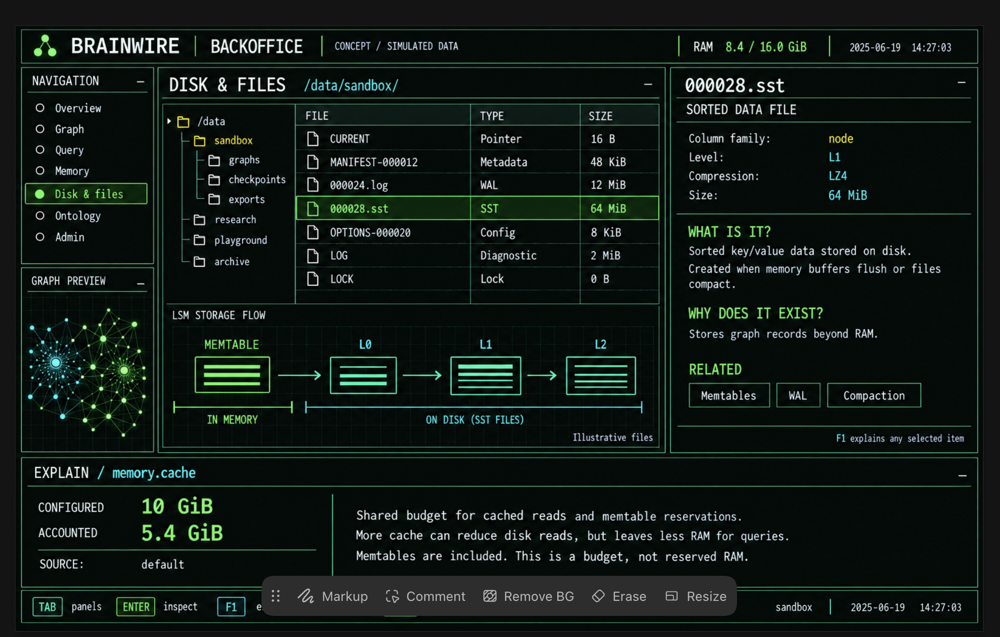
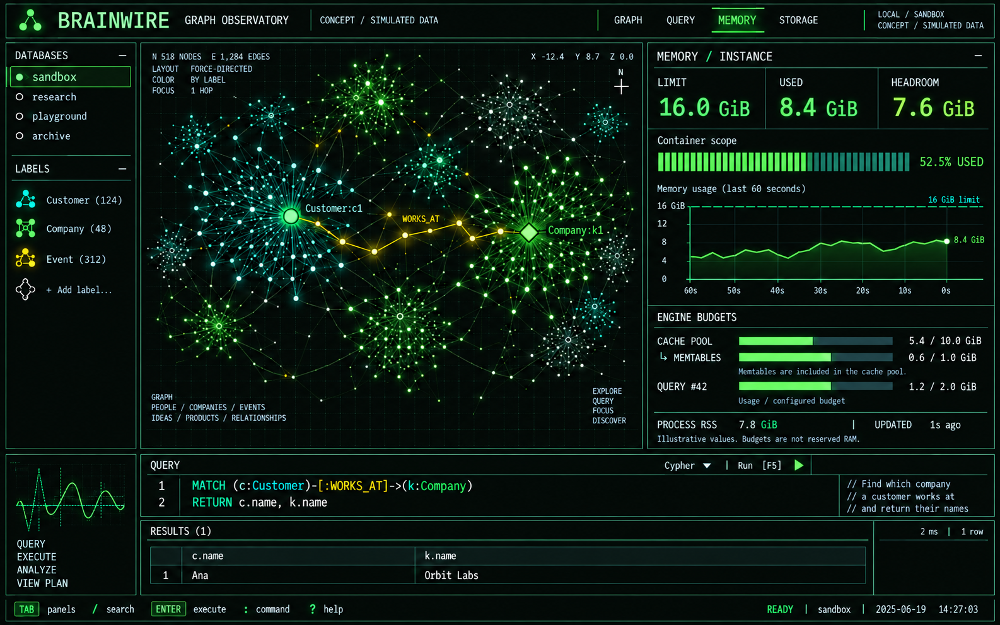
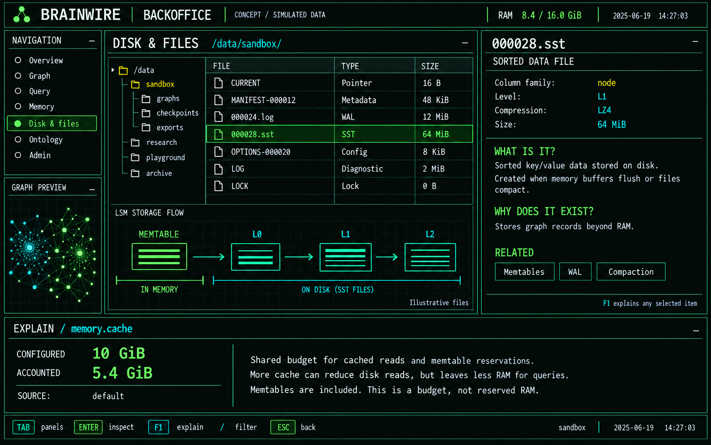

# Brainwire Observatory: terminal backoffice

Status: visual identity selected by Allan on 2026-09-26. The interactive
[terminal demo](../tui-demo.md) now implements Graph, guided Query examples,
Memory and Disk & Files with synthetic data, including a Braille graph canvas,
explained memory cards and the folder/file/LSM backoffice composition. Connected behavior, live telemetry
and the broader interactions below remain a design proposal. The user requested
planning around the generated concept, both graph exploration and Cypher in the first prototype, a cyberpunk
palette and logo (then preferred a stronger green with restrained cyan), an
understandable memory panel, and a backoffice for files
and storage. Numerical budgets below are initial design targets to validate.

This refines [approved design section 4.3](../superpowers/specs/2026-09-24-brainwire-design.md#43-cli-and-tui).
After the demo, the [engine MVP](../superpowers/plans/2026-09-26-brainwire-mvp.md)
continues with real Bolt transactions and `serve`. The atomic executor and
separate embedded [`brainwire cypher` command](../local-cypher.md) are implemented.

## 1. Product experience

`brainwire shell` should answer four questions in one workspace:

1. What is connected to this entity?
2. What does my query return, and where are those entities in the graph?
3. How much memory can the instance use, where is it going, and what do its
   settings actually mean?
4. What is stored on disk, why do those files exist, and how does the storage
   engine turn writes into durable graph data?

The first prototype includes Graph, Query, Memory and Disk & Files with a
shared inspector and contextual explanations. It uses an explicitly labeled
synthetic scenario. A connected release requires the real backend contracts
below; a mock response is never presented as live query execution or telemetry.

## 2. Selected visual identity

Allan explicitly chose the latest green identity on 2026-09-26. The green v2
memory and backoffice images below, together with the green B/W logo, are the
canonical visual references for future Brainwire screens and brand assets.
Earlier mint and magenta concepts are retained only as exploration history.
Implementation refinements should preserve this identity.

During the demo implementation on 2026-09-26, Allan sent the backoffice image
again and explicitly asked that it not be forgotten. The exact uploaded image
is preserved as the **primary backoffice composition reference** below. Keep
its strong green focus, restrained cyan, dense panel hierarchy, folder/file
browser, graph mini-preview, LSM flow, right-hand file explanation and bottom
memory explanation. The external image-editor toolbar in the screenshot is
not part of Brainwire. The clean green-v2 concept remains useful for details
obscured by that toolbar. A functional demo is an intermediate step, not a
replacement for this visual target.

| Token | Color | Role |
|---|---|---|
| Background | `#070B09` | Near-black graphite canvas |
| Primary | `#57FF48` | Strong electric green focus and activity |
| Secondary | `#57CBD0` | Restrained cyan details and complementary nodes |
| Highlight | `#E8BD58` | Sparse amber traversal or warning accent |
| Text | `#E9F2EC` | Main labels and values |

Use sharp panel boundaries, monospaced typography, fine graph lines, and
sparse animated accents. Color identifies graph types, while shape, labels
and selection markers keep meaning available without color. Honor ontology
`display_color` with contrast handling. Warnings also carry words and icons.
The selected identity uses strong green with restrained cyan.
Remove glitch effects, rainbow accents and glowing panel borders. Keep the
graph character through geometry and interaction. Stop animation when it settles.
Glowing pixels in the concept are art direction, not a promise of identical
rendering in every terminal.

The [logo concept](assets/brainwire-logo-green-concept-v2.png) combines
interwoven B/W wiring with three junctions. The spelling remains BRAINWIRE.
The logo direction is selected. This transparent raster is the reference for
a clean vector master, monochrome mark, and small terminal glyph. Verify
legibility at small sizes before shipping those production assets, preserving
the chosen mark and palette. Generation prompts and
provenance are in [image-prompts.md](image-prompts.md).

## 3. Workspace and navigation

| Area | Behavior |
|---|---|
| Header | Connection, database, mode (demo/live), compact memory status, sample age |
| Navigation | Overview, Graph, Query, Memory, Disk & Files, Ontology, Admin |
| Graph | Bounded neighborhood, selection, expansion, pinning and path highlights |
| Query | Editor, parameters, execution status, result table and graph selection |
| Inspector | Selected node, edge, file, metric or setting, with explanations |
| Explanation drawer | What it means, scope, source, implications and related concepts |
| Footer | Shortcuts for the currently focused panel |

At approximately 160x48 cells show the full composition. At 120x36 collapse
the navigation and toggle the inspector. At 80x24 show one panel at a time,
preserving editor contents, selection and back navigation. Do not require a
mouse or special icon font. Large graph text labels prioritize selected nodes.

`Tab` changes panel; arrows navigate; `Enter` inspects or expands the selected
item; `/` searches within the focused view; `F1` explains the selection;
`F5` runs the editor query; `Esc` closes a drawer or returns; `:` opens the
command palette. Inside the editor, Enter inserts a newline and characters
remain text. Shortcuts must not steal normal typing. Mouse support is optional.

Every user-facing string has pt-BR and English catalog entries, as required by
the approved spec. The images use English as a design reference.

## 4. Graph and query form one workflow

Open a synthetic Customer, expand WORKS_AT, select the Company, inspect its
properties, run a query and highlight the returned nodes. Selecting a node
cell in a result selects that same entity in the graph. Scalar-only results
remain a table; they do not invent relationships.

Retain stable node positions between expansions, pin the chosen anchor and
provide back/forward exploration history. Lay out only the visible subgraph.
Initial targets: 200 nodes and 400 edges, one hop per expansion; a hard local
view cap of 1,000 nodes and 2,000 edges. Report truncation and allow filtering
or replacing the neighborhood. These limits describe a view, not total graph
size or proven engine capacity.

Propose up to 30 frames/s only while animating, lower refresh over SSH, and no
continuous redraw when idle. Measure before claiming that target. `--no-anim`
removes motion; `NO_COLOR` and an ASCII/list fallback preserve function.

Graph identities and relationship endpoints come from backend records.
The planned MVP output currently covers scalar values and nodes, not general
relationship/path values. A connected explorer therefore needs a bounded
neighborhood result contract or explicit relationship output support. Do not
infer edges merely because two nodes appeared in the same query row.

Syntax support follows the engine. Query errors show a location when provided.
Large results need server cursors and bounded work: adding LIMIT in a client
does not fix an eagerly materialized scan. Cancellation is shown as confirmed
only after the backend acknowledges it; never automatically retry a write
whose commit outcome is unknown after a disconnect.

## 5. Memory must explain its numbers

The top memory panel separates three concepts: operating-system limits,
configured component budgets, and measured consumption. A configured budget
is not RAM already allocated or reserved. The server is the measured machine;
the local TUI process is a separate scope.

Illustrative container: limit 16.0 GiB, used 8.4 GiB, arithmetic headroom
7.6 GiB, utilization 52.5%. Show all four from the same sampled scope. Keep
process RSS (for example 7.8 GiB) separate. Do not add RSS, cache and container
usage together. Headroom is not a guarantee that an allocation will succeed.

Linux cgroup v2 exposes current usage and a limit, but hierarchical limits and
shared ancestors need scope-aware handling. Name the observed cgroup and
report inaccessible ancestors rather than inventing an effective limit. An
unlimited or unknown value has no percentage gauge. Host physical RAM and
available RAM appear separately. Native macOS development gets available OS
metrics and an explicit "no container limit detected" state, not a fabricated
16 GiB allocation. [Linux cgroup documentation](https://docs.kernel.org/admin-guide/cgroup-v2.html)

| Field | Plain-language explanation | Current repository status |
|---|---|---|
| Container limit | Maximum usage allowed for the observed container/cgroup scope | Collector and API planned |
| Container used | Memory charged to that scope, including more than the database process | Collector and API planned |
| Process RSS | Physical memory resident for the server process | Collector and API planned |
| `memory.cache` | Shared cache budget for read blocks and memtable accounting reservations | Configured, default 10 GiB; store resource exists |
| `memory.memtables` | Shared write-buffer target before data is flushed into disk tables | Configured, default 1 GiB, charged inside the cache budget |
| `memory.query` | Intended execution-memory ceiling; consumes memory outside the cache pool | Configured, default 2 GiB; executor enforcement not implemented |

Memtable reservations in the cache and actual memtable allocation are related
but not identical counters. Reservations can lag a decrease in allocation.
Show "cache accounted" and "memtables allocated" separately, with an inclusion
note; do not double-count them or promise a perfect breakdown of RSS.
RocksDB has other memory consumers beyond these two budgets.
[Write Buffer Manager](https://github.com/facebook/rocksdb/wiki/Write-Buffer-Manager),
[RocksDB memory usage](https://github.com/facebook/rocksdb/wiki/Memory-usage-in-RocksDB).

The original spec describes both a per-query ceiling and a total execution
budget. Before connected memory controls, resolve global query admission and
per-query enforcement explicitly. Showing 2 GiB for every concurrent query
must not imply their sum stays within 2 GiB. Until then, use the actual setting
scope and show enforcement as unavailable; do not silently redefine the key.

## 6. Explain any setting without leaving the task

Each setting has a descriptor shared by `config show --explain`, the proposed
`config explain <key>` command and the TUI F1 drawer. Those commands are
proposals, not current CLI capabilities.

The descriptor contains a localized name, short explanation, units, scope,
configured value and source (default/file/environment), measured value and
timestamp when available, enforcement status, effects of increasing or
decreasing the value, validation rules and related settings. Configuration
provenance already exists in `config.rs`; extend it rather than duplicate it.

Example text for `memory.cache`:

> Shared budget for cached reads and memtable reservations. More cache can
> reduce disk reads, but leaves less RAM for queries and other work. The
> memtable budget is included here. This is a budget, not reserved RAM.

Example text for `memory.memtables`: buffers recent writes in memory before
flushing to SST files; increasing the target can change flush frequency and
reduce room for cached reads. A flush writes data to disk; a transaction need
not wait for that flush to be durable when its WAL commit was synced.

Example text for `memory.query`: intended limit on temporary query work such
as bindings and intermediate results. More room can allow larger operations,
but competes with other work. Display the implemented scope and enforcement
status, not just the configured number.

The first connected view explains and inspects. Editing budgets later needs
an explicit supported configuration operation, validation, a before/after
preview, and an accurate indication of whether restart is required.

## 7. Disk & Files is an engine-aware explorer

Start with the selected database's data directory. Show a paginated file list,
type, byte size, modification time and sample timestamp. Select an item to
learn what it does, how it relates to graph data and what created it.

| File | Explanation |
|---|---|
| `*.sst` | Sorted key/value tables created by flush or compaction; inspect column family, level and compression when metadata exposes them |
| Numbered `*.log` | Write-ahead log used to recover writes not yet represented in flushed tables |
| `MANIFEST-*` | Record of storage version and file-set changes |
| `CURRENT` | Identifies the active manifest |
| `OPTIONS-*` | Persisted RocksDB options; distinguish these from Brainwire TOML configuration |
| `LOG` | Human-readable engine diagnostics; separate from the numbered WAL files |
| `LOCK` | Database ownership/locking file; its presence alone does not prove an active owner |

The distinction between MANIFEST and CURRENT follows
[RocksDB's manifest model](https://github.com/facebook/rocksdb/wiki/MANIFEST);
the options inspector follows the
[RocksDB options-file documentation](https://github.com/facebook/rocksdb/wiki/RocksDB-Options-File).

Provide a second, logical view: `node`, `pk`, `out`, `in`, `meta` and the other
column families, each with a plain-language purpose. A column family is not
necessarily a directory. Join file metadata to a column family from engine
metadata, never infer it from the filename. LSM level names describe storage
organization, not graph traversal depth. File key counts can include obsolete
versions and tombstones; do not label them as live node counts.

Draw a simple lifecycle: writes enter memory and the WAL; flush produces SSTs;
compaction reorganizes SSTs. Let the user follow Memtables -> Files -> Levels.
The [WAL documentation](https://github.com/facebook/rocksdb/wiki/Write-Ahead-Log-%28WAL%29)
describes the recovery role and the shared log across column families.
Show both database file usage and filesystem free space with their scopes.
Do not compute bytes per live entity from inconsistent approximate counters.

The explorer is initially read-only and metadata-first. It does not expose
arbitrary server paths, edit SSTs or delete engine files. File previews are
bounded; binary files get structured metadata rather than text decoding.
Any future record inspection must honor graph visibility rules. File access
requires the admin capability on a connected server. Compaction can replace
files during inspection, so a missing file becomes "no longer in snapshot"
with refresh, not a crashed screen. Raw text is escaped for terminal controls.

## 8. Client architecture and backend gaps

Keep one `brainwire` command surface. Add a `brainwire-tui` crate for terminal
state, graph layout, views, theme, input and explanation catalogs. The TUI is
a client of Bolt for queries and an admin API for metrics/storage inspection,
matching the approved spec. It must not open the live RocksDB directory next
to the running server. The same services support future noninteractive CLI
commands and an eventual web backoffice.

Ratatui provides tables, charts and a Canvas whose braille grid can draw nodes
and links; use Crossterm for keyboard, optional mouse and resize events.
High-resolution image rendering is an optional second renderer with explicit
capability checks and fallback. Pin compatible versions during implementation.
[Ratatui Canvas](https://docs.rs/ratatui/latest/ratatui/widgets/canvas/struct.Canvas.html),
[Crossterm events](https://docs.rs/crossterm/latest/crossterm/event/index.html),
[kitty graphics protocol](https://sw.kovidgoyal.net/kitty/graphics-protocol/).

Use one application state and event reducer, bounded worker channels and
request identities. Network work, disk inspection and layout calculation must
not block input/rendering. Ignore stale responses after a database switch.
Restore terminal mode, cursor and mouse state on normal exit and failure.

Backend contracts still needed:

- Server capabilities and supported query features.
- Bounded neighborhood pages with stable entity/edge identities and an
  explicit partial-result marker; no ACL bypass through counts or metadata.
- Query cursor lifecycle, cancellation and real transaction semantics.
- Timestamped memory samples with units, scope, source and unavailable states.
- Paginated storage inventory and file detail for authorized database roots.
- Consistent config descriptors and provenance for explanations.

An empty sample is not zero; old data is marked stale. Shared cache and write
buffer resources are counted once per instance, not once per database.

## 9. Delivery sequence and acceptance

These are slices of the same backoffice, not competing Graph/Query prototypes.

| Stage | Deliverable | Exit criteria |
|---|---|---|
| A. Integrated demo | Graph + Query + Memory + Disk, shared inspector, F1 explanations, electric-green theme | Synthetic scenario walks through every view; scalar results never fabricate edges; all samples visibly marked demo |
| B. Core engine prerequisite | Existing MVP Tasks 4 and 5 | Durable execution, real commit/rollback, restart demo and tests pass |
| C. Connected explorer | Real query results, neighborhood contract, graph/table selection | Bounded traversal, error/cancel states and reconnect behavior tested; no mock values in live mode |
| D. Memory and storage telemetry | Shared resource metrics, OS scope, admin file metadata and config explanations | No double-counting; unlimited/stale/unsupported states; disk view survives compaction; access checked |
| E. Operational backoffice | Dashboard, ontology, supported configuration changes, backups and jobs | Every action has an implemented server capability and observable outcome |
| F. Rich exploration | Timeline, notes, algorithms, Ask, cluster view, optional image renderer | Enable each feature only when its backend exists; retain keyboard and text fallback |

Stage A can validate visual interactions without finishing the engine, but
arbitrary Cypher execution in demo mode requires the real executor against an
isolated synthetic database. Before that, a canned scenario must explicitly
identify itself and reject unsupported input rather than pretend to execute
it. That explicitly synthetic behavior is implemented. The atomic executor is
available separately through the local command; Stage B still needs real Bolt
transaction lifecycle and durable server integration.

Before implementation, turn each stage into a task brief with exact API
contracts. Do not treat this design proposal as a completed implementation
plan for protocols that do not exist yet.

## 10. Verification plan

Test focus and typing behavior, graph/result identity, expanded-node caps,
stable positions, resizing, disabled animation, no-color rendering and
terminal restoration. Add snapshots at the proposed terminal sizes and one
manual keyboard-only walkthrough on a normal terminal and over SSH.

Memory contract tests cover included memtable reservations, shared instances,
missing collectors, unlimited limits, ancestor scope, stale samples and
configured-but-unenforced query limits. Disk contract tests cover file type
classification, metadata joins, file replacement during compaction, bounded
pagination and forbidden paths. Integration tests cover rollback, query
failure and disconnection without blind write retries.

Measure UI responsiveness and resource use separately from engine throughput.
The generated pictures are reference artwork; none of their figures are
benchmarks, actual database statistics or commitments about scale.
