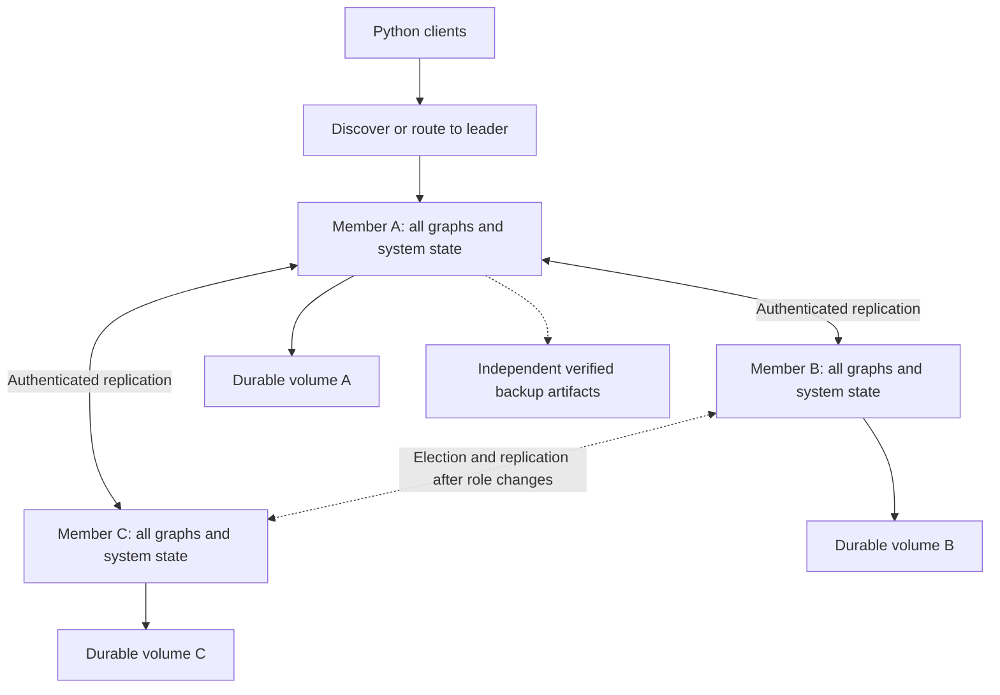

# Distributed capacity and operations concepts

Status: proposed, unimplemented. Companion to the
[consistency concepts](2026-10-12-distributed-concepts.md) and
[failure exercises](2026-10-12-distributed-scenarios.md).
This document explains costs and operational boundaries; it is neither a
performance measurement nor a deployable cluster configuration.

The [deployment companion](2026-10-12-distributed-deployment.md) maps members to
Pods/tasks, hosts and volumes, and separates client balancing from peer discovery.

## The first topology

The approved direction starts with one consensus group replicating the entire
Brainwire instance. A, B and C each retain every named graph plus system state.
They run on independent machines, with independently durable volumes. One is
leader; leadership can move through the consensus protocol.

The arrows illustrate possible roles, not a permanent leader assignment. Backup
capture can eventually be performed by an eligible member at a consistent
published prefix; uploads must not consume the only healthy quorum's capacity.

Three full copies buy tolerance of one unavailable voter under the supported
failure assumptions. They do not divide graph size by three. Read distribution
is possible only under an explicit consistency and authorization contract;
writes still enter the same ordered history.

### Member count versus zone survival

Under a simplified fixed membership with usable independent storage/network,
placement matters as much as member count:

| Voters across three zones | Majority | Loss of any single zone retains a majority? |
| --- | --- | --- |
| 1 / 1 / 1 | 2 | Yes, two voters remain |
| 2 / 1 / 0 | 2 | No, loss of the two-member zone leaves one |
| 2 / 2 / 1 | 3 | Yes, at least three voters remain |
| 3 / 1 / 1 | 3 | No, loss of the three-member zone leaves two |

This table does not model shared region-wide dependencies or a second failure
while degraded. A placement label is useful only when it reflects the real
failure domain. It also does not change majority rules during a membership
transition, where the selected protocol may require old and new quorums.

The same arithmetic applies to regions, but a zone is not necessarily a region.
Putting three voters across only two regions as 2 / 1 cannot preserve a majority
after loss of either region: losing the two-voter region leaves one. Adding
voters without changing that concentration does not automatically fix the
regional failure model. A 2 / 2 / 1 placement across three regions retains a
fixed majority after one region is lost, under the table's assumptions, but its
network latency and common dependencies still require evaluation.

There is a latency tradeoff, not a free resilience setting. If a write quorum
requires a remote region, its confirmation path depends on that region's
network and durable storage. If a majority resides entirely in one region,
losing that region removes quorum. A fixed placement designed to retain a
majority after losing any one region necessarily requires cross-region write
quorums even during healthy operation. Losing a fast follower, while retaining
a majority, can also change which network/disk path determines confirmation
time. The first external application trial should state whether it tests
process, host, zone or region failure rather than calling all of them HA.

## Where confirmation time goes

For the candidate durable-apply contract, the final successful Python write confirmation follows:

1. Admission, authentication, query execution and transaction validation against published state
   and pending proposals.
2. Durable consensus logging and the protocol's commit decision.
3. Ordered application into the target graph and its replay marker.
4. Durable advancement of system state, then publication of matching runtime
   state and release of the result.
5. Transport of the response to the client.

A useful conceptual accounting is:

`final commit time = queue + execute/validate + durable commit + apply/publication + transport`

Here confirmation means final COMMIT success or successful completion of an
implicit write, not an earlier Bolt RUN success or streamed row. An explicit
transaction can return provisional query results before it commits; its
reservation/identifier contract still applies. Query work performed in earlier
RUN requests must be accounted for separately when measuring a whole transaction.

This is not a formula for adding independently measured percentiles. Components
can overlap; disk contention and batching affect several stages together. The
proposal has not yet been benchmarked. The durable-commit stage must obey the
selected consensus library's rules, including election/log identity; counting
copies of any arbitrary old entry is not a substitute for those rules.

In a healthy three-voter group, leader plus one eligible follower can constitute
a majority. The third member need not finish first for every write. Once the
fast follower fails, the remaining follower's network and storage may dominate
confirmation time. Capacity and latency must therefore be measured in both the
healthy and one-member-unavailable topology.

Network transit and durable disk operations impose real constraints. etcd's
[performance discussion](https://etcd.io/docs/v3.6/op-guide/performance/) provides
a concrete explanation of those constraints and batching. Its benchmark figures
are not predictions for Brainwire's graph mutation and apply pipeline.

OpenRaft distinguishes accepting readable log entries from reporting that they
have reached durable storage. A memory append is not enough to satisfy the
persistence callback. See its
[log storage contract](https://docs.rs/openraft/latest/openraft/storage/trait.RaftLogStorage.html).
A proposed adapter must not acknowledge durable replication early to improve
reported latency.

## Four different kinds of delay

| Delay | Meaning | Consequence |
| --- | --- | --- |
| Client admission queue | Work waiting before proposal | Added latency; can reject work before acceptance |
| Follower replication delay | Missing durable log suffix | Less redundancy; may need snapshot transfer |
| State-machine apply delay | Committed entries not yet published locally | Strong/bookmark reads wait; a leader may commit ahead of visible state |
| Derived-index delay | Search or analytical projection behind graph state | Requires explicit search readiness and visibility rules |

Positions are meaningful only within the appropriate recovery lineage and
membership context. Subtracting two entry indices gives entries, not bytes or
seconds. A small entry gap can contain a large vector batch; a large gap can
contain tiny updates. Display positions together with retained bytes, delay
observations and sample time.

A node can be healthy at receiving the log and slow at applying it. Increasing
network bandwidth will not fix a RocksDB compaction bottleneck. Conversely, fast
local apply cannot reconstruct entries a disconnected member never received.

## Bound admission before optimizing concurrency

The simplest proposal-aware validation contract serializes validation through
publication. It is easier to reason about but can restrict write throughput.
It also means a slow committed mutation in one named graph can delay later
mutations for other graphs in this whole-instance group.

Bound queues by bytes as well as item count. Reject or wait under a documented
admission deadline before creating uncontrolled staged work. Once consensus
has committed a command, a client timeout cannot turn it into an aborted
transaction; the client may need to resolve an unknown result. A server must not
skip a committed command because a local apply queue is full.

Later optimizations could pipeline proposals using reservations for pending
conflicts, or batch durable operations. They need a correctness model first.
Grouping unrelated graph entries across separate RocksDB instances changes the
recovery boundaries and is not an automatic extension of the single-entry
publication protocol.

For fairness, candidate admission budgets could separate interactive writes,
Python imports and maintenance before proposal. Fairness cannot reorder an
already committed prefix. Maintenance therefore needs small bounded commands;
a large committed cleanup can delay ordinary work even if it arrived through a
low-priority queue.

### Alternatives if that bottleneck becomes material

These are design comparisons, not selected changes to the approved boundary:

| Shape | Benefit | Cost or missing contract |
| --- | --- | --- |
| Separate graph RocksDBs, one instance Raft group and apply lane | Reuses today's graph stores; one global ordered history | Graph/system publication protocol, extra persistence and shared apply/snapshot delays |
| One physical RocksDB, one instance Raft group | A batch could include graph and system metadata atomically | Format migration and logical graph isolation; shared compaction pressure; consensus durability remains necessary |
| Separate Raft groups for graphs | Independent histories and potential apply concurrency | More memberships/leaders; global registry/policy and instance backup cuts need coordination; cross-group work is not automatically atomic |

Per-graph groups would not by themselves partition a very large individual
graph. Nor does one physical store automatically allow Cypher transactions
across graphs. Choose based on measured requirements and a verified recovery
contract, rather than changing topology to hide a slow-path benchmark.

## Python batches and source ordering

Batch size must consider encoded mutation bytes, indexes, mirrored adjacency,
history, cursor metadata and response size. Counting source rows alone does not
bound memory, log entries or apply time. Document vectors may dominate payload
size even when their node count is modest.

A useful future ingestion contract retains a pinned source identity, mapping
version and graph incarnation. The source cursor moves atomically with the
corresponding graph mutations. Retries use the original request context; they
must not silently target a recreated graph or a new disaster-recovery lineage.

For incremental input, distinguish extraction progress from graph application
progress. Two import workers sharing a source cannot independently advance a
single cursor without an ownership/concurrency contract. Source versions require
ordering or explicit per-record version arbitration. A later snapshot must not
be overwritten by a late retry of an earlier snapshot.

Arrow can reduce conversion/copy overhead at a data boundary. It does not supply
source ordering, consensus, durable cursor updates or retry deduplication. The
DuckLake/Arrow bridge remains a separate engineering task; no new importer is
implemented in this conceptual session.

## Memory and storage are per member

Each member needs capacity for the full authoritative data set. Replication also
needs log buffers, pending proposals, transfers and recovery workspace. Query
budgets, RocksDB caches, memtables, operating-system cache and allocator/runtime
overhead consume different parts of process/host memory. Existing query guards
do not automatically account for future replication buffers.

An arithmetic example, not a benchmark: one million raw 768-dimensional float32
vectors occupy 3,072,000,000 bytes. Three full copies occupy 9,216,000,000 bytes
before metadata, graph edges, indexes, history, logs and backups. This says
nothing about actual on-disk compression or ANN index expansion.

A disk budget must cover live SST files, local WAL, consensus logs, retained
history, compaction workspace and snapshot/installation generations. Old and new
snapshot generations may coexist during safe installation. An object-storage
backup does not remove this local headroom requirement.

RocksDB can slow or stop writes when flush/compaction falls behind; a condition
triggered by one column family affects its entire RocksDB instance. See
[write stalls](https://github.com/facebook/rocksdb/wiki/Write-Stalls). In the
candidate ordered apply lane, a stalled graph database can also delay later
entries for other graph databases. This second effect is a consequence of the
Brainwire proposal, not an assertion that separate RocksDB instances share all
internal stall state.

## Recovery has its own capacity budget

A recovering member competes with live requests for disk, CPU and network.
Snapshot transfer can move most bytes; applying the later log suffix can still
be the bottleneck. Capture a consistent prefix briefly, then transfer immutable
captured artifacts without holding the application barrier for the whole upload.

For a simplified constant-rate model, let backlog be B, incoming committed bytes
per second be r, and effective catch-up bytes per second be c. If c exceeds r,
ideal catch-up time is B / (c - r). If c does not exceed r, that model never
catches up while the workload continues. This assumes comparable work/byte and
excludes transfer setup, snapshot installation, variable command costs and
compaction; real recovery must be measured.

Log retention also has a cost: 5 MiB/s for a hypothetical 30-minute outage is
9,000 MiB of incoming log data before compression and overhead. These rates are
illustrative, not a Brainwire measurement. When retention no longer covers a
follower, it needs a compatible snapshot plus suffix. Logs cannot be discarded
merely to free disk if no recoverable published snapshot covers them.

Replacement starts with a non-voting learner, then uses the selected protocol's
membership transition after catch-up. A learner adds transfer load but does not
immediately add a vote. See
[OpenRaft membership changes](https://docs.rs/openraft/latest/openraft/docs/cluster_control/dynamic_membership/index.html).
Do not casually promote an empty member or replace two voters together.

### A membership transition is not an ordinary replica count

Consider replacing C in voters {A, B, C} with a caught-up D. During a joint
configuration {A, B, C} plus {A, B, D}, a usable quorum needs a majority of both
configurations, as enforced by the consensus library. Assuming all other
protocol conditions hold:

| Available members | Old majority | New majority | Joint quorum |
| --- | --- | --- | --- |
| A, B | Yes | Yes | Yes |
| A, C | Yes | No | No |
| A, D | No | Yes | No |
| A, C, D | Yes | Yes | Yes |

While the effective configuration is joint, both majorities are required.
OpenRaft controls when the uniform configuration becomes effective and how it
is committed; operators must not derive the active quorum from the desired
configuration alone. Once uniform {A, B, D} is effective, A and D can constitute
its majority under the protocol's requirements. Catch-up and safe completion of
the transition restore the intended fault margin; a started replacement does
not establish it. This is an illustration of membership semantics, not an
implementation recipe replacing OpenRaft's membership API.

## Kubernetes and Swarm: avoid false assurances

Three containers on one machine are useful for exercising process failures,
but cannot demonstrate survival of that machine's loss. Failure-domain claims
must include the actual disk/storage backend and shared dependencies, not just
pod or service counts.

Kubernetes ReadWriteOnce allows attachment on one node and can be used by
multiple pods there. ReadWriteOncePod provides a different single-pod constraint
with CSI requirements. Neither access mode replaces database locking, member
identity validation or fencing an old process. See
[persistent volume access modes](https://kubernetes.io/docs/concepts/storage/persistent-volumes/).

A PodDisruptionBudget can constrain supported voluntary disruptions; it does
not prevent involuntary failures, and workload controllers' rolling-update
behavior needs its own safe policy. One-at-a-time changes still require verifying
that the remaining members are ready and caught up before the next change.
See [Kubernetes disruptions](https://kubernetes.io/docs/concepts/workloads/pods/disruptions/).

Swarm's default local volume driver can create a same-named empty volume when a
task moves to another node. A familiar volume name is not evidence that the
original data moved with the task. The member must validate its persistent
identity and recover through an explicit replacement procedure. See
[Swarm service volumes](https://docs.docker.com/engine/swarm/services/).

Forcibly replacing an unreachable StatefulSet pod can leave the original
process running while creating another with the same identity. Administrative
name deletion is not proof that the old process stopped. The proposed cluster
needs its supported operational fencing procedure. See
[StatefulSet force deletion semantics](https://kubernetes.io/docs/tasks/run-application/force-delete-stateful-set-pod/).

Use separate process liveness, startup/recovery state and request readiness.
Lack of quorum is not by itself a reason to kill every healthy voter. Existing
single-instance deployment files are not converted into a replicated cluster
by increasing their replica count.

## Temporal data and maintenance

A ticket can have source event time, valid-time intervals and a recorded graph
revision. Consensus order chooses the order of committed mutations; it does not
prove that a business event happened at that wall-clock instant.

A leader proposes a bounded maintenance command using a chosen cutoff and
explicit targets/version preconditions. Followers apply the same decided
mutation set. Followers must not independently delete authoritative history
based on their local clocks during replay. Source-version checks also prevent a
late event from unintentionally replacing newer current ticket state.

Retention is a product/data contract. Backup retention and deletion policy must
agree with graph history retention; restoring a backup cannot automatically
promise that already expired records remain inaccessible without reconciliation.

## Future sharding and sparse algorithms

Replication protects copies of one ordered data set. Sharding distributes
different parts of it. A potential later tenant partition should keep tickets,
comments, users and chunks local when the real workload allows it. Shared users,
shared documents, cross-tenant links and a disproportionately large tenant need
explicit handling.

Each shard's consensus group can decide its own history. That alone does not
make an edge update spanning two shards atomic: both adjacency directions,
indexes and any associated cursor must follow the selected transaction boundary.
A future cross-shard transaction protocol needs a recoverable decision and
participant behavior after coordinator failure, plus conflict/isolation rules.
CockroachDB's [transaction layer](https://docs.cockroachlabs.com/docs/stable/architecture/transaction-layer)
illustrates a separate atomic-commit layer coordinating replicated writes.
This is a design reference, not a choice of that protocol for Brainwire.
Similarly, unrelated per-shard log indices do not define one global snapshot;
a cross-shard read needs its own consistent-cut contract.

A sparse adjacency matrix reduces the cost of representing and computing over
local edges. It does not make a cross-machine edge local. Distributed PageRank
would also exchange contributions between partitions and coordinate iterations
or another convergence strategy. Its result needs an identified input snapshot;
computing while graph mutations advance independently can mix versions.

The first replicated milestone should measure complete local queries on each
member and consistency-aware read routing. Distributed traversals, cross-shard
transactions and distributed sparse analytics remain separate proposals.

## What the future TUI should explain

These are proposed observability requirements, not implemented panels:

| Field | Plain meaning | Avoid implying |
| --- | --- | --- |
| Member role and identity | Which durable member is serving this view | A pod name alone proves storage identity |
| Membership/quorum status | Which configured voters can support the current operation | Counting HTTP health checks establishes quorum |
| Commit and published positions | Decided prefix versus locally visible prefix | A durable log entry is already queryable |
| Read mode and snapshot/bookmark | Which consistency promise this result carries | A follower always serves the latest data |
| Queue bytes and oldest wait | Staged pressure before/after commit | Timeout always means no effect |
| Replication/apply delay | Network/log receipt versus local graph publication | Both delays have the same cause |
| Search/projection position | Which graph state a derived result reflects | Graph commit makes every future index ready |
| Disk headroom and stalls | Whether apply and recovery have working space | Live SST size is the complete disk budget |
| Backup prefix, lineage and verification | Which completed independent restore point exists | A scheduled upload is a verified backup |

Telemetry must include observation time and unavailable/unknown states. An
isolated old leader cannot present its own stale membership view as proof that
it can confirm writes. Instance telemetry remains separately authorized; it must
not reveal named graphs outside the viewer's grants.

## Measurements required before claims

The eventual experiment should vary one factor at a time, recording actual
client outcomes and correctness alongside latency and throughput:

- Healthy three-member topology versus one unavailable member.
- One and several concurrent writers, conflicting and disjoint records.
- Small updates versus bounded relationship/vector/import batches.
- Warm/cold query state, compaction pressure and constrained disk headroom.
- Follower log catch-up versus snapshot installation while writes continue.
- Strong reads versus causal-minimum or explicitly stale reads.
- Recovery after supported crashes, including lost client responses.

Report p50/p95/p99 from the client, accepted/confirmed/unknown/rejected request
counts, bytes per command, graph invariants and per-member resources. Do not add
stage p95 values to manufacture an end-to-end p95. Single-host tests can expose
protocol bugs but do not certify independent-machine availability. The current
single-instance benchmark receipts remain useful baselines with their stated
limits; they do not establish distributed performance.
