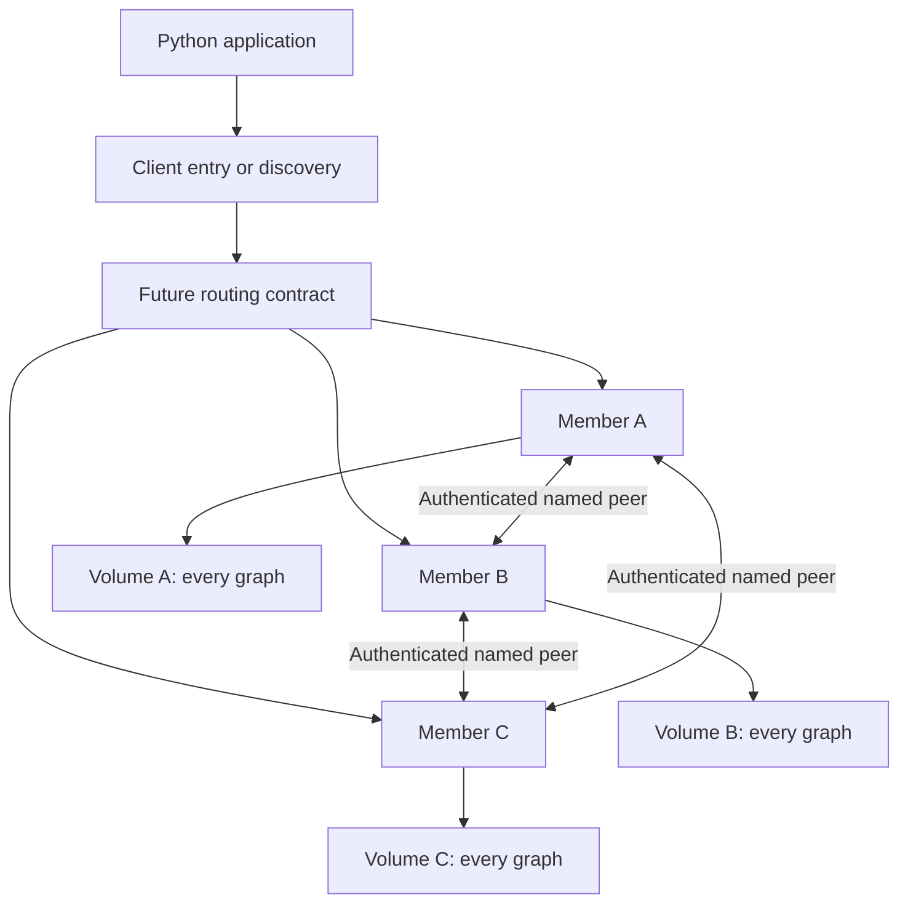
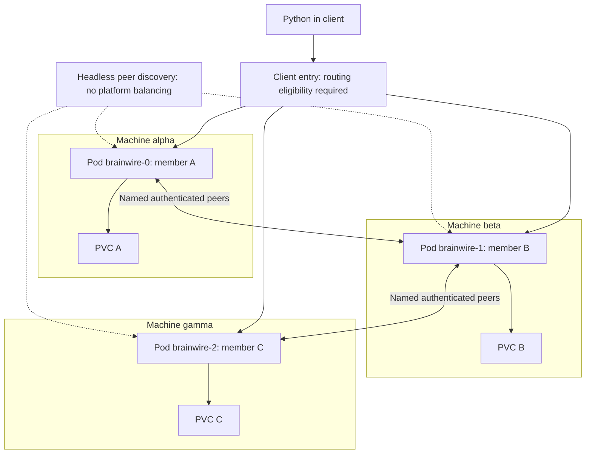
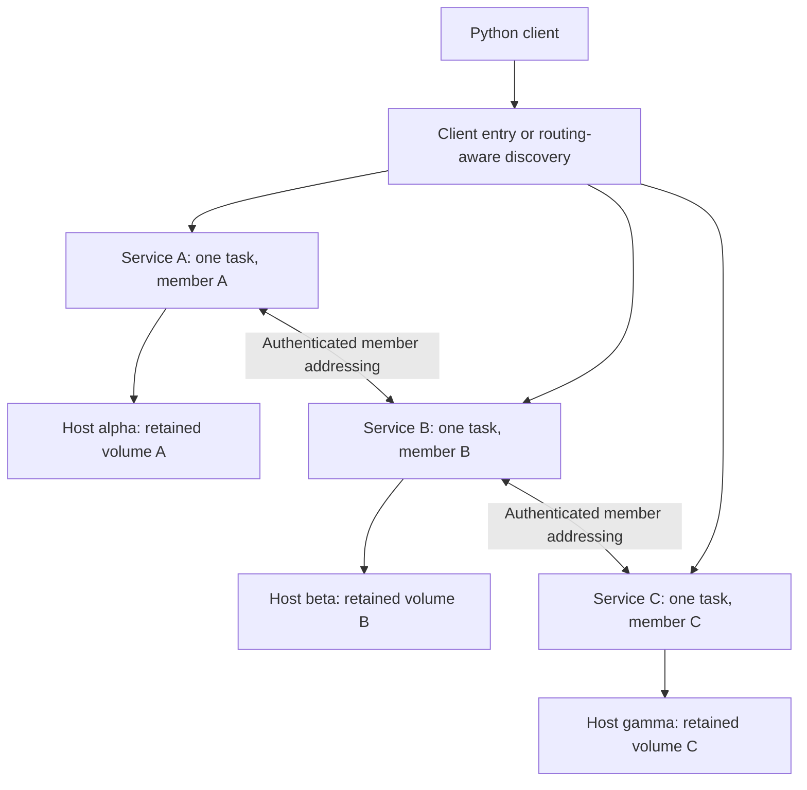

# Distributed deployment and client routing concepts

Status: proposed, unimplemented. The first distributed Brainwire would run three
complete replicas on three independent machines, with one Raft group covering
every named graph. Kubernetes or Swarm would manage placement and process
recovery; Brainwire would manage membership, commitment and read authority.

This companion makes the proposed deployment boundary concrete. Read the
[consistency contracts](2026-10-12-distributed-concepts.md),
[failure exercises](2026-10-12-distributed-scenarios.md) and
[capacity notes](2026-10-12-distributed-capacity.md) alongside it. The current
server and deployment templates remain single-node. Nothing here is a runnable
cluster manifest or a new set of supported configuration flags.

## One member inside one process on one machine

These names describe different things:

| Object | Meaning in the proposed deployment | What can change |
| --- | --- | --- |
| Brainwire instance | One logical replicated history containing several named graphs | Its leader and hosting processes |
| Brainwire member | One protocol participant with persistent cluster/member identity, votes and logs | Its process or address through a supported recovery procedure |
| Container | Packaged running Brainwire process | Recreated from the image without deleting its durable state |
| Kubernetes Pod | Scheduling/network unit containing the Brainwire container and any support containers | Pod UID and IP on replacement |
| Swarm task | Scheduled execution of a service | Task ID and container IP on replacement |
| Node or machine | Host on which the process runs | Hosting can move only if storage and fencing permit it |
| Volume | Durable graph, system and consensus storage for one member | Attachment can change; contents and identity must remain valid |

One Pod with three containers is not three independent machines. Three Pods on
one machine also share its failure. Sidecars do not add votes. The first proposed
topology uses one authoritative Brainwire member per Pod/task, with its own
durable volume; all three volumes must have the intended failure independence.

| Logical member | Example Kubernetes Pod | Example machine | Durable association |
| --- | --- | --- | --- |
| A | brainwire-0 | host-alpha | Member A identity and volume A |
| B | brainwire-1 | host-beta | Member B identity and volume B |
| C | brainwire-2 | host-gamma | Member C identity and volume C |

These are illustrative names, not deployed resources. The ordinal helps locate
a member; its persistent protocol state determines who it is. A newly created
empty PVC cannot impersonate the former A just because it mounts at `/data`.

## Three networking purposes

| Path | Destination rule | Required application contract |
| --- | --- | --- |
| Python/Bolt client | A routable endpoint eligible for the requested operation | Authentication, graph scope, leadership/read mode and transaction affinity |
| Member replication | The particular authenticated member named by the protocol | Cluster/member identity, persistent membership and consensus transport |
| Operations and backup | An authorized target with the intended telemetry/artifact scope | Health meaning, snapshot consistency and independent backup verification |

The peer path must not use a shared address that can select any replica. If A
sends a protocol message to B, reaching C is an identity error, even when C is
healthy and belongs to the same cluster. Discovery locates participants; it does
not grant membership, a vote or permission to bootstrap a new cluster.

The conceptual network boundary is:

Routing is a logical responsibility in this diagram, not a selected new gateway
process. Each arrow represents a permitted path; it does not mean any member
may complete a write independently. Client Bolt currently uses port 7687. A
future peer protocol, listener and ports remain unspecified.

## What a load balancer actually balances

A transport load balancer selects a backend for a connection. This is useful
for a stable entry address and spreading connection establishment. It does not
know Brainwire's committed prefix, discover the current leader by itself, or
move a staged explicit transaction into another process. Those are application
contracts inferred from the separation between transport and protocol state.

A pool can reuse one connection for many queries. Equal connection counts do
not imply equal query CPU, memory or storage load. One long traversal or a large
import can dominate a member. The current accept loop caps active connections
at 64 per process; a future router needs its own bounded pool, admission and
overload behavior instead of hiding an unlimited queue in front of that cap.

The future cluster must choose a client-routing approach:

| Candidate | Entry behavior | Missing Brainwire work |
| --- | --- | --- |
| Routing-aware Bolt driver | Contact an eligible discovery endpoint, then connect to advertised read/write targets | Authenticated ROUTE, routable addresses, role/read eligibility, bookmarks and stale-route errors |
| Router or TCP gateway | Choose an eligible backend when creating a connection | Safe role discovery, connection affinity, authentication boundary, overload and router availability |
| Leader-targeting client Service | A controller updates endpoints to the eligible leader | Controller ownership, stale endpoints, leadership changes and safe server refusal |

These are alternatives, not three mandatory components. A static selector such
as `role=leader` is not a leadership protocol. All candidates still require the
serving member to check its authority at operation admission and commitment.
An old route must fail safely or follow a specified forwarding contract; it must
not turn into an ordinary independent local commit.

A pure TCP gateway cannot choose a backend from the read/write mode of a future
Bolt transaction. Its endpoint needs a defined purpose or a conservative leader
destination. Distributing reads by transaction mode requires application-aware
routing; safe refusal on a wrong backend is not automatic rerouting.

A pure TCP gateway can retain one backend for one connection, but a connection
that outlives leadership still needs the server's role/failure handling. A
protocol-aware gateway that terminates sessions needs a much larger contract;
it cannot treat BEGIN, RUN and COMMIT as unrelated balanced requests.

### One explicit Python transaction during failover

1. Python establishes a connection to the serving member and starts BEGIN.
2. RUN produces staged changes or provisional results on that member.
3. If that process or route fails, the staged snapshot is not transferred to a
   new member merely because the endpoint name remains the same.
4. A fresh transaction may need to restart. If COMMIT was admitted before the
   response disappeared, preserve an unknown outcome and use the defined
   resolution/retry identity instead of assuming rollback.

See the [Bolt message contract](https://neo4j.com/docs/bolt/current/bolt/message/)
and the proposed [retry boundaries](2026-10-12-distributed-concepts.md#python-retries-and-ingestion).
ROUTE and cluster bookmarks are not implemented in Brainwire today.

### Internal and external addresses

A Pod address usable by another Pod is not automatically usable by Python
outside the cluster. Discovery must advertise client addresses reachable by the
actual caller, with the correct transport identity. A public entry followed by
a routing table of private `.svc` names would fail for an external client.

Possible future solutions include private-network clients, reachable member
endpoints, or a gateway with a defined mapping. They require a deployment-specific
contract. Peers retain internal named addresses separately; do not expose their
replication listener just to make public client routing easier.

TLS termination, token authentication and peer identity must also be explicit.
Native TLS is currently pending. A future edge terminator would protect only
the segments it actually encrypts; it does not make a plaintext backend hop
encrypted. Client service tokens are not membership credentials.

### Availability of the entry path

Three healthy voters do not guarantee availability of a single router, DNS
resolver or public entry. Client-observed recovery includes discovering reachable eligible
members and establishing new connections. A future routing-aware client needs
recoverable discovery/seed paths; a gateway design needs its own failure-domain
and overload plan. Neither can advertise failover time from an election timer
alone.

Gateway replicas would not be voters and would not contain the authoritative
graph. Their connection state still cannot migrate transparently when one
dies. Bounded reconnect attempts and jitter can limit a reconnect storm, but
they do not change the unknown-outcome or deduplication contract.

## Kubernetes topology

The candidate uses a StatefulSet for stable per-Pod identity and per-member
storage, plus separate discovery and client-traffic purposes:

The client arrows show potential connections under the selected routing
contract, not unconditional write eligibility. Replication is not a client
Service's balancing function. Example peer names would be
`brainwire-0.brainwire-peers.<namespace>.svc.<cluster-domain>` and the corresponding
names for 1 and 2, if the governing headless Service were named `brainwire-peers`.
Neither that name nor a peer-address configuration exists in the current
single-node manifest.

StatefulSet storage association and discovery come from
[StatefulSets](https://kubernetes.io/docs/concepts/workloads/controllers/statefulset/).
A [headless Service](https://kubernetes.io/docs/concepts/services-networking/service/#headless-services)
returns endpoints without a Service VIP or platform proxy/load balancing.
Member-specific names still need authentication and the application's peer map.

### Bootstrap must not wait on its own quorum

There are two different dependency traps:

- If peer DNS is published only after client readiness, and client readiness
  requires quorum, members can be unable to find each other before becoming
  ready. A peer-only discovery Service may need `publishNotReadyAddresses`.
  Its unready endpoints must never be treated as client readiness proof.
- The default StatefulSet `OrderedReady` creation waits for Pod 0 readiness
  before creating Pod 1. If the future Pod 0 readiness requires two voters,
  creation can stop before that second voter exists. A deliberately selected
  parallel creation policy or another bootstrap design must break that cycle.

Publishing unready peers does not bypass membership or permit writes. Parallel
Pod creation does not authorize parallel voter removal, scale-down or upgrades.
The selected Kubernetes version and update settings need separate verification;
`podManagementPolicy` alone does not define a Raft-safe rolling operation.
See [Pod DNS readiness](https://kubernetes.io/docs/concepts/services-networking/dns-pod-service/)
and StatefulSet management policies.

### Placement and storage

Candidate placement should require distinct host failure domains and express
the intended zone distribution. Hard anti-affinity/spread rules can leave a
member Pending when there are too few eligible hosts; quietly placing two
voters together would change the promised machine-loss tolerance.
See [topology spread constraints](https://kubernetes.io/docs/concepts/scheduling-eviction/topology-spread-constraints/).

A PVC is an attachment/retention abstraction. A local PV can pin recovery to a
particular host; a block-backed PV may permit cross-host reattachment depending
on its driver and topology. Shared backing storage can be a common failure
domain even with three separate PVC objects. Capacity must include snapshots,
compaction, retained logs and the full graph data set on each member.

Before moving A, fence its former process and verify reattachment of A's current
state. An old or empty volume follows replacement/disaster-recovery rules, not
ordinary restart. `ReadWriteOnce` is not a universal single-Pod fence; even
`ReadWriteOncePod` does not supply the database's identity and recovery protocol.
See [volume access modes](https://kubernetes.io/docs/concepts/storage/persistent-volumes/).

A legitimately lagging follower retains its own complete durable vote/log state
and can catch up through the protocol. That differs from rolling its disk back
to a voter backup that forgot later votes or entries. Missing expected state or
detectable identity/provenance mismatches must fail ordinary restart. However,
historically valid IDs in rolled-back files cannot prove that no rollback
occurred. Known backups need controlled restore/replacement and, where required,
external generation/provenance evidence. Neither a PVC name nor a local counter
provides universal rollback detection; catch-up does not authorize forgetting
earlier durable votes.

### Requests, limits and real host capacity

The current Kubernetes template requests 512 MiB and 0.25 CPU for its one
container, with limits of 2 GiB and 2 CPU. Requests inform scheduling; a memory
limit is enforced on container usage, not reserved exclusively at startup.
See [container resource management](https://kubernetes.io/docs/concepts/configuration/manage-resources-containers/).

As an arithmetic illustration, three containers with those unchanged settings
would request 1.5 GiB in aggregate and could reach 6 GiB across their memory
limits, before other host workloads. Placing them on one host can therefore
create pressure even if their requests fit. These numbers are not a selected
replication profile or a measured Brainwire memory requirement.

Each member's RocksDB cache, query pool, future replication buffers and snapshot
work must fit its own process/host budget. Three hosts do not create one shared
RAM pool for the graph. The existing query reservation is not the container's
hard RSS limit, and memtables are already part of the configured cache budget.
Measure degraded recovery and compaction as well as idle resource use before
choosing distributed requests, limits or concurrency.

### Client exposure

An internal ClusterIP or an external TCP-capable entry can carry Bolt traffic
under the chosen routing model. Standard Kubernetes Ingress routes HTTP/HTTPS,
not arbitrary Bolt TCP. A TCP LoadBalancer Service or a verified TCP-capable
gateway/controller is a candidate; provider/controller support must be checked.
See [Ingress scope](https://kubernetes.io/docs/concepts/services-networking/ingress/).
Neither a public IP nor a TCPRoute would supply leader awareness by itself.

### Control-plane outage is a separate failure

An unavailable Kubernetes API can block scheduling and changes to Pods/Services
without necessarily stopping every existing workload. Existing paths that do not
depend on that API can continue under the outage's actual network, node and
storage conditions; see [Kubernetes failure scenarios](https://kubernetes.io/docs/tasks/debug/debug-cluster/#specific-scenarios).
This does not guarantee DNS, external load balancers or storage survive every
control-plane failure.

For the proposed Brainwire deployment, evaluate database quorum and client
reachability separately from orchestrator management. A future leader-targeting
controller that must update endpoints through the unavailable API cannot be
relied on to publish a new leader route during that outage. Existing programmed
routes may be stale, so final authority checks remain in the database. A client
might lose service even when the peer group can still make progress.

## Docker and Swarm topology

Compose remains useful for a local process-failure laboratory. Three containers
on one Docker host cannot prove survival of that host, and running three copies
of the current binary creates three independent databases.

For a future multi-host Swarm experiment, explicit per-member services are a
candidate association: service A, B and C each have one Brainwire task, a distinct
durable volume and validated member identity. Task replacement changes its IP
without authorizing a new protocol identity. A single replicated service's task
list is not a stable member map.

An overlay network connects services; it does not replicate RocksDB. Swarm VIP
discovery balances connections across a service's tasks. DNSRR returns task
addresses instead. Neither makes those addresses immutable member identities.
Even a one-task service address must verify its expected peer after replacement.
See [Swarm service networking](https://docs.docker.com/engine/swarm/networking/).

For client entry, published ingress uses Swarm's routing mesh; host-mode
publication bypasses it and has placement/port constraints. DNSRR cannot be
combined with published ingress-mode routing mesh. Choose the combination with
the intended TCP router and reachability, rather than mixing incompatible
defaults. See [routing mesh and host mode](https://docs.docker.com/engine/swarm/ingress/).

Local volume names are scoped to their host. Rescheduling service A to an empty
same-named volume on another host is not recovery. The current single-node
Swarm manifest pins its writer to the volume-owning node; a future replica
replacement needs retained attachment or a new learner and snapshot catch-up.

Stop-first updates avoid an intended overlap between old and new tasks of one
service. They do not fence an unreachable former process under every failure.
Nor does `parallelism: 1` on three separate services coordinate a cluster-wide
one-at-a-time update: an operator/controller must serialize the member steps.
Start-first can overlap identity/storage users and needs a separate safe design.
See [service update order](https://docs.docker.com/reference/cli/docker/service/update/).

Swarm managers maintain the orchestrator's own history, not Brainwire's graph
history. Losing manager quorum can prevent scheduling/management even while
existing tasks continue running; see [Swarm administration](https://docs.docker.com/engine/swarm/admin_guide/).
Whether the future database remains accessible then depends on its own peers,
storage, network and client route. Restoring Swarm state does not restore a lost
graph volume, and fixing Brainwire quorum does not repair the orchestrator.

## Health is not one green light

| Signal | Proposed meaning | Must not depend on |
| --- | --- | --- |
| Startup/recovery | Local identity/storage reconciled enough for the intended peer/recovery phase | A circular requirement for quorum before other members can start |
| Liveness | The process can make local progress under its documented watchdog | Quorum always being available or every query being fast |
| Client readiness | Safe eligibility for that endpoint's advertised purpose | Merely accepting TCP or having a valid Pod name |
| Write admission | Current authority, supported command and policy, bounded resources | A cached load-balancer health result |
| Strong-read eligibility | Verified read authority and required local publication | Follower label or a successful historical probe |

A single Pod readiness bit cannot independently represent every read mode,
discovery role and write role. Use a conservative common client condition plus
application-level checks, or define separate endpoint selection/control. Readiness
information is delayed; final authority checks stay inside Brainwire.

Probes also need bounded capacity that can distinguish overload from a stuck
process. Sending every liveness check through a saturated client connection
pool can turn heavy load into synchronized restarts. Future peer traffic and
recovery work need their own resource accounting and headroom; a public query
queue must not be the only path available for replication progress.

The current `probe --mode ready` runs `RETURN 1`, and `--mode live` negotiates
Bolt/login. Neither understands a future consensus group. The existing startup
window and 60-second stop allowance are deployment settings, not evidence of
cluster recovery or graceful transaction drain. See the current
[orchestrator guide](../orchestrators.md) and
[Kubernetes probe semantics](https://kubernetes.io/docs/tasks/configure-pod-container/configure-liveness-readiness-startup-probes/).

## Planned restart, drain and fencing

A conceptual planned member restart is:

1. Verify the other members provide the required quorum and are usable under
   the upgrade/recovery contract. Do not begin a second change while degraded.
2. Mark the target unavailable for new client work under the chosen routing
   model, and stop new application admission, including on existing sockets.
3. Drain bounded work. Reject unproposed mutations according to the contract;
   finish or later recover committed commands. Preserve unknown client outcomes
   when responses cannot be delivered.
4. Keep required peer participation through the permitted drain phase, or use
   an explicitly supported leadership-transfer procedure. Stop the process
   under a bounded budget; drain does not itself remove voting membership.
5. Restart the same member only with its current valid state and exclusive
   ownership. Recover, catch up and validate before client eligibility returns.
6. Verify healthy service and the intended failure margin before moving on.

This is an operational outline, not an implemented shutdown handler. Endpoint
removal primarily affects new traffic; it does not migrate existing sessions.
Kubernetes exposes terminating endpoint conditions, and `preStop` consumes the
same termination grace budget as shutdown. See
[endpoint termination](https://kubernetes.io/docs/tutorials/services/pods-and-endpoint-termination-flow/)
and [lifecycle hooks](https://kubernetes.io/docs/concepts/containers/container-lifecycle-hooks/).

A future Kubernetes PodDisruptionBudget can constrain voluntary evictions through
the Eviction API. It does not prevent machine failures, direct deletion, or
workload-controller rolling updates. Its Pod availability accounting must match
the selected readiness contract; it is not a consensus health check. Safe update
settings and the database preflight remain separate requirements. No PDB
configuration is selected here. See [disruption budget limits](https://kubernetes.io/docs/concepts/workloads/pods/disruptions/#pod-disruption-budgets).

Fencing is a separate guarantee that an old process cannot continue using the
same member/storage identity during replacement. A network partition can make
an old process unreachable without making it stopped. Force-deleting a Pod,
removing a DNS entry or waiting a grace period is not proof of fencing. Consensus
authority prevents unsupported minority confirmation; it also requires that
the deployment preserve the protocol's one-participant-per-identity assumption.

For example, if two independent processes illegally reuse A's identity and vote
separately, B could count `{A-old, B}` while C counts `{A-new, C}`. Each view
would appear to contain two configured identities while violating the required
single durable voting history for A. This is a counterexample to treating Pod
replacement alone as fencing, not a supported Brainwire topology or test result.

## Scheduling changes versus membership changes

| Requested operation | Deployment work | Protocol work |
| --- | --- | --- |
| Restart A with its current disk | Recreate the process and preserve exclusive state association | Recover the same A, catch up, reestablish eligibility |
| Move A to another host | Fence old A and correctly reattach current storage | Retain A identity; reject mismatched or missing state |
| Replace lost C with D | Provision independent D storage/process | Add learner, catch up, safely change voters, fence retired C |
| Increase Pod/task count | Allocate new processes and resources | Explicit membership admission; count alone grants no votes |
| Reduce Pod/task count | Stop selected processes | Safe prior membership transition or intentional quorum loss; deletion alone does not shrink quorum |
| Restore the instance from an old disaster backup | Stage and verify recovered complete generation | Controlled new lineage/cluster recovery with old-history fencing |

Autoscaling voter count from CPU utilization is not the initial proposal.
Stateless routers or ingestion workers might scale separately, but bounded
admission, source ownership and connection costs still apply. Scaling clients
does not increase the one-group write path's consensus or apply capacity.

## Deployment fault contract ledger

These are additional orchestration/routing exercises for the future replicated
engine, not tests executable against today's independent single-node replicas.
Record the original logical membership, valid durable member identities,
placement/storage assumptions, published positions and client outcomes.

| Fault or operation | Expected contract | Evidence required |
| --- | --- | --- |
| First Pod is not client-ready while other peers must start | Creation and discovery allow the configured group to form without treating unready peers as client-ready | Creation timeline, peer discovery and authenticated membership; no premature successful write |
| One process stops, then a whole host stops in a separate run | Availability follows the actual failure domains and supported quorum rules | Hosts that disappeared, valid remaining participants, confirmed/unknown request ledger |
| Client entry stops while peers stay healthy | Client outage is classified separately; no membership reset to repair a router | Entry errors plus independently observed database authority and preserved history |
| Cached client route selects the old leader | Safe authority handling; no independent minority commit or transparent transaction migration | Serving member, admission/commit outcome and new route acquisition |
| Peer DNS resolves to the wrong member | Reject the authenticated identity mismatch | Expected and actual member/cluster identity; no false vote counted |
| Recreated Pod/task mounts empty/mismatched state or a known voter backup | Refuse missing/incompatible restart state; use controlled replacement/restore for the identified backup | Expected state/provenance and no healthy empty graph exposure; no universal unmarked rollback-detection claim |
| Member drains with an established transaction | Stop new admission; preserve committed effects and unknown response outcomes | Proposal/commit/publication boundary and connection response timing |
| Another member is already unavailable during an update | Refuse a new voluntary step that would lose the supported quorum margin | Cluster preflight, controller decision and actual remaining usable members |
| Orchestrator replica count decreases without protocol membership change | The configured quorum does not silently shrink | Configured membership versus running task/Pod count and safe refusal |
| An external driver receives private member addresses | Fail reachability validation rather than claim successful external routing | Caller network scope, advertised address and bounded discovery/connection outcome |

A one-host laboratory can exercise process loss, synthetic networking and
protocol invariants. It cannot certify machine-loss tolerance merely by stopping
a container. Distinct-machine tests must establish which storage and network
dependencies survive the injected fault. A passed manifest render is not any of
these runtime outcomes.

## Current files and the missing distributed contracts

| Current evidence | Exists today | Needed before the proposed topology is real |
| --- | --- | --- |
| [Kubernetes manifest](../../deploy/kubernetes/brainwire.yaml) | One StatefulSet replica, headless Bolt Service, retained per-Pod PVC, local probes | Raft/member state, separate peer discovery, safe bootstrap/readiness, routing and placement |
| [Swarm manifest](../../deploy/swarm.yaml) | One pinned writer, retained local volume, overlay, stop-first policy | Per-member association, authenticated replication, membership and client routing |
| [Compose manifest](../../deploy/compose.yaml) | One local Bolt endpoint and durable named volume | Future multi-member laboratory; distinct-machine acceptance remains separate |
| [Bolt session](../../crates/bolt/src/session.rs) | Explicit transaction state and graph selection; ROUTE fails as unsupported | Routing contract, safe role failures and causal context |
| [Server accept loop](../../crates/bolt/src/server.rs) | Bounded active connections and per-connection execution | Cancellation/admission/drain, consensus-aware readiness and listener lifecycle |

The design's operational acceptance should extend the existing failure workbook:

- Create peers without a readiness/discovery cycle and reject unauthorized
  bootstrap or wrong member identity.
- Demonstrate a Python transaction over the selected client-entry path, then
  fail its serving member with completed and unknown outcomes recorded.
- Drain one member while another is unavailable; refuse the unsafe second step.
- Reschedule with retained storage, then present an empty/mismatched volume and
  verify refusal of ordinary restart. Use an explicitly identified voter backup
  to verify the controlled replacement/restore procedure; do not assume the
  process can detect every unmarked rollback from local files alone.
- Change endpoint addresses and cached routes; preserve safe authority checks
  without transferring an uncommitted transaction's state.
- Force client/peer traffic to the wrong replica and reject the peer identity
  mismatch rather than counting an arbitrary healthy server as the intended vote.

These are future tests, not cluster results. The next implementation contract
must choose routing, membership/bootstrap identity, health phases and drain
semantics before a three-replica deployment can be claimed.

## Deployment information for the future TUI

The [capacity observability requirements](2026-10-12-distributed-capacity.md#what-the-future-tui-should-explain)
need a physical deployment view alongside protocol progress. These fields are
proposed display requirements, not current panels or newly supported metrics.

| Display | Source and meaning | Keep separate from |
| --- | --- | --- |
| Member, Pod/task and host association | Validated protocol identity alongside observed orchestrator placement | Treating an ordinal or container name as durable identity |
| Volume provenance and attachment | Supported storage association and known restore/replacement procedure | Assuming a mounted PVC proves current vote/log history |
| Client entry and peer addresses | Caller-reachable client targets versus named authenticated peer targets | Counting successful TCP connections as votes |
| Recovery, drain and client eligibility | Documented phase and endpoint purpose with observation time | A single green health indicator claiming every operation is safe |
| Placement dependencies | Host, zone and shared storage/network dependencies actually established | Inferring three independent failure domains from three Pods |
| Configured and observed resources | Per-member requests, limits, engine budgets and measured usage where available | Adding three RAM budgets into one shared graph memory pool |

A disconnected observer must show unknown or stale information with its age,
not infer a healthy cluster from the last recorded role. Observing orchestrator
metadata also needs an authorized integration; the current Kubernetes base template disables
service-account token mounting and do not grant that integration automatically.
Database telemetry remains scoped by the existing authorization contract.

## Dependency order for future evidence

This is a conceptual sequence, not approval of a new implementation phase or a
calendar estimate. Later stages consolidate evidence; they do not defer crash
safety until deployment is complete.

| Stage | Contract to settle or demonstrate | Gate before a stronger claim |
| --- | --- | --- |
| 1. Mutation and durable publication | Deterministic commands, retry identity, durable commit/apply, graph/system publication and recovery boundaries | Crash analysis and replay evidence preserve acknowledged effects and do not expose partial publication |
| 2. Fixed-member process laboratory | Three authenticated participants, explicit bootstrap, peer discovery, election, logs and catch-up | Restart, partition and election exercises respect the configured membership and durable vote/log state; one host proves no machine-loss tolerance |
| 3. Client and lifecycle integration | Selected Bolt route/entry, reachable advertisements, authority failures, health phases and bounded drain | Python records completed/unknown outcomes through connection and leader loss; peer availability is already required by stage 2 |
| 4. Distinct-machine orchestration | Separate Kubernetes and Swarm placement/storage/entry procedures, fencing and serialized maintenance | Establish real independent failure domains; run the deployment fault ledger without treating controller success as database safety |
| 5. Consolidated recovery and load evidence | Healthy and degraded mixed workloads, snapshots, catch-up, retained-state restart and controlled disaster restore | Publish measured latency, memory, recovery time and applicable backup RPO; claims stay within the tested workload and fault assumptions |

The first supported topology still has one consensus/apply group for the entire
instance. More client connections, Pods or voter machines alone do not establish
more write throughput. Read scaling, sharding and elastic voter membership need
their own authority, cost and correctness evidence.

A fixed-member laboratory does not establish safe learner replacement or voter
changes. Those procedures require their own membership-transition contract and
fault evidence before being offered as supported maintenance operations.
