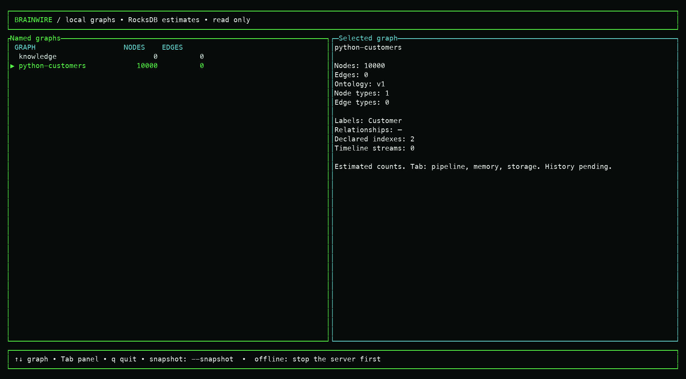
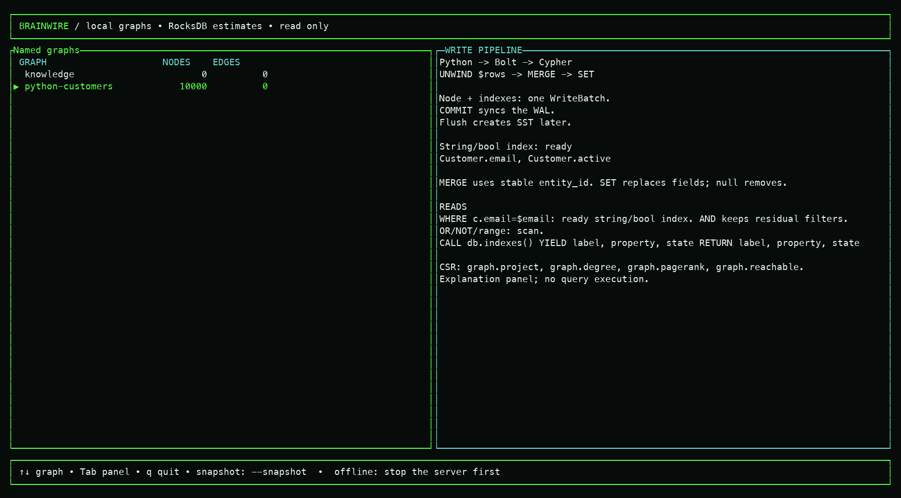
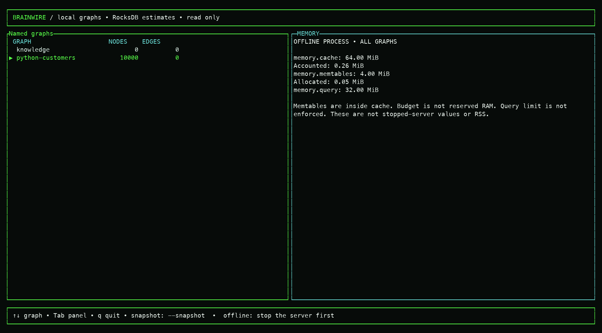
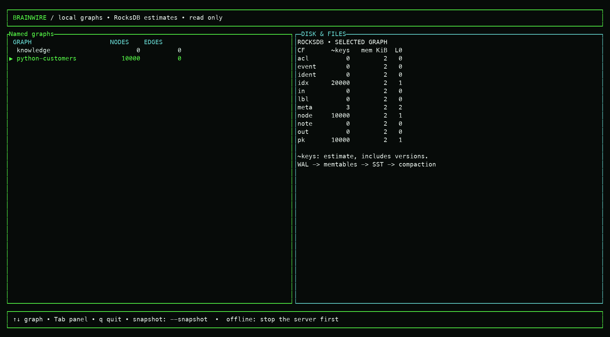

# Real terminal captures, 2026-10-02

These PNGs render actual interactive ANSI output from `brainwire shell
--overview --estimated` at 160x40. Tab navigated Graph, Write pipeline,
Memory and Disk; `q` exited successfully. Corresponding `.txt` files preserve
the terminal contents. No concept image was used as the terminal output.

The temporary synthetic fixture had 10,000 Customers in `python-customers`,
no edges, an independent empty `knowledge` graph and ready `email`/`active`
indexes (20,000 physical entries). It passed `db check` and was removed
afterward. Cache was 64 MiB, memtables 4 MiB inside cache, query setting
32 MiB unenforced. Counts are explicitly RocksDB estimates, and memory values
belong to this offline process, not running-server RAM or process RSS.

The pipeline panel explains WHERE index selection, residual filters,
`CALL db.indexes()` and CSR procedures. It remains read-only guidance;
connected query execution and the selected rich graph/file-browser
composition remain future work.

