# Actual offline TUI captures - 2026-10-03

These PNGs are renders of actual PTY output from the current debug executable,
using pyte and system Menlo fonts; they are not image-generation mockups.
The fixture is isolated and synthetic: `python-customers` has 10,000 Customers,
20,000 scalar entries (`email`, `active`); `knowledge` is empty. Import uses 250
rows per embedded Cypher batch. The temporary databases were removed afterward.

Panels: Graph, Query/write pipeline, Memory and Disk & Files. English captures
use 160×40 and 80×24 cells; Portuguese uses 160×40. The narrow Disk explanation
is shown after F1. A node-family SST is selected initially when available, otherwise the first SST. File names, sizes,
column families, levels and counters came from real offline RocksDB metadata.
The capture fixture was reopened between write batches, so its SST layout is
not a production ingestion layout or performance benchmark.

Cache 64 MiB, memtables 4 MiB, query guard 32 MiB. Cache/memtable counters belong
to the offline inspection process, not the stopped server. Memtables are inside
cache accounting; configured budgets are not reserved RAM. Query guarding is
conservative per RUN, not process RSS or a global query pool. Graph counts here
use RocksDB estimates. Disk metadata is bounded and non-atomic; SST entries can
include historical versions and tombstones. No file contents were read.

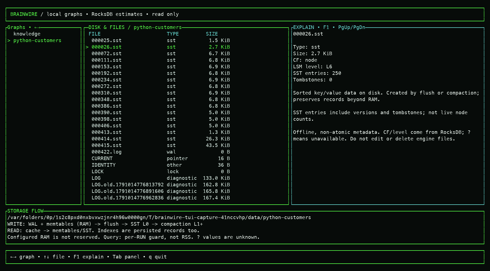
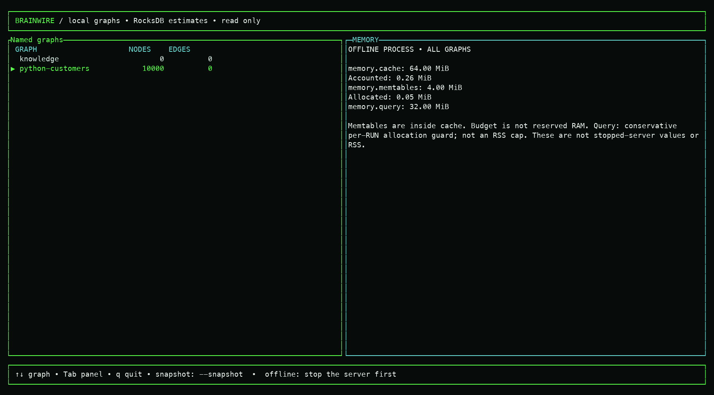
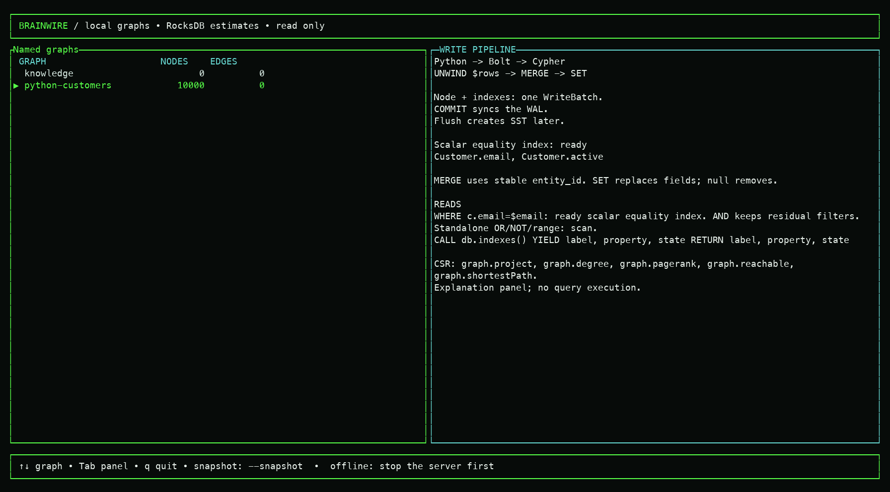
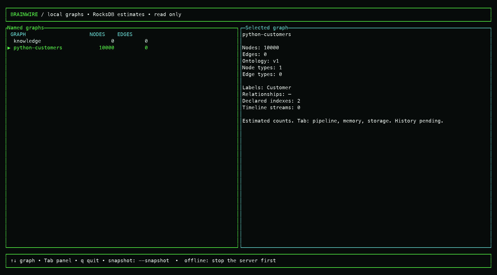
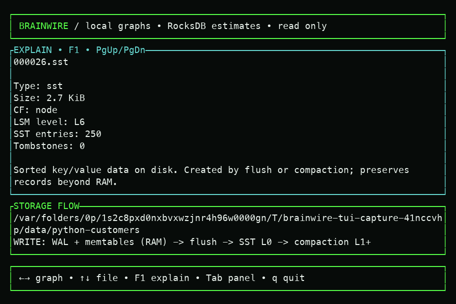
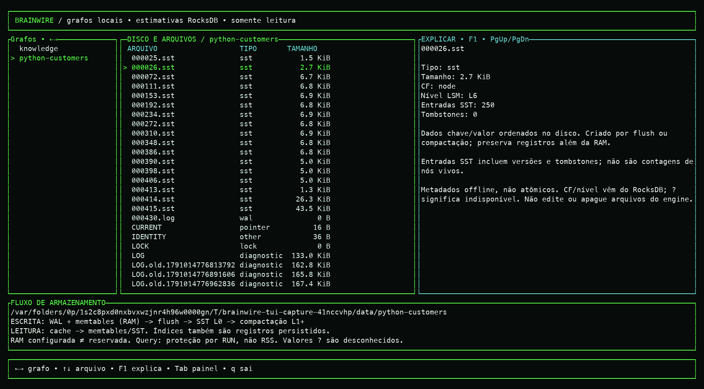

## 100,000-node capture

The `100k/` directory repeats all four panels in English and Portuguese at
160×40 with 100,000 Customers and 200,000 scalar index entries. It uses the same
isolated embedded import, budgets and offline inspection scope as above; this
fixture has no edges. Disk inventory intentionally stops after 256 entries and
shows `truncated` when more files exist. All temporary databases were removed.

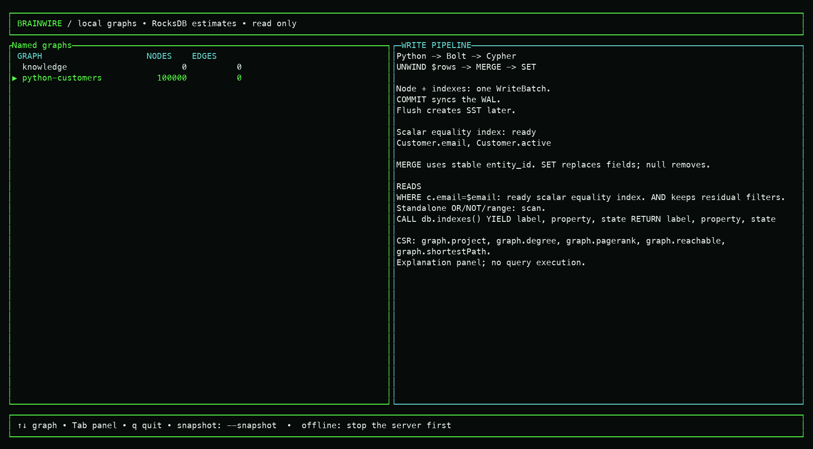

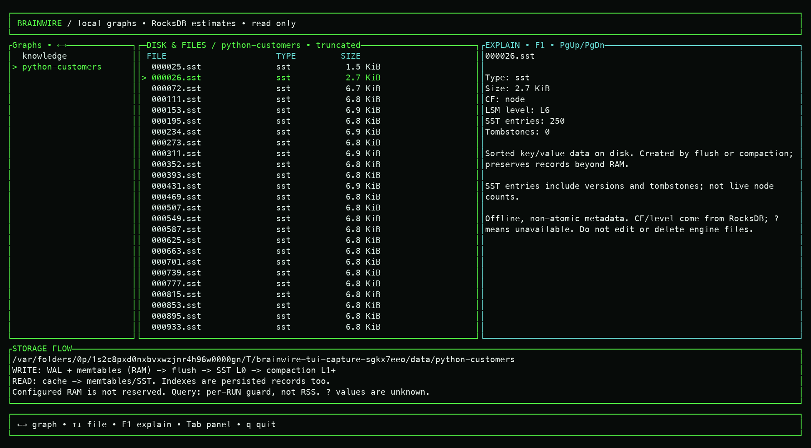
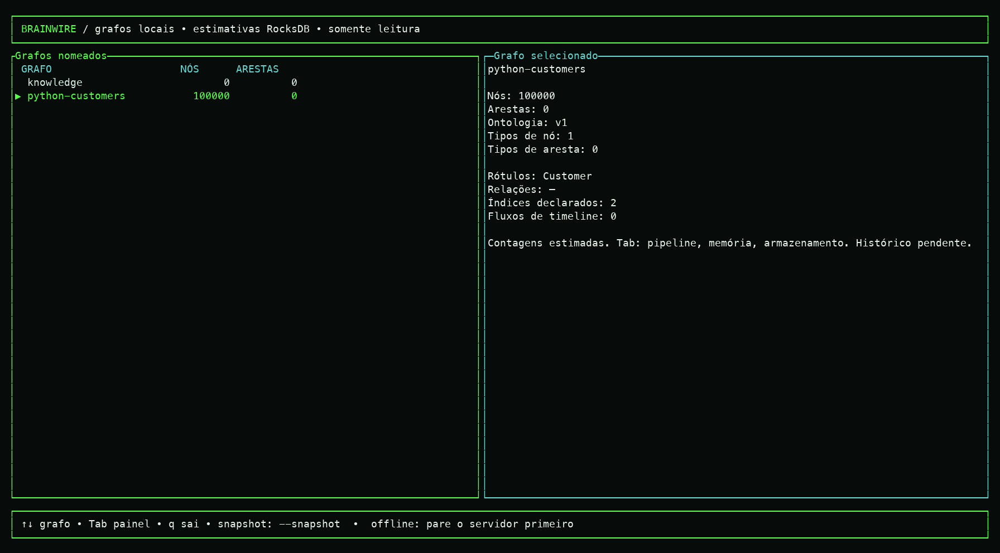
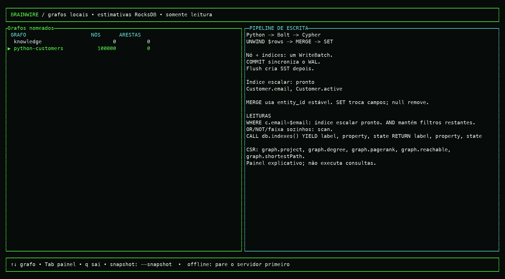
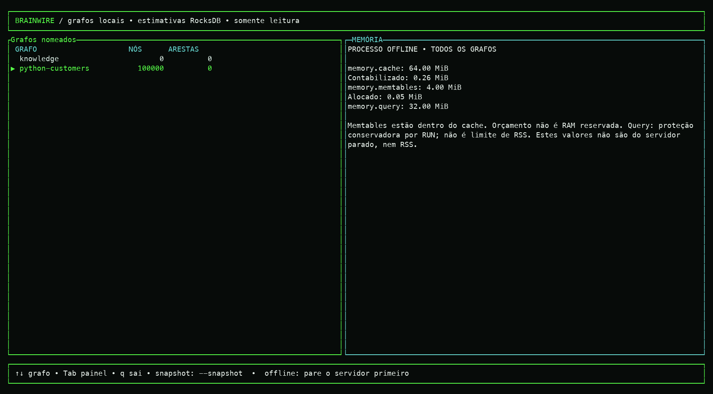
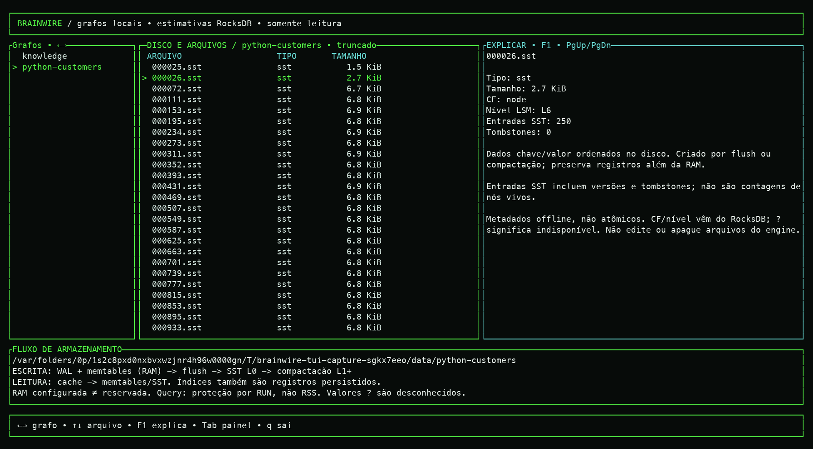
