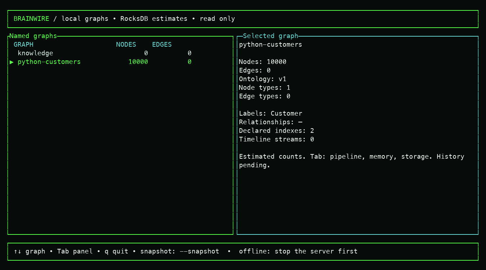
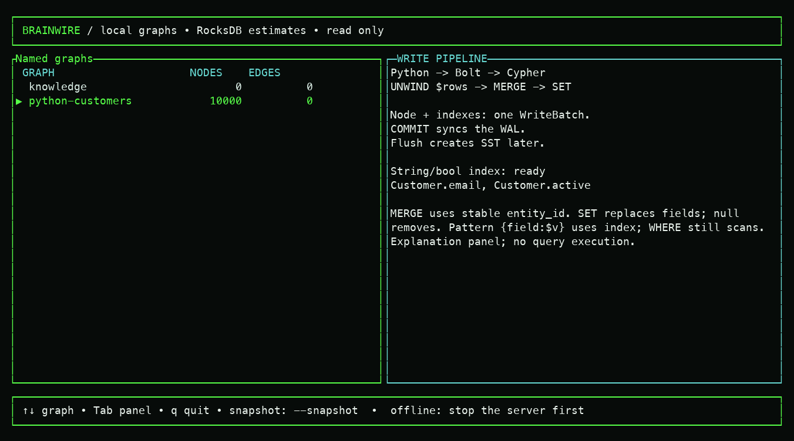
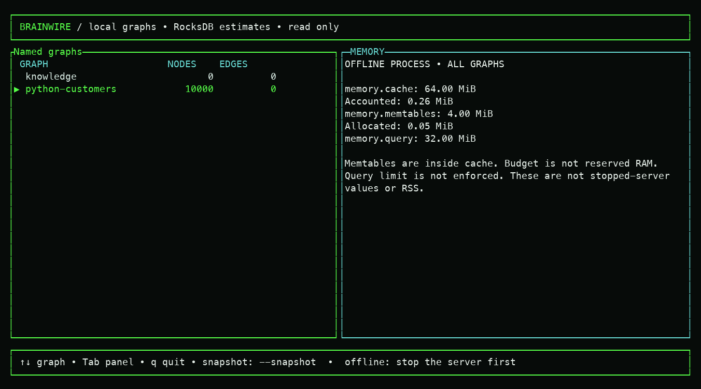
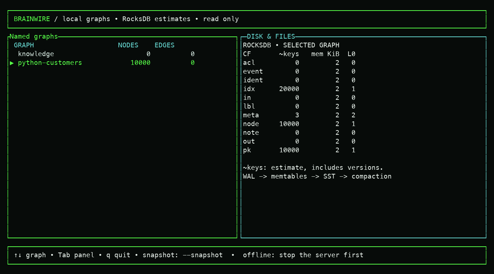

# Multiple graphs and the local backoffice

Brainwire can store several independent named graphs under one configured
`server.data_dir`. Each name maps to a separate RocksDB directory and ontology
catalog. `default` is only the default name; it is not a limit of one
graph. The Bolt server opens existing names and clients choose a database in
their session. Cache and memtable budgets are shared by the process, so the
number of graphs and their active working sets still matter.

## What was on this checkout on 2026-10-01

The following values came from `brainwire db overview --json` in this local
checkout. They are exact graph counts from a full scan, not forecasts:

| Named graph | Nodes | Relationships | Ontology | Labels | Edge types |
| --- | ---: | ---: | --- | --- | --- |
| `analytics-demo` | 3 | 2 | v1 | `Page` | `LINK` |
| `staging-100k` | 100,000 | 1,000,000 | v1 | `Page` | `LINK` |
| `default` | 0 | 0 | none | none | none |

The `staging-100k` directory occupied about 9.5 MiB on this host when
measured with `du -sh`; this synthetic fixture is highly compressible and
cannot predict production storage size. RocksDB's `node` and `pk` families
each estimated 100,000 keys; `out` and `in` each estimated 1,000,000; `idx`
and `ident` were empty. These key counts and bytes are estimates, not process
RAM usage. The [query/ontology audit](benchmarks/2026-10-01-query-ontology-audit.md)
records the pre-index baseline. New string/Boolean equality indexes populate
`idx` on indexed graph types; `staging-100k` declares no indexed fields.

## Run and inspect

From `/Users/fraga/Documents/brainwire`, after building the binary:

```sh
cargo build --locked --offline -p brainwire-server --bin brainwire
./target/debug/brainwire db list
./target/debug/brainwire db overview
./target/debug/brainwire db overview --json
./target/debug/brainwire db overview --estimated --json
./target/debug/brainwire shell --overview --lang pt-BR
./target/debug/brainwire shell --overview --estimated --lang pt-BR
./target/debug/brainwire shell --overview --snapshot --graph staging-100k --lang pt-BR --width 120 --height 30
./target/debug/brainwire db schema staging-100k --json
./target/debug/brainwire db metrics staging-100k --json
```

`shell --overview` is a **real, read-only, offline** TUI. Up/Down chooses a
graph and the inspector shows its exact node/edge counts, ontology version,
node labels and edge types. Tab changes to the write pipeline, Memory,
Disk and Ontology panels; Shift-Tab moves backward. The page strip highlights
the active panel, and `?` opens an explanation of its terms and available
controls. PgUp/PgDn scroll long explanations. `--view query|memory|disk|ontology`
chooses the initial panel; `q` or Esc exits. See the
[Python ingestion guide](python-ingestion.md) for memory semantics and the
new offline `db check` consistency audit. `--graph` sets the initial
selection, including in `--snapshot` mode. It opens the RocksDB directories
exclusively, so stop `brainwire serve` first. By default it scans every graph
for counts; starting with `--view ontology` skips that scan automatically. Add `--estimated` to use quick RocksDB
key-count estimates instead of the full scan; the output labels those values
as estimates. An unknown graph name is an error.

For the running server, the [connected Ontology mode](connected-ontology.md)
uses Bolt and requires no local RocksDB access. Other overview panels stay offline.

## Ontology connections in the TUI

```sh
./target/debug/brainwire shell --overview --view ontology --graph tickets
./target/debug/brainwire shell --overview --view ontology --graph tickets --lang pt-BR
```

The Ontology panel reads the persisted catalog, including every declared
source/relationship/target signature. It displays a type list, directed
connections around the selected type and an inspector with properties,
declared indexes, incoming/outgoing signatures and relationship properties.
These boxes are **types, not individual graph records**; allowed connections
remain visible even when no instance edges exist. Isolated types and graphs
without an ontology have explicit empty states. Canonical names are unchanged
by localization.

Up/Down selects a type; Left/Right switches named graphs and resets selection.
At 100 columns or wider, connections and inspector are side by side. On smaller
terminals, Enter or F1 switches between connections and the inspector; Esc closes
the inspector before exiting. PgUp/PgDn scroll long content; `q` exits.
The header reports the selected graph and scalar-index readiness separately from
the inspector's declarations. Schema identifiers with terminal controls are escaped.

Starting with `--view ontology` uses quick RocksDB count estimates automatically,
so opening the schema does not trigger full node/edge count scans. Catalogs and
file metadata are loaded once at startup, under the same exclusive offline access
as the other overview panels. Reopen the TUI after schema changes. This is schema
inspection, not a live server connection or an ontology editor.

[Actual Ontology captures and startup measurements](design/assets/2026-10-04-ontology/README.md)
cover English/Portuguese, compact inspectors, isolated types, empty schemas and
the existing 100K-node/1M-edge fixture.

On this warm local 100K/1M fixture, one measured exact overview took 1.053 s
and one estimated overview took 0.078 s. They returned the same counts in
this run; that agreement is not a guarantee that RocksDB estimates are exact
after other write/compaction states. Neither measurement extrapolates to
billion-element graphs.

Create another independent graph and apply its own ontology:

```sh
./target/debug/brainwire db create tickets --ontology crates/core/tests/fixtures/graph_mapping.json
./target/debug/brainwire db create knowledge --ontology crates/core/tests/fixtures/graph_mapping.json
./target/debug/brainwire db overview
```

These are examples; choose an ontology appropriate to each graph. Do not
reapply the sample mapping merely to change an existing production graph.
Offline `brainwire cypher --database ./data/tickets --query '…'` addresses one
graph, while `brainwire serve` lets a Bolt driver choose a named database:

```python
from brainwire import connect

with connect("bolt://127.0.0.1:7687", "tickets", auth=None) as graph:
    driver = graph.driver
    with driver.session(database="tickets") as session:
        print(session.run("RETURN 1 AS ready").single()["ready"])
```

The server is single-node. This example uses unprotected development mode;
[service-token connections](bolt-auth.md) are optional and native TLS is pending, so the
example is for a trusted local test network. The [server guide](serve.md)
covers configuration and transaction behavior.

## What each terminal surface can do

| Surface | Operations now | Data source |
| --- | --- | --- |
| `shell --connect IP:PORT --graph NAME --view ontology` | Inspect schema and refresh; retain stale snapshot on failure | Real server catalog over Bolt |
| `shell --overview` | Select named graph/files/types; inspect ontology connections, properties, counts, index readiness, shared offline memory and native SST metadata | Real local RocksDB, read only |
| `shell --demo` | Explore Graph, Query, Memory, Disk & Files; select nodes/files; run two guided queries; read F1 explanations | Synthetic fixture, no real writes |
| `db files/checkpoint` | Inspect real file metadata; create a native committed graph checkpoint | Real local RocksDB, offline |
| `db create/apply-ontology` | Create and update a named graph's catalog | Real local RocksDB, offline |
| `db stats/schema/metrics/overview/check` | Inspect counts, ontology and storage estimates | Real local RocksDB, offline |
| `cypher --database` | Execute the supported Cypher subset against one graph | Real local RocksDB, offline |
| `serve` | Query multiple named graphs over Bolt, selected by session | Real local RocksDB, online |

The Disk panel now lists real file names/sizes and live-SST column family, level,
entries and deletions. These native counters include versions/tombstones, not
exact live graph counts. Metadata is sampled non-atomically, with at most 256
files, and symlinks are not followed. Left/Right selects a graph, Up/Down a file;
F1 opens the explanation on narrow terminals. Contents are never decoded.
`db files NAME --json --limit 256` exposes the same inspection.

The current TUI does not run arbitrary Cypher, edit ontologies, delete graph
data or perform maintenance jobs. The connected Ontology slice is available; the next
backoffice slice should expose a bounded per-graph neighborhood and read-only
query results through the server, then live storage and memory telemetry. Any
mutation from the TUI needs explicit scope to the selected graph and an
auditable operation; ontology changes must never implicitly delete old data.

## Captured offline panels

These are actual terminal captures against an isolated synthetic 10K-node graph
with 20K scalar index entries. The [capture notes](design/assets/2026-10-01-ingestion/README.md)
record dimensions, provenance and the memory scope.






Current terminal captures: [2026-10-03 session](design/assets/2026-10-03-session/README.md).

The latest Memory panel explains the shared server reservation pool, transaction
lifetime and cooperative `server.query_timeout_ms` deadline in English and
Portuguese. Its live-server Cypher example is `CALL db.memory()`; offline pool
usage remains explicitly unobserved. The pipeline panel distinguishes streaming
simple reads from eager writes, grouped counts and CALL.

Latest 100K-node captures: [second October 3 session](design/assets/2026-10-03-session2/README.md).
