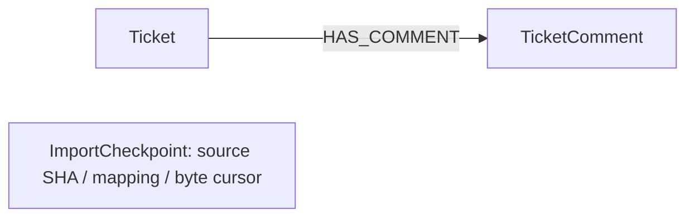

# external application ticket/comment shadow integration

This is an executable **synthetic integration contract**, not an approved live
external application schema or a production deployment. It implements the October 9–10
workload/fixture slice. The local external application starter graph mapping is empty; the
Zendesk connector fragment documents Ticket, TicketComment and HAS_COMMENT.
This example selects those documented concepts and supplies explicit scope and
mapping rules rather than claiming the starter already has a working graph.

Source reference: sibling external application repository,
`external-data/services/pipelines/src/connectors/zendesk/ontology_fragment.yaml`.
No production records, credentials or connector endpoints are read by the fixture.

## Supported contract

| Record | Required fields, all explicitly present | Meaning |
| --- | --- | --- |
| Both | record_type, tenant_id, connector_id, external_id | type is ticket/comment; identity components are nonempty strings |
| Ticket | subject, status, priority, tags | Strings/null; tags is a list of strings/null |
| TicketComment | ticket_id, body, is_public | Parent provider ID is a nonempty string; body string/null, visibility Boolean/null |

All internal labels/properties are English. The adapter enumerates authoritative
SET fields: null removes that field and its old scalar index entry; an omitted
required field is rejected, rather than implicitly clearing data. Extra fields
are ignored. IDs are compact JSON tuples `[tenant,connector,kind,external_id]`,
so a provider ID reused in another tenant/connector does not merge its records.
Convert provider numeric identifiers to strings in the source export deliberately.
Tenant-qualified identities are **not authorization**.

The ontology has Ticket equality indexes on status/priority, TicketComment indexes
on ticket_entity_id/is_public, and ImportCheckpoint progress metadata. Each comment
has one immutable parent and a merged `Ticket-[:HAS_COMMENT]->TicketComment` edge.
Ticket parents must already exist, or be in the same batch; tickets are upserted
before comments. Missing parents, reparenting and conflicting duplicate parents
fail the entire current batch. Replayed duplicate comments do not duplicate edges.
These checks assume adapter-managed records and do not repair externally changed
or corrupted edges. Requester/assignee/company relationships are not implemented.



`ImportCheckpoint` stores import progress; it is not a ticket relation or ticket
history. Duplicate input IDs within a batch use the last explicit property values;
conflicting comment parents are rejected even when both tickets exist.

## Resume and source ordering

The adapter reuses the existing bounded immutable-JSONL importer. SHA256,
`next_offset` and `contract_id=external-zendesk-snapshot-v1` bind the logical source
ID to both content and mapping. Data, comment links and progress share a transaction.
Completed replay performs no writes. Mapping/digest mismatch fails even at EOF.
Older customer checkpoints without contract_id remain valid only for the unchanged
default Customer example. Changing a mapping requires a new versioned contract;
changing its name is not a schema migration.

Use a **new source ID for each new immutable snapshot revision**. A new snapshot
can update existing source-qualified nodes, but absent records are not deleted.
Apply overlapping snapshots **chronologically and serially per tenant/connector**:
finish or deliberately abandon an older partial run before applying the next.
There is no lease, source-version arbitration or protection against resuming an
older snapshot after newer data. Run one importer per source ID.

Default input bounds: 250 rows, 1 MiB batch bytes, 64 KiB per line. These are input
limits, not RSS limits: JSON decoding, normalization and query buffers also use
memory. Earlier successful batches survive later malformed/oversized rows; a
failed batch does not advance its cursor. Allocator reservations can still advance
the durable store counter on rollback, so that counter is not the source cursor.
Input must remain immutable; stat checks catch ordinary edits, not adversarial
replacement. Source hashing reads the complete file on every resumed invocation.

## Run a local synthetic graph

From the Brainwire repository root, choose an unused loopback port and fresh
storage/file paths. For this unprotected example use an isolated local test. The server now also
supports [protected service-token connections](bolt-auth.md); shared deployment
still requires the transport and operational gates.
The [protected Bolt checklist](beta-auth-checklist.md) records the next dependency.

```sh
cargo build --release --locked --offline -p brainwire-server --bin brainwire
export BRAINWIRE_SERVER_DATA_DIR=/tmp/brainwire-support-demo
export BRAINWIRE_SERVER_DEFAULT_DATABASE=support-demo
export BRAINWIRE_SERVER_LISTEN=127.0.0.1:17687
export BRAINWIRE_MEMORY_CACHE=64MiB
export BRAINWIRE_MEMORY_MEMTABLES=16MiB
export BRAINWIRE_MEMORY_QUERY=64MiB
./target/release/brainwire db create support-demo --ontology examples/source_ingestion/ontology.json
./target/release/brainwire serve
```

In another terminal, still from the repository root:

```sh
python3 -m examples.source_ingestion.generate_fixture /tmp/brainwire-external-tickets.jsonl --tickets 10000
uv run --no-project --with neo4j==5.28.6 python -m examples.source_ingestion.ingest_snapshot \
  /tmp/brainwire-external-tickets.jsonl --database support-demo \
  --uri bolt://127.0.0.1:17687 --source-id zendesk-synthetic-snapshot-001 \
  --batch-size 250 --batch-bytes 1048576 --line-bytes 65536 \
  --max-batches 4
```

`--max-batches` pauses only after the requested number of committed batches.
The command prints the durable cursor as `paused`; rerun the same command and
source ID (omit `--max-batches` to finish) to resume. A cursor at the file size
prints `complete`. Keep the JSONL file unchanged across runs.

The generator refuses to overwrite an existing file. The module invocation is
required because the adapter imports the shared example from the repository root.
The 10K generator emits 10K tickets, 20K comments and repeated provider IDs in two
synthetic tenants, with 1KiB comment text. It prints expected counts as a manifest.

Queries through Python/Bolt (the CLI must not open the running server's directory):

```cypher
MATCH (t:Ticket {status:'open'}) RETURN count(*) AS openTickets
MATCH (t:Ticket {priority:'high'}) RETURN t.entity_id, t.subject LIMIT 20
MATCH (t:Ticket {entity_id:$ticket_id})-[:HAS_COMMENT]->(c:TicketComment)
RETURN c.external_id, c.body, c.is_public LIMIT 20
MATCH (s:ImportCheckpoint {entity_id:$source_id})
RETURN s.sha256, s.next_offset, s.contract_id
```

Stop the server, then in its original terminal/environment inspect real data:

```sh
./target/release/brainwire db check support-demo --json
./target/release/brainwire shell --overview --graph support-demo --view ontology
./target/release/brainwire shell --overview --graph support-demo --view query
```

Ontology and pipeline show real schema/index state; this task does not add a live
TUI import-job editor or connected query UI. Existing EN/PT-BR display and selected
Observatory identity are unchanged.

## Export a DuckDB snapshot first

`examples/source_ingestion/export_snapshot.py` provides an optional source bridge for the
candidate ticket/comment contract. It reads one trusted SELECT from a read-only
DuckDB file, normalizes every row with the same adapter used by ingestion and
publishes a new immutable JSONL file. It does not change the Rust dependency tree.
Tested optional versions are DuckDB **1.5.5** and Neo4j Python driver **6.3.0**.

From the repository root, prepare a `source` table/view with the explicit required
fields above. Adapt [the candidate SQL](../examples/source_ingestion/export_snapshot.sql)
to your source schema; provider IDs must already be nonempty strings:

```sh
uv run --no-project --with duckdb==1.5.5 python -m examples.source_ingestion.export_snapshot \
  --database /private/path/source.duckdb \
  --query-file examples/source_ingestion/export_snapshot.sql \
  --output /private/path/snapshot-001.jsonl \
  --fetch-rows 250 --line-bytes 65536 --max-output-bytes 1073741824

export BRAINWIRE_BOLT_AUTH_FILE=/private/path/writer.json
uv run --no-project --with neo4j==6.3.0 python -m examples.source_ingestion.ingest_snapshot \
  /private/path/snapshot-001.jsonl --database support-demo \
  --uri bolt://127.0.0.1:17687 --source-id zendesk-snapshot-001
```

The exporter returns counts, encoded bytes, SHA256 and mapping contract only after
successful source COMMIT and exclusive final-file publication. Tickets must precede
all comments across batches. Nulls/lists are preserved; invalid types, late ticket
rows, duplicate result-column names, multiple statements and non-SELECT statements
are rejected. SELECT validation is **not a SQL sandbox**; run trusted queries only.
Do not mutate the published input before or during ingestion.

The helper accepts a caller-prepared connection and requires exclusive use with no
active transaction. It checks fully fetched transaction IDs before BEGIN because
nested BEGIN in the tested DuckDB version can invalidate an existing transaction.
Refusal preserves the caller's staged data; the helper never closes the connection.
The CLI always creates its own read-only connection. DuckDB's transaction provides
a consistent view of DuckDB tables. [Transactions](https://duckdb.org/docs/current/sql/statements/transactions),
[Python API](https://duckdb.org/docs/stable/clients/python/reference/).

`--fetch-rows` bounds fetched Python row count; it does not bound individual values,
SQL execution memory or process RSS. Encoded line and total-output byte limits are
checked separately. File contents are flushed/fsynced before source COMMIT; the
complete temporary file is then linked exclusively, so an existing destination is
never overwritten. Validation, COMMIT or publication failure leaves no partial final
input. Abrupt process death or cleanup failure may leave a private `.snapshot-*.tmp`
file. Directory metadata is not fsynced, so the receipt is not a power-loss durability
promise for the final pathname. A lost receipt can leave a complete final file;
do not blindly overwrite or treat a file-exists retry as proof of success.

## Export an explicit DuckLake snapshot

`examples/source_ingestion/export_ducklake_snapshot.py` reuses the validated publisher for
a **local SQLite DuckLake catalog and managed local data directory**. Version is
mandatory; it never silently selects latest. It attaches read-only as `source_lake`,
with data-path overrides disabled. Catalog/data must already exist and stay
available for the chosen version. Install optional extensions once, then export:

```sh
uv run --no-project --with duckdb==1.5.5 python -c \
  "import duckdb; c=duckdb.connect(); c.execute('INSTALL ducklake'); c.execute('INSTALL sqlite'); c.close()"
uv run --no-project --with duckdb==1.5.5 python -m examples.source_ingestion.export_ducklake_snapshot \
  --catalog /private/path/metadata.sqlite --data-path /private/path/managed-data \
  --snapshot-version 2 --query-file examples/source_ingestion/export_ducklake_snapshot.sql \
  --output /private/path/ducklake-snapshot-002.jsonl \
  --fetch-rows 250 --line-bytes 65536 --max-output-bytes 1073741824
```

Adapt the candidate SQL table/columns to an approved source; the example queries
`source_lake.main.source`. The exporter LOADs cached extensions with automatic
installation/loading disabled. Missing extensions fail without publication;
it does not download software silently. Receipts add source type, explicit
version and loaded DuckDB/DuckLake versions. The tested DuckLake extension reports
build identifier `d8a1881e`; this is not asserted to be a semantic release.

DuckLake-managed UPDATE/DELETE creates later versions; an old pinned snapshot
retains the tested original rows and values even when latest has changed. Supplied
DATA_PATH spelling must match catalog metadata, including an intentional symlink
alias. The directory is validated but its absolute spelling is preserved. A
different location is rejected without override or catalog creation; this does
not migrate a lake. Keep snapshots/managed files retained while exporting:
concurrent expiration/cleanup can make reads fail, without partial publication.
[Connection options](https://ducklake.select/docs/stable/duckdb/usage/connecting),
[time travel](https://ducklake.select/docs/stable/duckdb/usage/time_travel).

This validates a synthetic SQLite/local-files bridge, **not the live external application
DuckLake catalog or its mapping**. PostgreSQL catalogs, object-store data,
Delta/Arrow and change-feed/deletion handling need independent adapters/checks.
External Parquet files outside the managed lake must be immutable/versioned:
a DuckDB transaction alone does not freeze externally rewritten files. One
snapshot remains rebuildable shadow ingestion rather than CDC.

## Automated local acceptance

```sh
python3 -m unittest discover -s examples/python -p test_resumable_customers.py
python3 -m unittest discover -s examples/source_ingestion -p 'test_*.py'
uv run --no-project --with duckdb==1.5.5 python -m unittest examples.source_ingestion.test_export_snapshot
uv run --no-project --with duckdb==1.5.5 python -m unittest examples.source_ingestion.test_ducklake_snapshot
uv run --no-project --with neo4j==5.28.6 python \
  docs/benchmarks/2026-10-10-source-ingestion/acceptance.py --tickets 10000
uv run --no-project --with duckdb==1.5.5 --with neo4j==6.3.0 python \
  docs/benchmarks/2026-10-12-mvp/acceptance.py --tickets 10000
uv run --no-project --with duckdb==1.5.5 --with neo4j==6.3.0 python \
  docs/benchmarks/2026-10-12-mvp/acceptance.py --tickets 10000 --ducklake
```

The harness creates disposable graphs, verifies exact nodes/links/index answers,
replay, contract mismatch, update/null behavior, parent failures, batch rollback,
SIGKILL with pending data/cursor, reopen and fresh checkpoint restore/resume. It
always stops its server and removes temporary storage. See the
[acceptance evidence](benchmarks/2026-10-10-source-ingestion.md) for actual run sizes and limits.

The [October 12 bridge evidence](benchmarks/2026-10-12-mvp.md) exercises a real
DuckDB file, protected Bolt, connected EN/PT inspection and SIGKILL/reopen.
This does not resolve cross-source customers, propagate source deletes, store
ticket history or provide ANN/Raft. Authentication and graph-scoped authorization
are implemented; encrypted transport and deployment qualification remain release
gates. Live external application DuckLake catalog access and general Parquet/Delta workflows remain pending.
