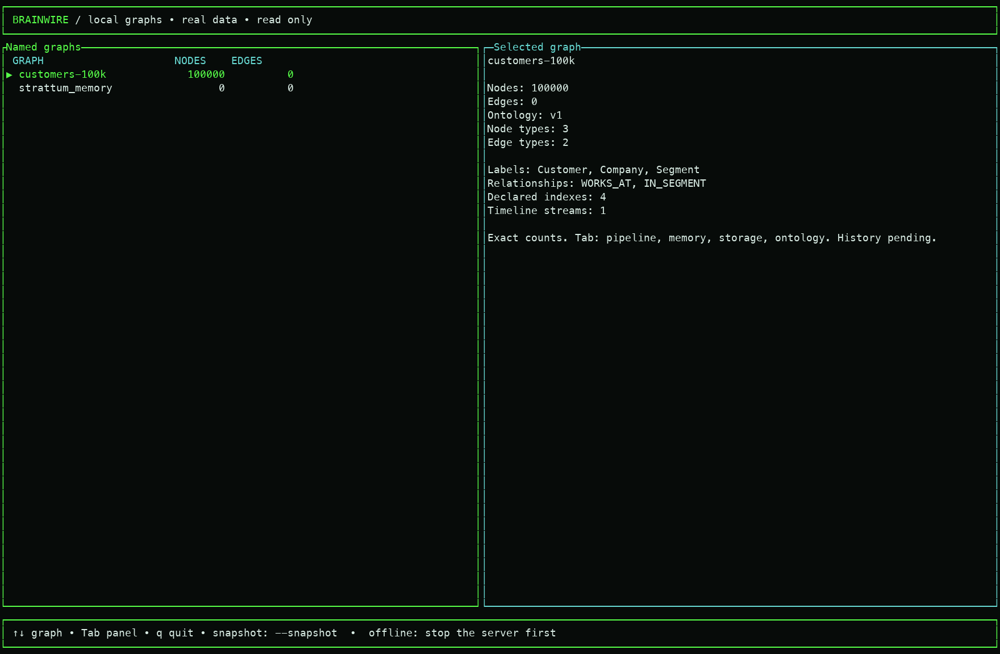
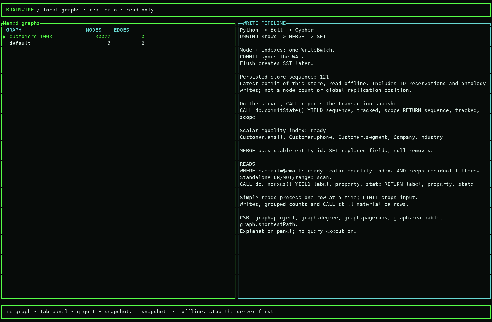
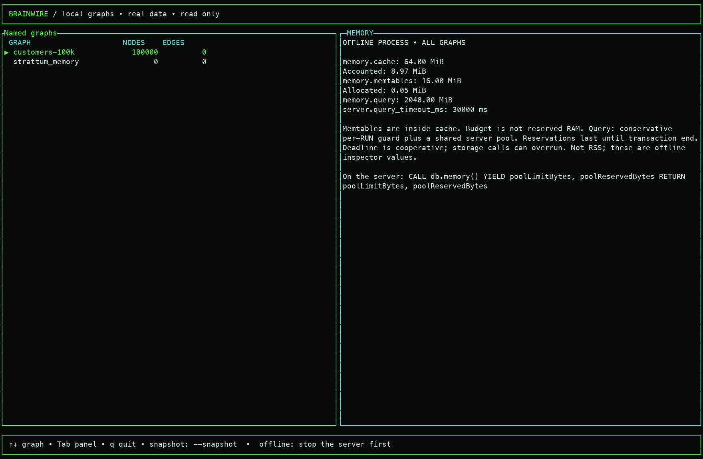
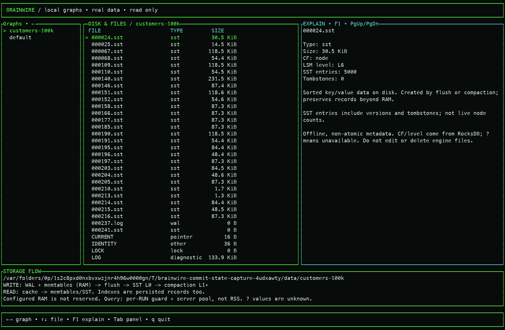
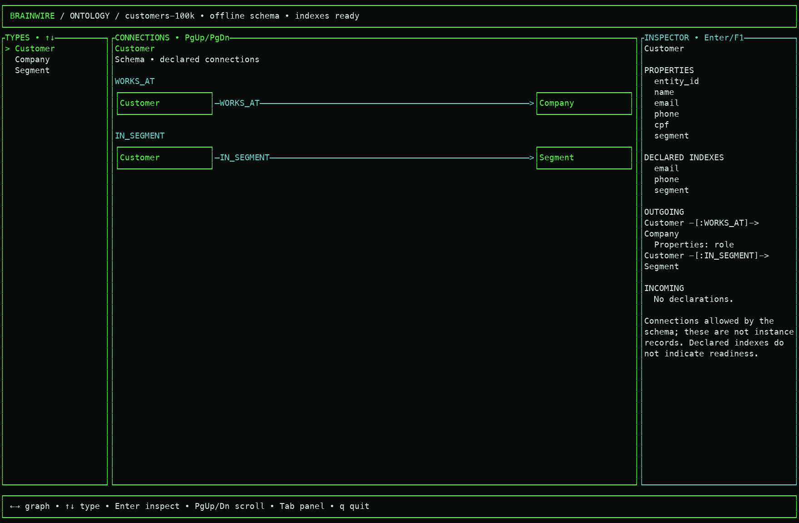
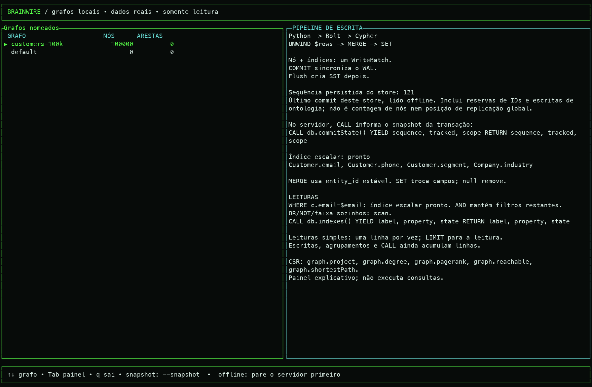

# Real offline TUI: 100K-node capture

October 7 captures of the actual terminal, using a disposable synthetic graph:
100,000 Customers, zero instance edges, commit sequence 121. The ontology declares
Customer/Company/Segment connections; those schema arrows are not stored edges.
The receipt and reproducible capture script are kept with the images.

Stop the server before opening its graph with this offline inspector:

```sh
./target/release/brainwire shell --overview --estimated --graph customers-resumable --view query
# Add --lang pt-BR for Portuguese; Tab switches panels; q exits.
```

The pipeline shows a durable per-store counter and explains its scope. It does
not execute queries. Memory describes the offline inspector process and shared
budgets; it does not claim live server RSS. Disk shows real RocksDB file metadata.
Connected ontology inspection remains available separately through --connect.
See [commit state](commit-state.md) and [Python ingestion](python-ingestion.md).

## Graph overview



## Write pipeline



## Memory



## Disk and files



## Ontology



## Portuguese pipeline



[Capture receipt](design/assets/2026-10-07-commit-state/receipt.json) records the
binary hash, exact counts and sequence, budgets and cleanup. These screenshots
show current behavior, not the final connected Observatory composition.
