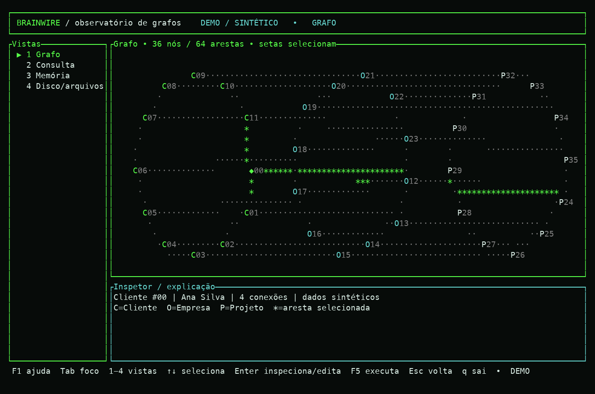
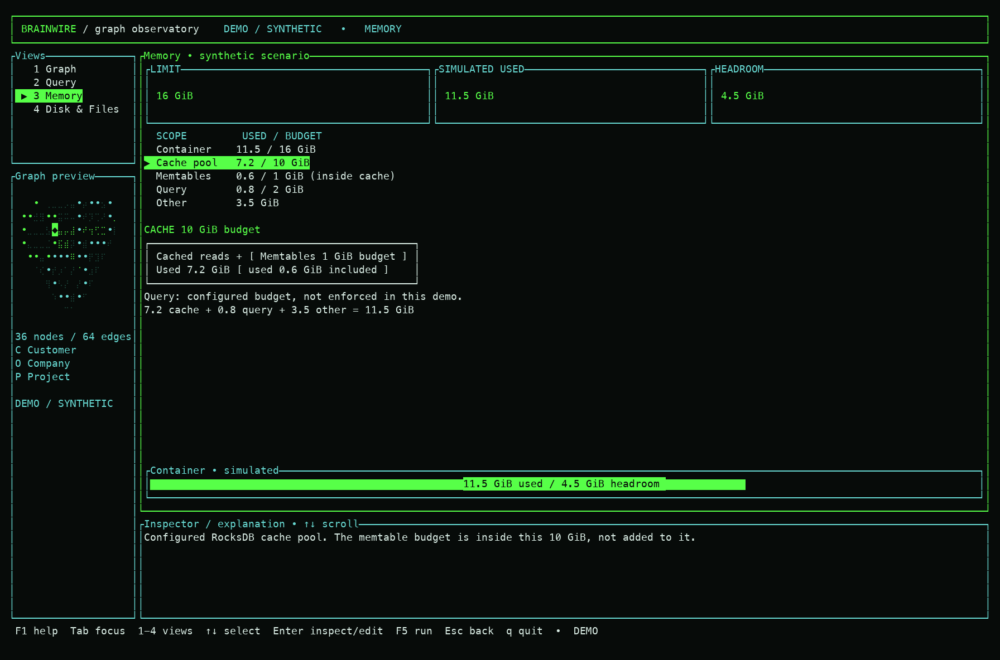
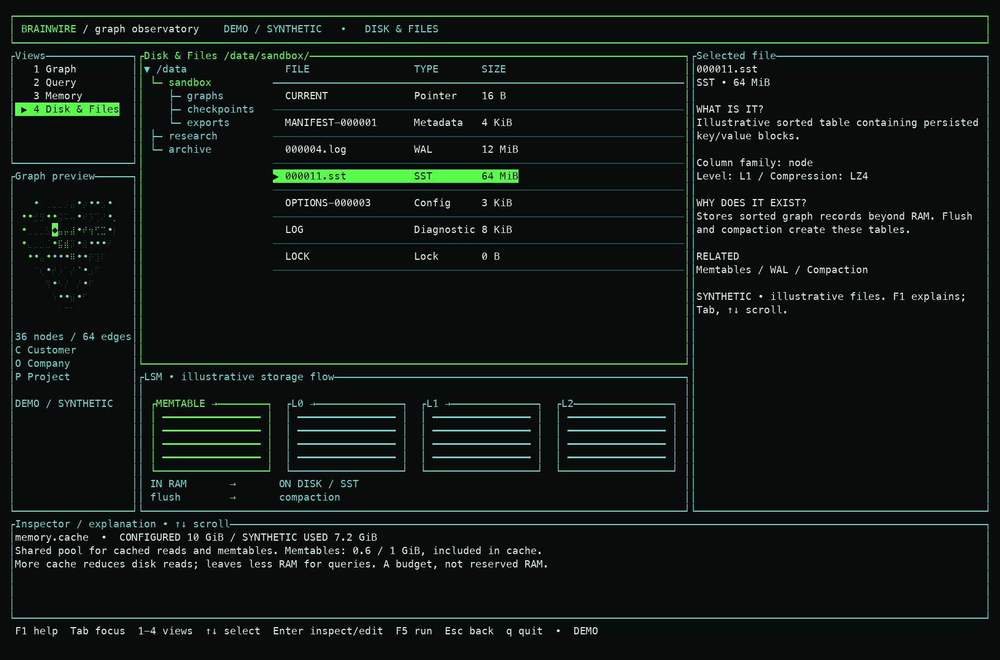

# Brainwire terminal demo

The interactive shell demonstrates the selected electric-green identity and
the Graph, Query, Memory and Disk & Files workflow. It uses synthetic data.
It does not connect to a running database, inspect real files or execute
arbitrary Cypher. For real local queries, use the separate
[`brainwire cypher` command](local-cypher.md).
For a separate read-only TUI showing **real named local graphs**, use
`brainwire shell --overview` as described in the
[multi-graph backoffice guide](multi-graph-backoffice.md).

From the standalone repository:

```sh
cd /Users/fraga/Documents/brainwire
cargo run --locked --offline -p brainwire-server -- shell --demo
```

Dependencies must already be downloaded for `--offline`. The default UI is
English; add `--lang pt-BR` for Portuguese. The built binary can also be launched
directly with `./target/debug/brainwire shell --demo` after building it.

## Actual terminal preview

These images render ANSI output captured from the running binary in a 160×48
pseudo-terminal (default English, color enabled; captured 2026-09-27). Text uses Menlo with Apple Symbols for
Braille graph cells. They are executable-demo captures,
separate from the earlier generated design concepts. Font rendering varies
between terminal emulators.







## Explore the demo

The screenshots show synthetic screen layouts. The key table below is the
current shortcut reference.

| Key | Action |
|---|---|
| `1`, `2`, `3`, `4` | Switch to Graph, Query, Memory or Disk outside editing |
| `Tab` | Toggle between the main content and its explanation panel |
| Arrow keys | Move the selected node, memory item, file or query result |
| `PgUp`, `PgDn` | Move the editor viewport while editing, or scroll the focused inspector |
| `Enter` | Inspect a selection or enter editing, according to focus |
| `F1` | Open page-specific help, including while editing a query |
| `?` | Open help outside query editing; in the editor, `?` is ordinary query text |
| `F5` | Run the supported guided query example |
| `Esc` | Close help or finish editing; `q` quits |
| `q` | Quit when not editing |

Both guided examples wrap at 80 columns. Longer edited text shows an overflow
hint; use `PgUp`/`PgDn` while editing to reveal the rest. Query results and the
inspector scroll independently; changing a selection resets the inspector.
The graph highlights the selected node and its incident edges, with labels and
markers that remain useful when color is disabled.

The footer shows the current controls. Typed shortcut characters remain text
while editing. A changed query outside the guided examples is refused
explicitly instead of receiving a fabricated successful result.

The help overlay explains each page without replacing the selected graph,
file, memory item or query. The page strip and footer stay visible when color is
disabled. In the local read-only overview, `?` describes the selected page and
`Tab`/`Shift+Tab` moves through Graphs, Pipeline, Memory, Files and Ontology.
The Ontology guide distinguishes schema declarations (allowed type
relationships) from edge records stored in the graph. In the connected
workspace, `?` explains the live, read-only Ontology, Memory, Indexes and Graph
panes; `r` refreshes the selected pane. The global connection catalog is an
offline overview feature; the connected pane remains focused on one selected
type.

Memory figures and file rows are illustrative. The memory view explains the
difference between a container limit, an internal component budget and actual
usage. Memtables are included in cache accounting; query-budget enforcement
is not implemented by this demo. The disk inspector explains the roles of
SST, WAL, MANIFEST, CURRENT, OPTIONS, LOG and LOCK without opening or modifying
a real database directory. Wide terminals add a folder tree, mini graph,
selected-file details and an LSM flow from memtable to disk. The compact layout
retains file selection, the flow and contextual help.

## Preview without a terminal

The snapshot mode renders the same widgets once as plain text:

```sh
cargo run --locked --offline -p brainwire-server -- shell --demo --snapshot --view graph --width 160 --height 48
cargo run --locked --offline -p brainwire-server -- shell --demo --snapshot --view memory --lang en --width 120 --height 36
```

Views are `graph`, `query`, `memory` and `disk`. Snapshot dimensions are bounded
to 80..240 columns and 24..80 rows. Interactive mode requires a terminal on
both input and output. `--no-anim` and `NO_COLOR` are available for quiet or
plain presentation. If your terminal environment sets `NO_COLOR`, unset it
for the green palette; the application deliberately honors that preference.

## Toward the connected MVP

The atomic Cypher executor and durable Bolt server are implemented. The
read-only multi-graph overview is connected to local storage. A connected
graph explorer still needs bounded neighborhood results, and live memory/file
views need server telemetry and storage-inspection contracts. The
The green and cyan visual system is shared with the Brainwire logo and docs site.
